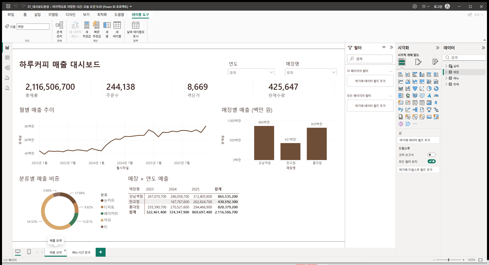

# Power BI 기초 학습 교안

Power BI 를 처음 배우는 학생이 **혼자서도 따라 할 수 있게** 만든 기초 과정(약 20시간)입니다.
가상의 카페 **하루커피**의 3년치 매출 데이터를 정리하고 분석해 매출 대시보드를 완성합니다.

- 웹 교안: https://sinaboro.github.io/power-bi-tutorial/
- 교안 PDF: [docs/PowerBI_기초_학습교안.pdf](docs/PowerBI_기초_학습교안.pdf)
- 실습 데이터: [data/](data/)
- 장별 완성 파일: [pbix/](pbix/)

> 2단계 심화 과정(Olist 전자상거래 데이터 분석)은 준비 중입니다.

## 과정 구성 (약 20시간)

| 장 | 내용 | 시간 | 완성 파일 |
|---|---|---|---|
| 0 | 과정 안내, 설치, 실습 파일 받기 | 1 | - |
| 1 | Power BI 화면과 데이터 불러오기 (엑셀·CSV) | 2 | `01_데이터불러오기.pbix` |
| 2 | Power Query 로 정리하기 (중복·빈 값·값 바꾸기·열 추가) | 3 | `02_데이터정리.pbix` |
| 3 | 관계와 날짜 테이블 | 2 | `03_관계와날짜.pbix` |
| 4 | 측정값 (SUM · DISTINCTCOUNT · DIVIDE, 필터 컨텍스트) | 2.5 | `04_측정값.pbix` |
| 5 | 차트 만들기 (꺾은선·막대·도넛·행렬) | 2.5 | `05_차트.pbix` |
| 6 | 슬라이서와 서식, 테마 | 2 | `06_슬라이서와서식.pbix` |
| 7 | 대시보드 완성과 공유 (PDF 내보내기) | 1.5 | `07_대시보드완성.pbix` |
| 8 | 과제 - 편의점 매출 대시보드 혼자 만들기 | 4 | `과제_편의점_풀이.pbix` |

부록: A 오류 해결 · B 용어 풀이 · C 확인 문제 풀이



## 시작하기

1. **Power BI Desktop** 설치 (Microsoft Store, 무료, Windows 전용)
2. 이 저장소를 **`C:\study\power-bi-tutorial`** 에 받기
   - 초록색 **Code → Download ZIP** → `C:\study` 에 풀고 폴더 이름을 `power-bi-tutorial` 로 바꾸기, 또는
   - `git clone https://github.com/sinaboro/power-bi-tutorial.git` (C:\study 에서)
3. 교안 PDF 를 열고 0장부터 따라 하기

> 완성 파일(.pbix)은 `C:\study\power-bi-tutorial\data` 의 파일을 불러오도록 만들어져 있습니다.
> 다른 위치에 두면 열기는 되지만 **새로 고침**할 때 파일을 찾지 못합니다 (교안 부록 A 참고).

## 실습 데이터

| 파일 | 내용 |
|---|---|
| `카페_판매.csv` | 2023-01-01 ~ 2025-12-31 판매 내역 360,470줄 (중복·빈 값·표기 혼용을 일부러 포함) |
| `카페_메뉴.xlsx` | 메뉴 22개 (메뉴명 공백·중복 행 포함) |
| `카페_매장.xlsx` | 매장 3곳 (판교점은 2024년 3월 개점) |
| `하루커피_테마.json` | 6장에서 쓰는 색 테마 |
| `편의점_*.csv / .xlsx` | 8장 과제 데이터 (2025년, 점포 3곳, 상품 18개) |

데이터는 모두 `tools/make_data.py` 로 만든 **가상 데이터**입니다 (seed 고정, 다시 실행해도 같은 파일).

## 정리 후 기준값 (정답 확인용)

| 측정값 | 카페 (전체 기간) | 편의점 과제 (2025년) |
|---|---|---|
| 총매출 | 2,116,506,700 | 560,453,100 |
| 주문수 / 판매건수 | 244,138 | 224,243 |
| 객단가 / 건당매출 | 8,669 | 2,499 |
| 판매수량 | 425,647 | 269,120 |

## 교안 다시 만들기 (강사용)

```powershell
pip install pandas openpyxl matplotlib reportlab pywinauto psutil markdown
python tools\make_data.py          # 실습 데이터
python tools\make_pbix.py all      # 장별 .pbix (Power BI Desktop 이 자동으로 열리고 닫힘)
python tools\capture_ui.py         # 교안용 조작 화면 캡처
python tools\make_figures.py       # 개념 그림
python tools\build_guide.py        # 교안 PDF
```

- `tools/course.py` 에 장별 모델(Power Query 단계, 관계, 측정값)과 보고서 화면이 정의되어 있고,
  `tools/pbip_writer.py` 가 이것을 Power BI 프로젝트(PBIP: TMDL + PBIR) 파일로 씁니다.
- `make_pbix.py` 는 Power BI Desktop 으로 PBIP 를 열어 새로 고친 뒤, 측정값을 DAX 로 질의해 기준값과 맞는지 확인하고 .pbix 로 저장합니다.
- 화면과 숫자는 Power BI Desktop 2.159 (2026년 11월) 기준입니다.

강사 김대철
