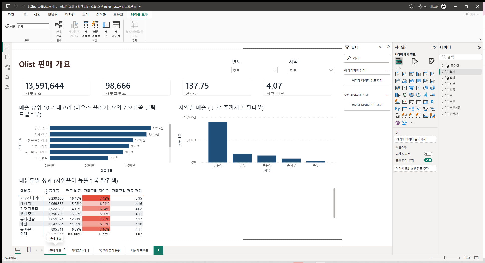
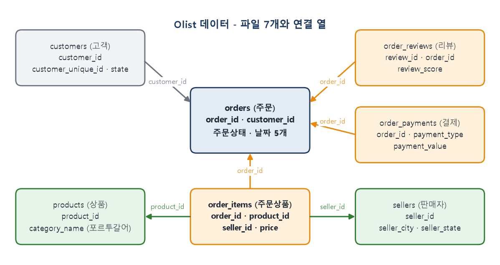

# 0장. 심화 과정 안내와 Olist 데이터

## 이 과정에서 만드는 것

기초 과정에서는 가상의 카페 데이터로 대시보드를 만들었다. 심화 과정에서는 **실제 회사의 데이터**를 다룬다. 브라질의 온라인 쇼핑몰 **Olist** 가 공개한 2016~2018년 주문 약 10만 건이다.

실제 데이터는 기초 과정보다 훨씬 복잡하다.

- 파일이 **7개**로 나뉘어 있고, 열 이름이 영어(일부는 포르투갈어)다.
- 주문 하나에 상품·결제·리뷰가 여러 개 붙는다. 테이블끼리의 관계가 복잡하다.
- "배송이 늦었나?", "다시 산 고객은 몇 명인가?" 처럼 **조건을 바꿔 가며 계산**해야 답할 수 있는 질문이 많다.

이 과정을 마치면 아래와 같은 보고서를 만들 수 있다. 막대에 마우스를 올리면 작은 요약 화면이 뜨고, 카테고리를 오른쪽 클릭하면 상세 페이지로 넘어가는 **대화형 보고서**다.



> 이 과정은 **기초 과정(1단계)을 마친 학생**을 위한 것이다. 데이터 불러오기, Power Query 기본 정리, 관계, SUM·DIVIDE 측정값, 차트·슬라이서를 이미 안다고 보고 진행한다. 기억이 나지 않으면 기초 교안의 해당 장을 먼저 보자.

## 진행 순서 (약 24시간)

| 장 | 내용 | 시간 | 완성 파일 |
|---|---|---|---|
| 0장 | 과정 안내, Olist 데이터 이해 | 1 | - |
| 1장 | 여러 파일 불러오기와 매개 변수 | 2 | 심화01_여러파일과매개변수.pbix |
| 2장 | Power Query 심화 - 병합과 조건 열 | 3 | 심화02_병합과조건열.pbix |
| 3장 | 데이터 모델링 심화 - 여러 사실 테이블, 비활성 관계 | 2.5 | 심화03_모델링.pbix |
| 4장 | DAX 심화 ① CALCULATE | 3 | 심화04_CALCULATE.pbix |
| 5장 | DAX 심화 ② 반복 함수와 시간 인텔리전스 | 3 | 심화05_시간인텔리전스.pbix |
| 6장 | 분석 실습 - 배송과 고객 만족도 | 2 | 심화06_배송과만족도분석.pbix |
| 7장 | 고급 보고서 기능 - 드릴다운, 드릴스루, 도구 설명, 조건부 서식 | 3 | 심화07_고급보고서기능.pbix |
| 8장 | 행 수준 보안(RLS)과 성능 점검 | 1.5 | 심화08_행수준보안.pbix |
| 9장 | 프로젝트 - 판매자 성과 대시보드 혼자 만들기 | 3 | 심화09_프로젝트_판매자성과_풀이.pbix |
| 10장 | (선택) PostgreSQL 데이터베이스에 연결하기 | 2 | - |

부록: A 오류 해결 · B 용어 풀이 · C 확인 문제 풀이

공부하는 방법은 기초 과정과 같다. 장마다 **학습 목표 → 따라 하기 → 정리 → 확인 문제** 순서이고, 막히면 `pbix` 폴더의 완성 파일을 열어 비교한다. 완성 파일은 모두 `심화` 로 시작한다.

## 0-1. 실습 파일 준비

기초 과정에서 받은 `C:\study\power-bi-tutorial` 폴더를 그대로 쓴다. 심화 데이터는 그 안의 `data\olist` 폴더에 있다.

> 기초 과정 뒤에 저장소가 바뀌었을 수 있다. 폴더에 `data\olist` 가 없으면 **ZIP 을 다시 받아** 풀거나, Git 으로 받았다면 `C:\study\power-bi-tutorial` 에서 `git pull` 을 실행한다.

```text
C:\study\power-bi-tutorial\data\olist
├─ olist_orders_dataset.csv            주문 (99,441건)
├─ olist_order_items_dataset.csv       주문상품 - 주문에 들어 있는 상품 (112,650줄)
├─ olist_order_payments_dataset.csv    결제 (103,886줄)
├─ olist_order_reviews_dataset.csv     리뷰 (100,000건)
├─ olist_customers_dataset.csv         고객
├─ olist_products_dataset.csv          상품 (32,951개)
├─ olist_sellers_dataset.csv           판매자 (3,095곳)
├─ product_category_name_translation.csv   카테고리 이름 포르투갈어 → 영어
├─ 카테고리_한글.csv                    카테고리 영어 → 한글, 대분류 (이 과정에서 만든 파일)
├─ 브라질_주.csv                        주 약어 → 한글 주 이름, 지역 (이 과정에서 만든 파일)
└─ Olist_테마.json                      보고서 색 테마
```

> **데이터 출처** - Olist, "Brazilian E-Commerce Public Dataset by Olist", Kaggle. 라이선스 CC BY-NC-SA 4.0 (출처를 밝히고 비상업적으로 쓸 수 있다). 위치 정보 파일(geolocation)은 크기가 커서 이 과정에서는 뺐다.

## 0-2. Olist 데이터 이해하기

Olist 는 작은 가게들이 큰 쇼핑몰에 상품을 올려 팔 수 있게 도와주는 회사다. 그래서 데이터에 **고객**과 **판매자**가 따로 있다. 고객이 주문하면, 그 주문 안의 상품은 서로 다른 판매자가 보낼 수도 있다.



| 테이블 | 한 줄이 뜻하는 것 | 연결 열 | 이 과정의 이름 |
|---|---|---|---|
| orders | 주문 하나 | order_id, customer_id | **주문** |
| order_items | 주문 안의 상품 하나 | order_id, product_id, seller_id | **주문상품** |
| order_payments | 결제 하나 (나눠 내면 여러 줄) | order_id | **결제** |
| order_reviews | 리뷰 하나 | order_id | **리뷰** |
| customers | 주문할 때의 고객 정보 | customer_id | (주문에 합친다) |
| products | 상품 하나 | product_id | **상품** |
| sellers | 판매자 하나 | seller_id | **판매자** |

알아 둘 점 세 가지.

1. **주문상품의 한 줄 = 상품 한 개.** 같은 상품을 2개 사면 두 줄이 된다. 그래서 매출은 주문상품의 `price` 를 더하면 된다 (수량 열이 없다).
2. **customer_id 는 주문마다 새로 생긴다.** 같은 사람이 두 번 주문하면 customer_id 는 둘이고, **customer_unique_id** 가 같다. 재구매 고객을 셀 때는 unique_id 를 써야 한다.
3. **돈의 단위는 브라질 헤알(R$)** 이다. 이 교안에서는 숫자만 쓰고 "헤알" 이라고 읽는다.

## 0-3. 심화 과정에서 새로 배우는 것

| 기초 과정에서 | 심화 과정에서 |
|---|---|
| 파일 경로를 식에 직접 적었다 | **매개 변수** 하나로 모든 파일 경로를 관리한다 |
| 값 바꾸기, 빈 행 거르기 | 테이블 **병합**, **조건 열**, 로드하지 않는 도우미 쿼리 |
| 사실 테이블 1개 + 차원 테이블 | 사실 테이블 여러 개, **필터 방향**, **비활성 관계** |
| SUM, DISTINCTCOUNT, DIVIDE | **CALCULATE**, REMOVEFILTERS, VAR, SUMX, FILTER, **시간 인텔리전스** |
| 차트와 슬라이서 | 드릴다운, **드릴스루**, **도구 설명 페이지**, 조건부 서식, 상위 N |
| - | **행 수준 보안(RLS)**, 성능 분석기 |

## 정리

- Olist 는 실제 브라질 쇼핑몰 데이터다. 주문·주문상품·결제·리뷰·상품·판매자 등 여러 파일로 나뉘어 있다.
- 주문상품 한 줄은 상품 한 개다. 매출 = price 의 합.
- 같은 사람을 찾으려면 customer_id 가 아니라 **customer_unique_id** 를 쓴다.

## 확인 문제

1. 고객이 상품 3개를 한 번에 주문하고, 신용카드와 바우처로 나눠 냈다. 주문·주문상품·결제 테이블에 각각 몇 줄이 생길까?
2. 같은 고객이 1월과 3월에 한 번씩 주문했다. customers 파일에는 이 사람이 몇 줄 있을까? 두 줄에서 같은 값을 가진 열은 무엇인가?
3. 메모장으로 `olist_orders_dataset.csv` 를 열어 첫 줄(열 이름)을 보자. 날짜·시간이 들어 있는 열은 몇 개인가?
