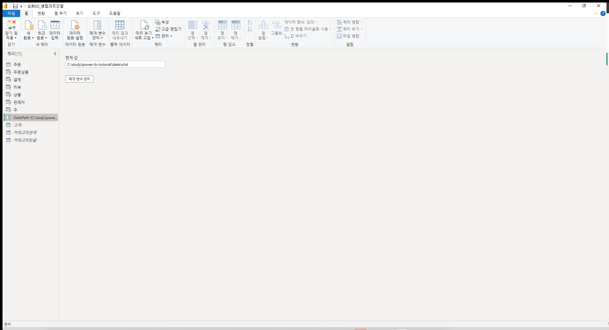
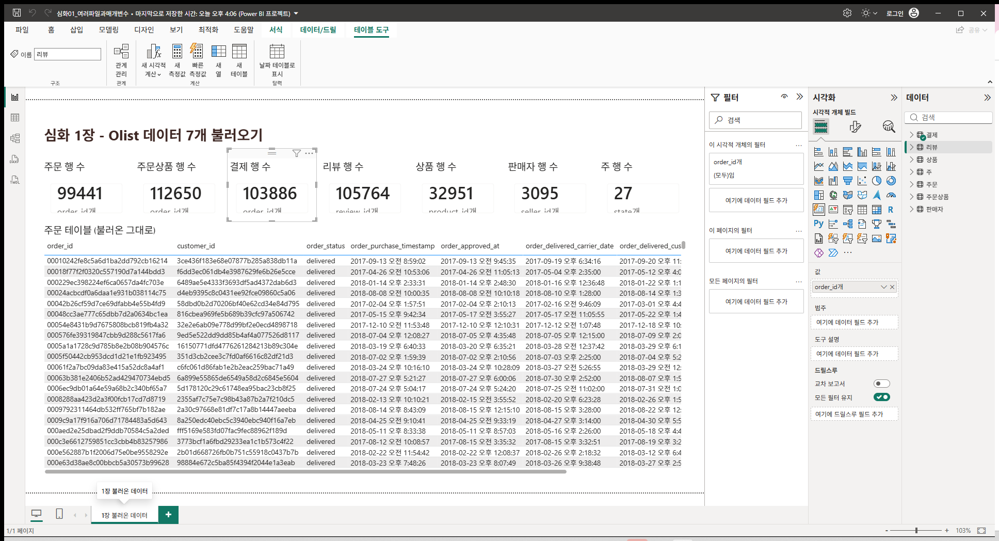

# 1장. 여러 파일 불러오기와 매개 변수

## 학습 목표

- 파일 위치를 **매개 변수** 하나에 담고, 모든 쿼리가 그 매개 변수를 쓰게 만든다.
- 수식 입력줄에서 Power Query 식(M)을 직접 고친다.
- CSV 7개를 불러오고 행 수를 확인해 이상한 테이블을 찾아낸다.

## 1-1. 왜 매개 변수가 필요할까

기초 과정의 완성 파일은 `C:\study\power-bi-tutorial\data` 에 있는 파일을 읽도록 만들어져 있었다. 폴더를 다른 곳에 두면 새로 고침할 때 "파일을 찾을 수 없습니다" 오류가 났다. 쿼리마다 경로가 따로 적혀 있어서 하나하나 고쳐야 했다.

이번에는 파일이 10개다. 경로를 **한 곳**에만 적어 두고 모든 쿼리가 그것을 가져다 쓰게 하자. 이렇게 이름을 붙여 여러 곳에서 쓰는 값을 **매개 변수**(parameter)라고 한다.

```text
(기초 과정)  주문 쿼리: File.Contents("C:\study\...\olist\olist_orders_dataset.csv")
            결제 쿼리: File.Contents("C:\study\...\olist\olist_order_payments_dataset.csv")   ← 폴더가 바뀌면 모두 고쳐야 한다

(심화 과정)  DataPath = "C:\study\power-bi-tutorial\data\olist"     ← 여기 한 곳만 고친다
            주문 쿼리: File.Contents(DataPath & "\olist_orders_dataset.csv")
            결제 쿼리: File.Contents(DataPath & "\olist_order_payments_dataset.csv")
```

`&` 는 글자를 이어 붙이는 연산자다. `DataPath & "\olist_orders_dataset.csv"` 는 `C:\study\power-bi-tutorial\data\olist\olist_orders_dataset.csv` 가 된다.

## 1-2. 첫 번째 파일 불러오기 - 주문

1. Power BI Desktop 을 열고 **빈 보고서** 를 고른다.
2. **홈 → 데이터 가져오기 ▾ → 텍스트/CSV** → `C:\study\power-bi-tutorial\data\olist\olist_orders_dataset.csv` → **열기**.
3. 미리 보기에서 파일 원본이 `65001: 유니코드(UTF-8)` 인지 확인하고, 이번에는 **로드가 아니라 데이터 변환** 을 누른다. Power Query 편집기가 열린다.
4. 왼쪽 쿼리 목록에서 `olist_orders_dataset` 을 두 번 클릭해 이름을 **주문** 으로 바꾼다.

## 1-3. 매개 변수 만들기

1. Power Query 편집기에서 **홈 → 매개 변수 관리 ▾ → 새 매개 변수**.
2. 아래처럼 채우고 **확인**.

| 항목 | 값 |
|---|---|
| 이름 | `DataPath` |
| 필수 | 체크 |
| 형식 | 텍스트 |
| 제안 값 | 모든 값 |
| 현재 값 | `C:\study\power-bi-tutorial\data\olist` (끝에 `\` 를 붙이지 않는다) |



왼쪽 쿼리 목록에 **DataPath** 가 생겼다. 아이콘이 표가 아니라 매개 변수 모양이다.

## 1-4. 쿼리가 매개 변수를 쓰게 고치기

1. 쿼리 목록에서 **주문** 을 누르고, 오른쪽 **적용된 단계** 에서 맨 위 **원본** 을 누른다.
2. 위쪽 수식 입력줄에 아래와 같은 식이 보인다. (수식 입력줄이 안 보이면 **보기 → 수식 입력줄** 체크)

```text
= Csv.Document(File.Contents("C:\study\power-bi-tutorial\data\olist\olist_orders_dataset.csv"),[Delimiter=",", Columns=8, Encoding=65001, QuoteStyle=QuoteStyle.None])
```

3. 따옴표로 감싼 경로 부분을 아래처럼 바꾸고 **Enter**.

```text
= Csv.Document(File.Contents(DataPath & "\olist_orders_dataset.csv"),[Delimiter=",", Columns=8, Encoding=65001, QuoteStyle=QuoteStyle.None])
```

4. 미리 보기가 그대로 나오면 성공이다. 경로 글자를 잘못 치면 노란 경고와 함께 "파일을 찾을 수 없습니다" 가 나온다. 경로와 `\` 를 다시 확인하자.

> **식을 고치기 어렵다면 - 톱니바퀴로 하기** 원본 단계 오른쪽 **톱니바퀴** 를 누르면 **쉼표로 구분된 값** 창이 열린다. 위쪽 **고급** 을 고르면 **파일 경로 파트** 가 두 칸으로 나뉜다. 첫 칸 왼쪽 ▾ 에서 **매개 변수** → `DataPath`, 둘째 칸에 `\olist_orders_dataset.csv` 를 적고 **확인**. 수식 입력줄을 보면 위 3번과 같은 식이 만들어져 있다.

> **수식 입력줄 = 단계의 진짜 모습.** Power Query 에서 단추를 누르면 그 작업이 M 식으로 기록된다. 단추로 할 수 없는 일(매개 변수 끼워 넣기 같은)은 식을 직접 고치면 된다. 식 전체를 외울 필요는 없고, **어디를 바꾸면 되는지**만 알면 된다.

## 1-5. 나머지 파일 불러오기

Power Query 편집기에서 **홈 → 새 원본 ▾ → 텍스트/CSV** 로 아래 파일을 하나씩 불러온다. 파일마다 **확인**(편집기 안에서는 로드 대신 확인)을 누른 뒤, 1-4 처럼 **원본** 단계의 경로를 `DataPath & "\파일이름"` 으로 바꾸고 쿼리 이름을 바꾼다.

| 파일 | 쿼리 이름 |
|---|---|
| olist_order_items_dataset.csv | **주문상품** |
| olist_order_payments_dataset.csv | **결제** |
| olist_order_reviews_dataset.csv | **리뷰** |
| olist_products_dataset.csv | **상품** |
| olist_sellers_dataset.csv | **판매자** |
| 브라질_주.csv | **주** |

> **반복 작업이 귀찮다면?** 원본 단계의 식을 복사해 두었다가 붙여 넣고 파일 이름만 바꾸는 방법도 있다. 단, `Columns=8` 처럼 **열 개수**는 파일마다 다르니 함께 고쳐야 한다. (Columns 부분을 아예 지워도 된다. 그러면 Power BI 가 열 개수를 스스로 센다)

다 했으면 **홈 → 닫기 및 적용**. 7개 테이블을 불러오는 데 수십 초 걸린다.

## 1-6. 행 수 확인 - 이상한 테이블 찾기

실제 데이터를 받으면 먼저 **행 수**를 확인하는 습관을 들이자. 원래 파일의 건수와 다르면 불러오는 과정에서 문제가 생긴 것이다.

1. 캔버스에 **카드** 를 하나 놓고, 데이터 창에서 **주문** 의 `order_id` 를 끌어 놓는다.
2. 카드 값 칸의 `order_id` 오른쪽 ▾ 를 눌러 **개수** 를 고른다. (**개수(고유)** 는 서로 다른 값의 수라서 행 수가 아니다)
3. 카드에 `99천` 처럼 줄여서 보이면 **시각적 개체 서식 지정 → 시각적 개체 → 설명 → 값 → 표시 단위** 를 **없음** 으로 바꾼다 (기초 6장).
4. 같은 방법으로 테이블마다 카드를 만든다. 아래는 완성 파일의 화면이다.



0장의 파일 설명과 비교해 보자. **리뷰** 만 105,764 로 100,000 보다 많다. 리뷰 파일에는 고객이 쓴 글이 들어 있는데, 글 안에서 줄을 바꾼 곳이 있다. Power BI 가 그 줄 바꿈을 **새 행의 시작**으로 읽어서, 리뷰 하나가 여러 행으로 쪼개진 것이다. 2장에서 고친다.

## 1-7. 매개 변수 값 바꿔 보기

나중에 폴더를 옮기면 이렇게 한다.

1. **홈 → 데이터 변환 ▾ → 매개 변수 편집**.
2. DataPath 값을 새 폴더 경로로 바꾸고 **확인** → **변경 내용 적용**.

모든 쿼리가 새 폴더에서 파일을 읽는다. 지금은 바꾸지 말고 창만 열어 보고 **취소** 하자. 저장은 `내Olist.pbix` 로 한다.

## 정리

- **매개 변수**는 여러 쿼리가 함께 쓰는 값이다. 파일 경로를 매개 변수로 만들면 폴더가 바뀌어도 한 곳만 고친다.
- Power Query 의 단계는 M 식이다. 수식 입력줄에서 식을 직접 고칠 수 있다. 글자 잇기는 `&`.
- 데이터를 불러온 뒤에는 **행 수**를 원래 건수와 비교한다. 카드의 집계는 **개수**(행 수)와 **개수(고유)**(서로 다른 값 수)를 구별한다.

## 확인 문제

1. DataPath 의 현재 값 끝에 `\` 를 붙여 `...\olist\` 로 만들면 주문 쿼리의 경로는 어떻게 될까? 그래도 파일을 찾을까?
2. 1-6 의 카드에서 **주문상품** 의 `order_id` 를 **개수(고유)** 로 바꾸면 얼마가 나오는가? **개수** 와 다른 이유는?
3. 리뷰 파일을 메모장으로 열어 `review_comment_message` 열에 줄 바꿈이 들어간 리뷰를 하나 찾아보자. 그 값은 무엇으로 감싸여 있는가?
