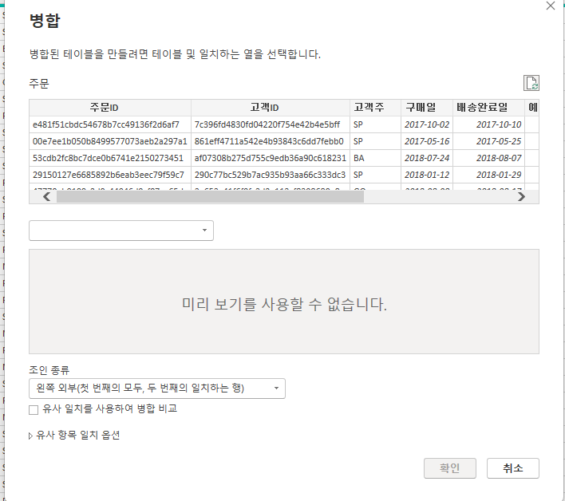
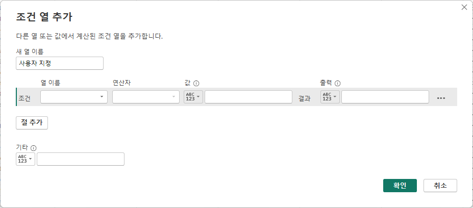
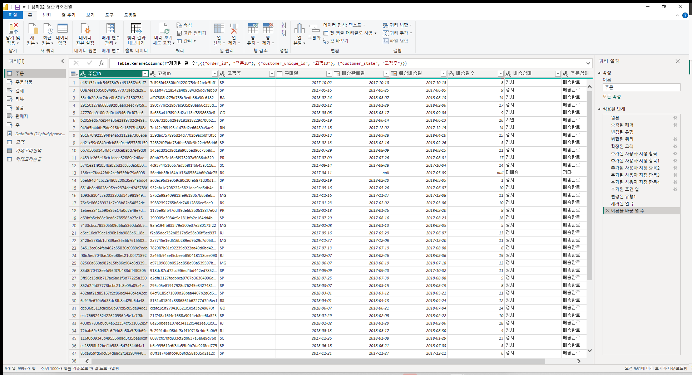
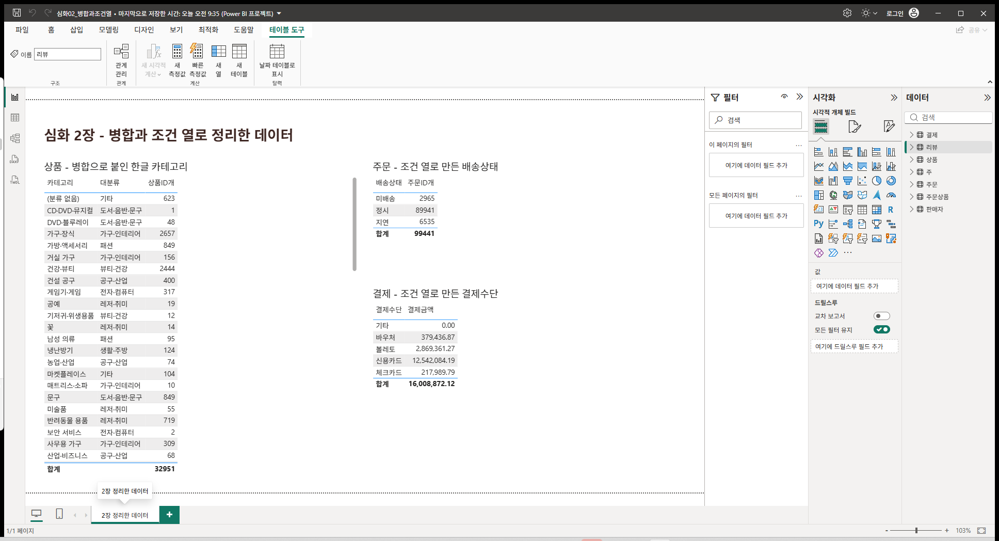

# 2장. Power Query 심화 - 병합과 조건 열

## 학습 목표

- 따옴표 안의 줄 바꿈 때문에 쪼개진 행을 바로잡는다.
- **로드하지 않는 도우미 쿼리**를 만들고, **쿼리 병합**으로 다른 테이블의 열을 붙인다.
- **사용자 지정 열**(if … then … else)과 **조건 열**로 분석에 쓸 새 열을 만든다.

## 2-1. 이 장에서 할 일

1장에서 불러온 데이터는 아직 분석하기 불편하다.

| 문제 | 해결 | 절 |
|---|---|---|
| 리뷰가 여러 행으로 쪼개졌다 | CSV 를 읽는 방식 바꾸기 | 2-2 |
| 주문에 고객 정보(같은 사람인지, 어느 주인지)가 없다 | 고객 쿼리를 **병합** | 2-3, 2-4 |
| 주문에 날짜/시간 열만 있고 "배송이 늦었나?" 가 없다 | **사용자 지정 열**, **조건 열** | 2-5, 2-6 |
| 카테고리 이름이 포르투갈어다 | 번역 쿼리를 **두 번 병합** | 2-8 |
| 열 이름이 영어다, 필요 없는 열이 많다 | 열 제거, 이름 바꾸기 | 2-7 |

1장의 `내Olist.pbix` 를 열고 **홈 → 데이터 변환** 으로 Power Query 편집기를 연다.

## 2-2. 리뷰 - 따옴표 안의 줄 바꿈

CSV 에서 쉼표나 줄 바꿈이 들어간 값은 큰따옴표(`"`)로 감싼다. 그런데 기본 설정(`QuoteStyle.None`)은 따옴표 안이라도 줄 바꿈을 만나면 새 행으로 읽는다.

1. **리뷰** 쿼리의 **원본** 단계를 누른다.
2. 수식 입력줄 끝의 `QuoteStyle=QuoteStyle.None` 을 `QuoteStyle=QuoteStyle.Csv` 로 바꾸고 **Enter**.
   식을 고치기 어렵다면 **원본** 단계 오른쪽 **톱니바퀴** → **줄 바꿈** 을 `모든 줄 바꿈 적용` 에서 **`따옴표 붙은 줄 바꿈 무시`** 로 바꾸고 **확인** 해도 같은 식이 된다.
3. 맨 아래 **변경된 유형** 단계를 다시 누른다. 이상한 값이 섞여 있던 `review_score` 열이 1~5 숫자만 남는다.
4. `review_id`, `order_id`, `review_score`, `review_creation_date` 네 열을 **Ctrl** 을 누른 채 고르고 **홈 → 열 제거 ▾ → 다른 열 제거**. 리뷰 글 열은 크고 이 과정에서 쓰지 않으니 뺀다.
5. 열 이름을 **리뷰ID, 주문ID, 평점, 리뷰작성일** 로 바꾼다. (머리글 두 번 클릭)
6. 리뷰작성일 머리글의 형식 아이콘을 눌러 **날짜** 로 바꾼다.

이제 리뷰는 정확히 **100,000행**이다. (리뷰ID 가 같은 줄이 조금 있지만 원본 데이터 그대로이므로 두자)

## 2-3. 도우미 쿼리 만들기 - 로드 사용 안 함

병합에 쓸 재료 쿼리 세 개를 불러온다. 1장처럼 **새 원본 → 텍스트/CSV** 로 불러오고 원본 경로를 `DataPath & "\…"` 로 바꾼다.

| 파일 | 쿼리 이름 | 쓰는 곳 |
|---|---|---|
| olist_customers_dataset.csv | **고객** | 주문에 고객 정보 붙이기 |
| product_category_name_translation.csv | **카테고리번역** | 포르투갈어 → 영어 |
| 카테고리_한글.csv | **카테고리한글** | 영어 → 한글, 대분류 |

이 세 쿼리는 다른 쿼리를 만드는 재료일 뿐, 보고서에 테이블로 넣을 필요는 없다.

1. 쿼리 목록에서 **고객** 을 오른쪽 클릭 → **로드 사용** 을 눌러 체크를 끈다.
2. 경고 창이 나오면 **계속**. 쿼리 이름이 기울임꼴로 바뀐다.
3. 카테고리번역, 카테고리한글도 똑같이 한다.

> **로드 사용 안 함** 쿼리는 Power Query 안에서만 쓰이고 모델(데이터 창)에는 나타나지 않는다. 파일이 작아지고 데이터 창이 깔끔해진다.

## 2-4. 쿼리 병합 - 주문에 고객 정보 붙이기

**병합**은 엑셀의 VLOOKUP 과 비슷하다. 두 테이블에서 같은 값을 가진 열(키)을 짝지어, 한쪽 테이블에 다른 쪽의 열을 붙인다.

1. **주문** 쿼리를 고르고 **홈 → 쿼리 병합**.
2. 위쪽 표(주문)에서 `customer_id` 머리글을 누른다.
3. 아래 목록에서 **고객** 을 고르고, 아래쪽 표에서도 `customer_id` 를 누른다.
4. 조인 종류는 **왼쪽 외부(첫 번째의 모두, 두 번째의 일치하는 행)** 그대로 두고 **확인**.



맨 오른쪽에 **고객** 이라는 열이 생기고 값이 모두 `Table` 이다. 행마다 짝이 맞는 고객 행이 표 모양으로 들어 있다는 뜻이다.

5. **고객** 머리글 오른쪽의 확장 단추(⇆)를 누른다.
6. `customer_unique_id`, `customer_state` 만 체크하고, 아래 **원래 열 이름을 접두사로 사용** 의 체크를 끈 뒤 **확인**.

단계 `병합된 쿼리`, `확장된 고객` 이 생기고, 주문마다 고객 고유 ID 와 주(state)가 붙었다.

| 조인 종류 | 결과 |
|---|---|
| **왼쪽 외부** | 첫 번째 테이블의 모든 행 + 짝이 있으면 그 값 (없으면 null) ← 가장 많이 쓴다 |
| 내부 | 양쪽에 짝이 있는 행만 |
| 왼쪽 앤티 | 첫 번째 테이블에서 짝이 **없는** 행만 (빠진 데이터 찾기에 쓴다) |

## 2-5. 사용자 지정 열 - 날짜와 배송일수

주문에는 날짜/시간 열이 5개 있다. 분석에는 날짜만 있으면 된다.

1. **열 추가 → 사용자 지정 열**.
2. 새 열 이름 `구매일`, 사용자 지정 열 수식 `DateTime.Date([order_purchase_timestamp])` → **확인**. (오른쪽 **사용 가능한 열** 목록에서 열을 두 번 누르면 `[열 이름]` 이 수식에 들어간다)
3. 같은 방법으로 두 열을 더 만든다.

> 사용자 지정 열 창에는 **데이터 형식을 고르는 칸이 없다.** 그래서 새 열 머리글에 형식 아이콘 `ABC123`(형식 없음)이 붙는다. 형식은 2-6 끝에서 한꺼번에 정한다.

| 새 열 이름 | 식 | 나중에 정할 형식 |
|---|---|---|
| 구매일 | `DateTime.Date([order_purchase_timestamp])` | 날짜 |
| 배송완료일 | `DateTime.Date([order_delivered_customer_date])` | 날짜 |
| 예상배송일 | `DateTime.Date([order_estimated_delivery_date])` | 날짜 |

4. 배송에 걸린 날 수를 계산한다. 새 열 이름 `배송일수`, 식은

```text
if [배송완료일] = null then null else Duration.Days([배송완료일] - [구매일])
```

날짜에서 날짜를 빼면 **기간**(duration)이 되고, `Duration.Days` 가 그 기간의 날 수를 꺼낸다. 아직 배송되지 않은 주문은 배송완료일이 비어 있으므로(null) 계산하지 않고 null 로 둔다.

5. 배송이 늦었는지 표시하는 열을 하나 더 만든다. 새 열 이름 `배송상태`.

```text
if [배송완료일] = null then "미배송"
else if [배송완료일] > [예상배송일] then "지연"
else "정시"
```

> **if 식 읽는 법** - 위에서부터 차례로 조건을 본다. 첫 조건이 맞으면 "미배송", 아니면 다음 조건을 보고, 모두 아니면 마지막 else 의 값. 식 안에서 줄을 바꿔도 된다.

## 2-6. 조건 열 - 주문상태를 한글로

같은 if 식을 대화 상자로 만들 수도 있다. **열 추가 → 조건 열**.



| 칸 | 값 |
|---|---|
| 새 열 이름 | 주문상태 |
| 첫 줄(If) | 열 `order_status` · 연산자 `같음` · 값 `delivered` · 출력 `배송완료` |
| 절 추가 → Else If | `order_status` 같음 `shipped` → `배송중` |
| 절 추가 → Else If | `order_status` 같음 `canceled` → `취소` |
| 기타(Else) | `기타` |

**확인** 하면 단계 `추가된 조건 열` 이 생긴다. 수식 입력줄을 보면 2-5 에서 직접 쓴 것과 같은 모양의 if 식이다.

### 새 열의 형식 정하기

2-5, 2-6 에서 만든 열 6개는 아직 형식이 없다(`ABC123`). 형식이 없으면 3장에서 날짜 관계를 만들 수 없고, 배송일수 평균도 구할 수 없다.

1. **구매일** 머리글을 누르고 **Ctrl** 을 누른 채 **배송완료일**, **예상배송일** 을 누른다.
2. 아무 머리글의 형식 아이콘(`ABC123`)을 눌러 **날짜**.
3. **배송일수** 는 **정수**, **배송상태**·**주문상태** 는 **텍스트** 로 바꾼다.

형식을 연달아 바꾸면 단계 `변경된 유형1` 하나에 모인다. ("현재 전환 바꾸기" 를 묻는 창이 나오면 **현재 전환 바꾸기** 를 누른다)

## 2-7. 열 정리

**주문** 에서

1. `customer_id`, `order_status` 와 날짜/시간 열 5개(`order_purchase_timestamp` ~ `order_estimated_delivery_date`)를 고르고 **열 제거**.
2. 이름 바꾸기: `order_id` → **주문ID**, `customer_unique_id` → **고객ID**, `customer_state` → **고객주**.



나머지 쿼리도 정리한다.

| 쿼리 | 할 일 |
|---|---|
| **주문상품** | `shipping_limit_date` 제거. 이름: order_id→**주문ID**, order_item_id→**순번**, product_id→**상품ID**, seller_id→**판매자ID**, price→**가격**, freight_value→**배송비** |
| **결제** | 조건 열 `결제수단` (credit_card→신용카드, boleto→볼레토, voucher→바우처, debit_card→체크카드, 기타) 추가, 결제수단 형식을 **텍스트** 로, `payment_type` 제거. 이름: order_id→**주문ID**, payment_sequential→**결제순번**, payment_installments→**할부개월**, payment_value→**결제금액** |
| **판매자** | `seller_zip_code_prefix` 제거. 이름: seller_id→**판매자ID**, seller_city→**판매자도시**, seller_state→**판매자주** |
| **주** | state → **주코드** |

> **볼레토(boleto)** 는 브라질에서 많이 쓰는 결제 방식으로, 고지서를 받아 은행이나 편의점에서 내는 현금 결제다.

## 2-8. 상품 - 두 번 병합하기

상품의 카테고리는 포르투갈어(`beleza_saude`)다. 카테고리번역으로 영어(`health_beauty`)를 붙이고, 다시 카테고리한글로 한글(`건강·뷰티`)과 대분류를 붙인다.

1. **상품** 쿼리 → **홈 → 쿼리 병합**. 상품 `product_category_name` ↔ 카테고리번역 `product_category_name` · 왼쪽 외부 → **확인**.
2. 확장: `product_category_name_english` 만, 접두사 끄기.
3. 다시 **쿼리 병합**. 상품 `product_category_name_english` ↔ 카테고리한글 `category_english` → **확인**.
4. 확장: `카테고리`, `대분류`, 접두사 끄기.
5. 카테고리 열을 내려 보면 `null` 이 있다. 원본에 카테고리가 비어 있는 상품(610개)과 번역 파일에 없는 카테고리 2개다.
   - **카테고리** 머리글 오른쪽 클릭 → **값 바꾸기** → 찾을 값 `null`, 바꿀 항목 `(분류 없음)`.
   - **대분류** 도 같은 방법으로 `null` → `기타`.
6. `product_id`, `카테고리`, `대분류` 만 고르고 **다른 열 제거**. product_id 이름을 **상품ID** 로.

## 2-9. 닫기 및 적용, 결과 확인

**홈 → 닫기 및 적용**. 데이터 창에 고객·카테고리번역·카테고리한글은 보이지 않고, 7개 테이블만 있다. 표로 결과를 확인해 보자.



| 확인 | 값 |
|---|---|
| 리뷰 행 수 | 100,000 |
| 배송상태 - 정시 / 지연 / 미배송 | 89,941 / 6,535 / 2,965 |
| 카테고리 `(분류 없음)` 상품 수 | 623 (빈 카테고리 610 + 번역 없음 13) |

## 정리

- 따옴표 안의 줄 바꿈이 있는 CSV 는 `QuoteStyle.Csv` 로 읽는다.
- **병합** = 키 열로 짝을 지어 다른 테이블의 열을 붙인다. 보통 **왼쪽 외부** 조인을 쓰고, 확장 단추로 필요한 열만 꺼낸다.
- 재료로만 쓰는 쿼리는 **로드 사용** 을 끈다.
- 계산이 필요한 열은 **사용자 지정 열**(식), 값에 따라 나누는 열은 **조건 열**(대화 상자). 둘 다 결과는 if 식이다.

## 확인 문제

1. 2-4 에서 조인 종류를 **내부** 로 골랐다면 주문 행 수는 달라질까? 고객 파일에 없는 customer_id 가 있는지 **왼쪽 앤티** 조인으로 확인해 보자.
2. 배송상태 식에서 `[배송완료일] > [예상배송일]` 을 `>=` 로 바꾸면 지연 주문이 늘까 줄까? 왜 그럴까?
3. 결제수단 조건 열을 만든 뒤 `기타` 로 분류된 결제는 몇 건인가? 원래 `payment_type` 값은 무엇이었을까?
4. 카테고리 `(분류 없음)` 이 될 상품을 2-8 의 5번 전에 미리 찾으려면 어떻게 할 수 있을까?
