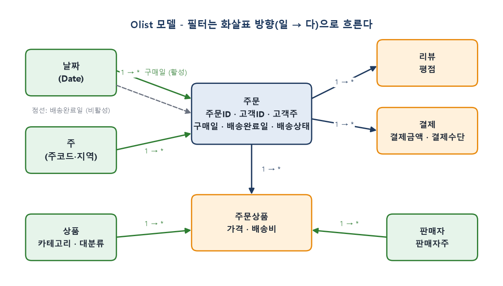
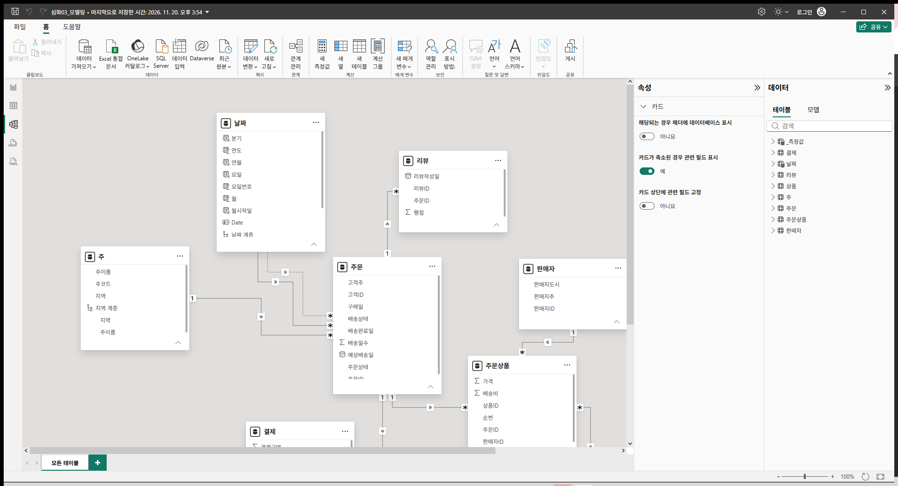
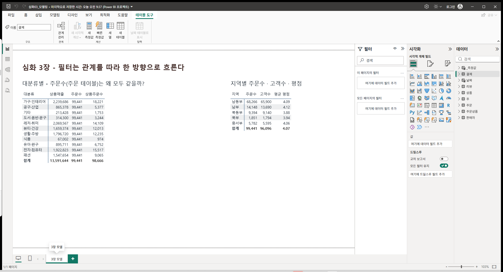
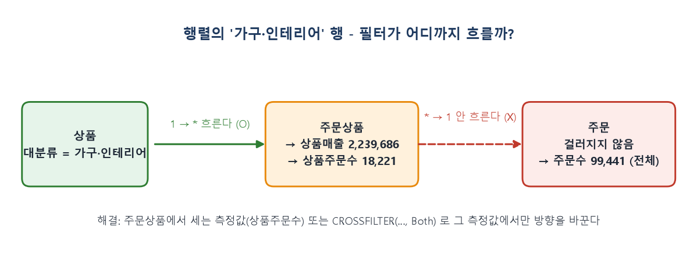

# 3장. 데이터 모델링 심화 - 여러 사실 테이블과 비활성 관계

## 학습 목표

- 사실 테이블이 여러 개인 모델을 설계하고 관계 8개를 만든다.
- **필터는 관계의 일(1) 쪽에서 다(\*) 쪽으로만 흐른다**는 것을 실험으로 확인한다.
- 같은 두 테이블 사이의 두 번째 관계가 **비활성**이 되는 이유를 안다.
- 측정값 전용 테이블과 **계층**을 만든다.

## 3-1. Olist 모델의 모양

기초 과정의 모델은 사실 테이블(판매) 하나를 차원 테이블(메뉴·매장·날짜)이 둘러싼 별 모양이었다. Olist 는 사실 테이블이 여럿이다.



| 테이블 | 종류 | 한 행 | 일(1) 쪽으로 연결되는 테이블 |
|---|---|---|---|
| **주문** | 사실 (주문 단위) | 주문 하나 | 날짜, 주 |
| **주문상품** | 사실 (상품 단위) | 주문 안의 상품 하나 | 주문, 상품, 판매자 |
| **결제** | 사실 | 결제 하나 | 주문 |
| **리뷰** | 사실 | 리뷰 하나 | 주문 |
| 상품 · 판매자 · 주 · 날짜 | 차원 | 상품 · 판매자 · 주 · 날 하나 | - |

**주문**은 자기도 사실 테이블이면서, 주문상품·결제·리뷰에게는 일(1) 쪽 테이블(차원 역할)이다. 날짜 슬라이서로 연도를 고르면 필터가 `날짜 → 주문 → 주문상품` 으로 이어져 흐른다.

## 3-2. 관계 만들기

2장 파일을 열고 왼쪽 **모델 보기** 로 간다. 불러올 때 Power BI 가 이름이 같은 열(주문ID 등)을 보고 관계를 **자동으로** 몇 개 만들었을 수 있다. 아래 표와 같은지 확인하고, 없는 것은 열을 끌어다 놓아 만든다.

| 다(\*) 쪽 | 일(1) 쪽 |
|---|---|
| 주문상품[주문ID] | 주문[주문ID] |
| 결제[주문ID] | 주문[주문ID] |
| 리뷰[주문ID] | 주문[주문ID] |
| 주문상품[상품ID] | 상품[상품ID] |
| 주문상품[판매자ID] | 판매자[판매자ID] |
| 주문[고객주] | 주[주코드] |

> 잘못 만들어진 관계(예: 다대다 \*:\*)가 있으면 선을 오른쪽 클릭 → **삭제** 하고 다시 만든다. 관계 선을 두 번 클릭하면 **관계 편집** 창에서 카디널리티와 필터 방향(단일)을 확인할 수 있다.

## 3-3. 날짜 테이블

기초 3장과 같은 방법이다. **모델링 → 새 테이블**.

```dax
날짜 = CALENDAR(DATE(2016, 1, 1), DATE(2018, 12, 31))
```

새 열을 만든다. 이번에는 **분기**를 더한다.

```dax
연도 = YEAR('날짜'[Date])
```

```dax
분기 = "Q" & QUARTER('날짜'[Date])
```

```dax
월 = MONTH('날짜'[Date])
```

```dax
연월 = FORMAT('날짜'[Date], "yyyy-mm")
```

```dax
월시작일 = DATE(YEAR('날짜'[Date]), MONTH('날짜'[Date]), 1)
```

```dax
요일 = FORMAT('날짜'[Date], "aaa")
```

```dax
요일번호 = WEEKDAY('날짜'[Date], 2)
```

**날짜 테이블로 표시** (Date 열), 요일은 **열 기준 정렬 → 요일번호**. 그리고 관계를 만든다.

| 다(\*) 쪽 | 일(1) 쪽 |
|---|---|
| 주문[구매일] | 날짜[Date] |

## 3-4. 두 번째 날짜 관계 - 비활성 관계

"이번 달에 **배송이 끝난** 주문은 몇 건인가?" 를 보려면 배송완료일로도 날짜와 이어야 한다.

1. 주문[배송완료일] 을 날짜[Date] 위로 끌어다 놓는다.
2. 새 관계가 **점선**으로 그려진다.



두 테이블 사이에 길이 두 개 있으면, 날짜 슬라이서가 어느 길로 필터를 보낼지 정할 수 없다. 그래서 Power BI 는 하나만 **활성**(실선)으로 두고 나머지는 **비활성**(점선)으로 만든다. 비활성 관계는 평소에는 쓰이지 않고, 측정값 안에서 `USERELATIONSHIP` 으로 **그때만 켜서** 쓴다 (4장).

## 3-5. 측정값 테이블과 기본 측정값

측정값이 많아지면 여러 테이블에 흩어져 찾기 어렵다. 측정값만 모아 두는 테이블을 만들자.

1. **모델링 → 새 테이블** → `_측정값 = ROW("임시", 0)` → Enter. (이름 앞의 `_` 는 데이터 창 맨 위에 오게 하려는 것)
2. 데이터 창에서 **_측정값** 을 고른 상태로 **새 측정값** 을 눌러 아래 7개를 만든다. 측정값마다 **측정값 도구** 탭(리본)의 서식을 정수 또는 소수 2자리로 맞춘다.

```dax
상품매출 = SUM('주문상품'[가격])
```

```dax
배송비 = SUM('주문상품'[배송비])
```

```dax
주문수 = COUNTROWS('주문')
```

```dax
상품주문수 = DISTINCTCOUNT('주문상품'[주문ID])
```

```dax
객단가 = DIVIDE([상품매출], [상품주문수])
```

```dax
고객수 = DISTINCTCOUNT('주문'[고객ID])
```

```dax
평균 평점 = AVERAGE('리뷰'[평점])
```

3. **_측정값** 의 `임시` 열을 오른쪽 클릭 → **숨기기**. 열이 모두 숨겨지고 측정값만 남으면 테이블 아이콘이 계산기 모양으로 바뀐다.
4. (선택) 측정값을 고르고 **속성 창**(모델 보기 오른쪽)의 **표시 폴더** 에 `1 기본` 을 적으면 폴더로 묶인다. 완성 파일은 장마다 폴더를 나눴다.

| 측정값 | 전체 값 |
|---|---|
| 상품매출 | 13,591,644 |
| 주문수 | 99,441 |
| 상품주문수 | 98,666 |
| 객단가 | 137.75 |
| 고객수 | 96,096 |
| 평균 평점 | 4.07 |

> 주문수(99,441)와 상품주문수(98,666)가 다르다. 취소·품절 등으로 **상품 줄이 없는 주문**이 775건 있기 때문이다.

## 3-6. 실험 - 필터는 한 방향으로 흐른다

보고서 보기에서 **행렬**을 만들어 행에 상품[대분류], 값에 상품매출·주문수·상품주문수를 넣는다.



**주문수가 모든 대분류에서 99,441 로 같다.** 상품매출과 상품주문수는 대분류마다 다른데 왜일까?



- 행렬의 "가구·인테리어" 행은 **상품** 테이블을 걸러낸다.
- 상품 → 주문상품 은 일(1) → 다(\*) 방향이라 필터가 흐른다. 그래서 주문상품 기준 측정값(상품매출, 상품주문수)은 값이 바뀐다.
- 주문상품 → 주문 은 다(\*) → 일(1) 방향이라 **필터가 거꾸로 올라가지 않는다.** 주문 테이블은 걸러지지 않고, `COUNTROWS('주문')` 은 항상 전체 99,441 이다.

해결 방법은 두 가지다.

1. **필터가 닿는 테이블로 측정값을 만든다.** 카테고리별 주문 수는 `상품주문수 = DISTINCTCOUNT('주문상품'[주문ID])` 를 쓴다. ← 이 과정의 기본 방법
2. 측정값 안에서만 필터 방향을 바꾼다 (`CROSSFILTER`, 4장).

> 관계 편집 창에서 **크로스 필터 방향** 을 **모두**(양방향)로 바꾸면 이 표는 바로 맞게 나온다. 하지만 양방향 관계가 여러 개 생기면 필터가 엉뚱한 길로 돌아 결과를 예측하기 어려워지고 보고서도 느려진다. 모델 전체의 방향은 **단일**로 두고, 필요한 측정값에서만 바꾸는 것이 좋다.

## 3-7. 계층 만들기

지역(남동부 등) 아래에 주(상파울루 등)가 있다. 이런 위아래 관계를 **계층**으로 묶어 두면, 차트에서 지역 → 주로 파고드는 **드릴다운**을 할 수 있다 (7장).

1. 데이터 창에서 **주** 의 `지역` 을 오른쪽 클릭 → **계층 구조 만들기**. **주** 테이블에 `지역 계층 구조` 가 생긴다.
2. `주이름` 을 `지역 계층 구조` 위로 끌어다 놓는다. 계층 구조를 펼치면 `지역`, `주이름` 두 수준이 보인다.
3. 같은 방법으로 상품에 `대분류 → 카테고리` 계층(`대분류 계층 구조`)을, 날짜에 `연도 → 분기 → 월` 계층(`연도 계층 구조`)을 만든다. 순서는 위 수준(큰 것)부터.

## 3-8. 보고서 테마 적용

심화 과정 완성 파일은 파란색 계열의 **Olist 테마**를 쓴다. 교안 그림과 색을 맞추려면 지금 적용해 두자.

1. 리본 **디자인 → 테마 가져오기**.
2. `C:\study\power-bi-tutorial\data\olist\Olist_테마.json` → **열기**.

> 예전 버전에는 **디자인** 탭이 없다. 그때는 **보기 → 테마 ▾ → 테마 찾아보기**.

## 정리

- 사실 테이블이 여러 개여도 원칙은 같다. **필터는 관계의 일 쪽에서 다 쪽으로** 흐른다. 다 쪽에서 일 쪽으로는 흐르지 않는다.
- 측정값은 **필터가 닿는 테이블**로 만든다. 카테고리별 주문 수는 주문상품에서 센다.
- 같은 두 테이블 사이의 두 번째 관계는 **비활성**(점선)이다. USERELATIONSHIP 으로 켜서 쓴다.
- 측정값 전용 테이블, 계층 구조로 모델을 정리하고, 테마를 적용한다.

## 확인 문제

1. 지역별로 행렬을 만들면 주문수는 지역마다 다르게 나온다(3장 완성 화면 오른쪽 표). 대분류와 달리 지역에서는 왜 제대로 나올까? 필터가 흐르는 길로 설명하시오.
2. 행에 판매자[판매자주]를 넣고 값에 고객수를 넣으면 어떻게 나올까? 예상한 뒤 확인해 보자.
3. 날짜[Date] 와 주문[예상배송일] 사이에 관계를 하나 더 만들면 실선일까 점선일까?
4. 남동부 지역의 주문수는 얼마인가? 전체 주문의 몇 %인가?
