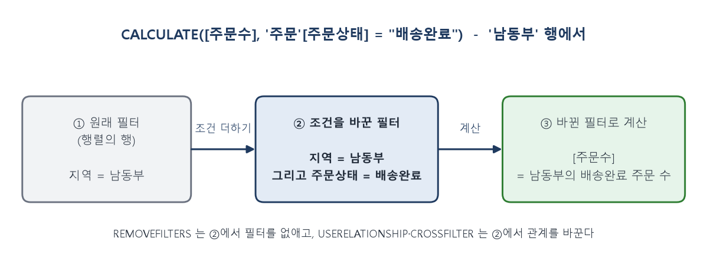
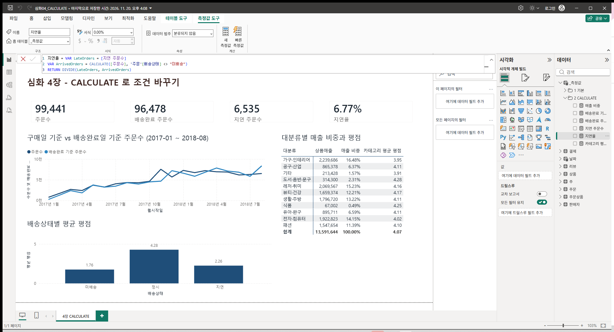
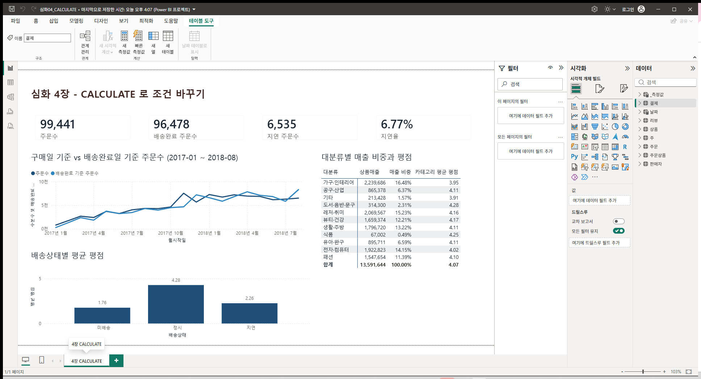

# 4장. DAX 심화 ① CALCULATE - 조건을 바꿔서 계산하기

## 학습 목표

- **CALCULATE** 로 측정값에 조건(필터)을 더하거나 없앤다.
- **REMOVEFILTERS** 로 전체 대비 비중을 계산한다.
- **VAR / RETURN** 으로 긴 식을 나눠 쓴다.
- **CROSSFILTER**, **USERELATIONSHIP** 으로 그 측정값에서만 관계를 바꾼다.

## 4-1. CALCULATE 는 무엇을 하는가

기초 과정에서 배운 **필터 컨텍스트**를 떠올리자. 측정값은 놓인 자리의 조건(필터)으로 계산된다. 행렬의 "남동부" 행에서 `[주문수]` 는 "지역 = 남동부" 인 주문만 센다.

**CALCULATE** 는 이 조건을 **바꾼 다음** 계산하는 함수다.

```dax
CALCULATE(계산할 식, 조건1, 조건2, …)
```



| 조건의 모양 | 하는 일 | 예 |
|---|---|---|
| `'테이블'[열] = 값` | 그 열의 필터를 이 값으로 **바꾼다** (다른 열의 필터는 그대로) | `'주문'[주문상태] = "배송완료"` |
| `REMOVEFILTERS('테이블')` | 그 테이블에 걸린 필터를 **없앤다** | 전체 대비 비중 |
| `USERELATIONSHIP(…)` | 비활성 관계를 **켠다** | 배송완료일 기준 |
| `CROSSFILTER(…)` | 관계의 필터 방향을 **바꾼다** | 카테고리별 평점 |

3장 파일을 열고 **_측정값** 테이블에 측정값을 차례로 만든다. 서식은 측정값마다 리본 **측정값 도구** 탭에서 정한다.

## 4-2. 조건 더하기 - 배송완료 주문수, 지연 주문수

```dax
배송완료 주문수 = CALCULATE([주문수], '주문'[주문상태] = "배송완료")
```

```dax
지연 주문수 = CALCULATE([주문수], '주문'[배송상태] = "지연")
```

카드로 확인하면 각각 **96,478**, **6,535** 다. 행렬에 지역을 넣으면 지역마다 "그 지역 + 배송완료" 인 주문 수가 나온다. 원래 조건(지역)은 그대로 두고, 조건(주문상태)을 **하나 더한** 것이다.

> **이미 같은 열에 조건이 있으면?** 주문상태 슬라이서에서 "취소" 를 골라도 `배송완료 주문수` 는 배송완료 주문을 센다. CALCULATE 의 조건이 같은 열의 바깥 조건을 **덮어쓰기** 때문이다. 바깥 조건을 지키면서 더하고 싶으면 `KEEPFILTERS('주문'[주문상태] = "배송완료")` 처럼 감싼다.

## 4-3. VAR 로 나눠 쓰기 - 지연율

지연율 = 지연 주문수 ÷ **배송이 끝난** 주문수. 아직 도착하지 않은 주문은 늦었는지 알 수 없으니 분모에서 뺀다.

```dax
지연율 =
VAR LateOrders = [지연 주문수]
VAR ArrivedOrders = CALCULATE([주문수], '주문'[배송상태] <> "미배송")
RETURN DIVIDE(LateOrders, ArrivedOrders)
```

- `VAR 이름 = 식` 으로 중간 결과에 이름을 붙이고, `RETURN` 뒤에 최종 결과를 쓴다.
- 식이 읽기 쉬워지고, 같은 값을 여러 번 쓸 때 한 번만 계산한다.
- 수식 입력줄에서 **Shift+Enter** 로 줄을 바꾼다. (Enter 는 확정)
- **변수 이름은 영문자·숫자·_ 만** 쓸 수 있다. `VAR 지연 = …` 처럼 한글로 쓰면 오류가 난다.

서식을 **백분율**(소수 2자리)로 바꾸면 **6.77%** 다.



## 4-4. 조건 없애기 - 매출 비중

대분류별 "전체 매출 중 몇 %" 를 구해 보자. 분모는 대분류 필터가 **없는** 전체 매출이어야 한다.

```dax
매출 비중 = DIVIDE([상품매출], CALCULATE([상품매출], REMOVEFILTERS('상품')))
```

- 분자 `[상품매출]` : 지금 행의 대분류 매출 (예: 가구·인테리어 2,239,686)
- 분모 : 상품 테이블의 필터를 없앤 매출 = 전체 13,591,644
- 결과 16.48%

> 연도 슬라이서로 2018년을 고르면? REMOVEFILTERS('상품') 은 **상품 테이블**의 필터만 없앤다. 날짜 필터는 남아 있으므로 "2018년 전체 중 이 대분류의 비중" 이 된다. 무엇을 없애고 무엇을 남길지 고르는 것이 CALCULATE 의 핵심이다.

## 4-5. 관계 방향 바꾸기 - 카테고리 평균 평점

3장에서 본 문제: 리뷰는 주문에 붙어 있고, 상품의 필터는 주문상품까지만 흐른다. 그래서 대분류별 `[평균 평점]` 은 모든 행이 전체 평균 4.07 로 같다.

```dax
카테고리 평균 평점 = CALCULATE([평균 평점], CROSSFILTER('주문상품'[주문ID], '주문'[주문ID], Both))
```

`CROSSFILTER(다 쪽 열, 일 쪽 열, Both)` 는 **이 측정값을 계산하는 동안만** 주문상품 ↔ 주문 관계를 양방향으로 바꾼다. 필터가 `상품 → 주문상품 → 주문 → 리뷰` 로 흘러, 그 대분류 상품이 들어 있는 주문의 리뷰만 평균한다.

| 대분류 | 평균 평점 (그냥) | 카테고리 평균 평점 |
|---|---|---|
| 가구·인테리어 | 4.07 | 3.95 |
| 도서·음반·문구 | 4.07 | 4.28 |

## 4-6. 비활성 관계 켜기 - 배송완료일 기준 주문수

3장에서 만든 점선 관계(주문[배송완료일] → 날짜[Date])를 쓴다.

```dax
배송완료 기준 주문수 = CALCULATE([주문수], USERELATIONSHIP('주문'[배송완료일], '날짜'[Date]))
```

꺾은선형 차트에 X축 날짜[월시작일], Y축 `주문수` 와 `배송완료 기준 주문수` 를 함께 넣으면, 배송완료 기준 선이 구매일 기준 선보다 **조금 오른쪽(늦게)** 에 그려진다. 주문하고 평균 12일 뒤에 도착하기 때문이다.



> 4장 완성 화면의 꺾은선형 차트에는 **시각적 개체 필터**로 기간(2017-01 ~ 2018-08)을 걸었다. 이유는 5장에서 설명한다.

## 정리

- `CALCULATE(식, 조건…)` = 조건을 바꾼 뒤 식을 계산한다. 조건은 같은 열의 바깥 필터를 덮어쓴다.
- `REMOVEFILTERS(테이블)` 로 필터를 없애 **전체 대비 비중**을 구한다.
- `VAR … RETURN` 으로 식을 나눠 쓴다. 변수 이름은 영문.
- `CROSSFILTER(…, Both)`, `USERELATIONSHIP(…)` 은 **그 측정값 안에서만** 관계를 바꾼다. 모델은 그대로 둔다.

## 확인 문제

1. `취소 주문수 = CALCULATE([주문수], '주문'[주문상태] = "취소")` 를 만들어 보자. 전체 값은 얼마인가?
2. 행렬 행에 주[지역]을 넣고 `[매출 비중]` 을 넣으면 모든 행이 100% 가 된다. 왜일까? 지역별 비중을 구하려면 식을 어떻게 고쳐야 할까?
3. 대분류 중 `카테고리 평균 평점` 이 가장 낮은 것과 가장 높은 것은?
4. `배송완료 기준 주문수` 의 전체 합계는 `[주문수]` (99,441) 보다 적다. 얼마이고, 왜 적을까?
