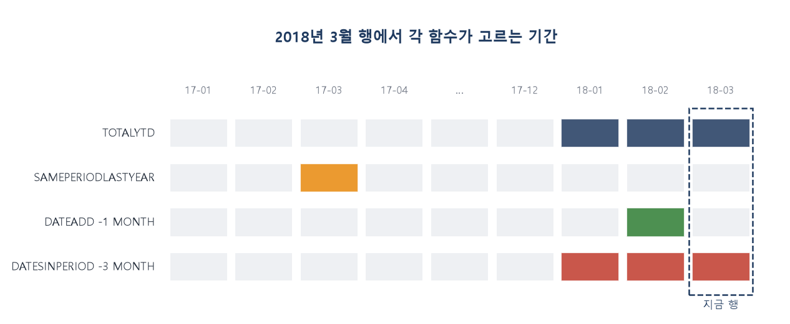
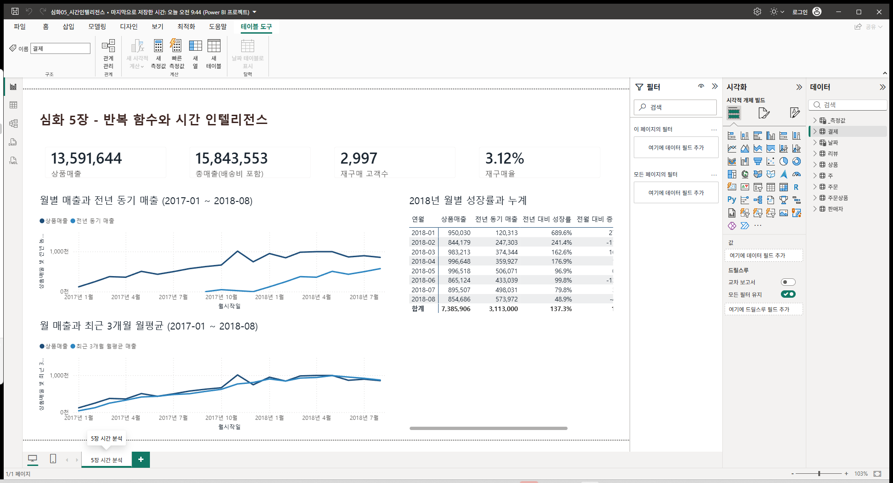

# 5장. DAX 심화 ② 반복 함수와 시간 인텔리전스

## 학습 목표

- **SUMX** 같은 반복 함수로 행마다 계산한 뒤 더한다.
- **FILTER** 와 **VALUES** 로 "조건에 맞는 고객" 을 세어 재구매 고객을 찾는다.
- **시간 인텔리전스** 함수로 누계, 전년 동기, 전월 대비, 최근 3개월을 계산한다.
- 시각적 개체 필터로 **분석 기간**을 정한다.

## 5-1. 반복 함수 - SUMX

`SUM` 은 열 하나를 더한다. 그런데 "가격 + 배송비" 처럼 **행마다 계산한 값**을 더하려면?

```dax
총매출(배송비 포함) = SUMX('주문상품', '주문상품'[가격] + '주문상품'[배송비])
```

`SUMX(테이블, 식)` 은 테이블의 **행을 하나씩 돌면서** 식을 계산하고, 그 결과를 모두 더한다. 이름 끝의 X 는 반복(iterate)한다는 표시다. 같은 무리에 `AVERAGEX`, `COUNTX`, `MAXX` 등이 있다.

| 방법 | 장점 | 단점 |
|---|---|---|
| Power Query 에서 열 추가 후 SUM | 단순하다 | 열이 모델에 저장돼 파일이 커진다 |
| 계산 열 후 SUM | DAX 로 바로 만든다 | 역시 저장 공간을 쓴다 |
| **SUMX 측정값** | 저장하지 않는다, 필터에 맞게 계산 | 아주 큰 표에서는 느릴 수 있다 |

결과는 **15,843,553** (상품매출 13,591,644 + 배송비 2,251,910).

```dax
평균 배송일수 = AVERAGE('주문'[배송일수])
```

배송일수는 2장에서 만든 열이다. 빈 값(미배송)은 AVERAGE 가 알아서 빼므로 **12.5일**이 된다.

## 5-2. FILTER 와 VALUES - 재구매 고객

"두 번 이상 주문한 고객은 몇 명인가?" 는 고객마다 주문 수를 세 본 뒤 조건에 맞는 고객을 세야 한다.

```dax
재구매 고객수 = COUNTROWS(FILTER(VALUES('주문'[고객ID]), CALCULATE([주문수]) > 1))
```

안쪽부터 읽는다.

1. `VALUES('주문'[고객ID])` - 지금 필터에서 보이는 **고객ID 목록** (중복 없이). 표 하나가 된다.
2. `FILTER(표, 조건)` - 그 목록을 한 줄씩 돌며 조건이 참인 줄만 남긴다. FILTER 도 반복 함수다.
3. `CALCULATE([주문수]) > 1` - **지금 돌고 있는 고객**의 주문 수가 1보다 큰가?
4. `COUNTROWS(…)` - 남은 고객 수.

> **CALCULATE 를 왜 감쌌을까?** FILTER 가 한 줄씩 돌 때 "지금 고객" 은 행 하나일 뿐, 필터가 아니다. `[주문수]` 측정값은 필터를 보고 계산하므로, 그대로 쓰면 모든 줄에서 전체 주문수가 나온다. `CALCULATE` 로 감싸면 **지금 행의 값(이 고객ID)을 필터로 바꿔서** 계산한다. 이것을 **컨텍스트 전환**이라고 한다. 사실 측정값을 반복 함수 안에서 부르면 자동으로 CALCULATE 가 감싸지지만, 일부러 써 두면 읽는 사람이 알아보기 쉽다.

```dax
재구매율 = DIVIDE([재구매 고객수], [고객수])
```

결과는 **2,997명, 3.12%**. 100명 중 3명만 다시 산다. Olist 고객 대부분이 한 번 사고 떠난다는 뜻이다.

## 5-3. 시간 인텔리전스

날짜 테이블이 있고 **날짜 테이블로 표시** 되어 있으면, 기간을 옮겨 계산하는 함수를 쓸 수 있다.



```dax
매출 YTD = TOTALYTD([상품매출], '날짜'[Date])
```

```dax
전년 동기 매출 = CALCULATE([상품매출], SAMEPERIODLASTYEAR('날짜'[Date]))
```

```dax
전년 대비 성장률 = DIVIDE([상품매출] - [전년 동기 매출], [전년 동기 매출])
```

```dax
전월 매출 = CALCULATE([상품매출], DATEADD('날짜'[Date], -1, MONTH))
```

```dax
전월 대비 증감률 = DIVIDE([상품매출] - [전월 매출], [전월 매출])
```

```dax
최근 3개월 월평균 매출 = CALCULATE([상품매출], DATESINPERIOD('날짜'[Date], MAX('날짜'[Date]), -3, MONTH)) / 3
```

| 함수 | 고르는 날짜 | 예: 2018년 3월 행에서 |
|---|---|---|
| `TOTALYTD` | 그해 1월 1일 ~ 지금까지 | 2018-01-01 ~ 2018-03-31 |
| `SAMEPERIODLASTYEAR` | 1년 전 같은 기간 | 2017년 3월 |
| `DATEADD(…, -1, MONTH)` | 한 달 전 | 2018년 2월 |
| `DATESINPERIOD(…, MAX, -3, MONTH)` | 마지막 날에서 3개월 거슬러 | 2018-01-01 ~ 2018-03-31 |

모두 CALCULATE 의 조건 자리에 들어가 **날짜 필터를 다른 기간으로 바꾼다.** 4장의 CALCULATE 와 같은 원리다.

## 5-4. 분석 기간 정하기 - 시각적 개체 필터

행렬 행에 날짜[연월]을 넣고 위 측정값들을 넣으면 이상한 숫자가 보인다.

- 2016년은 주문이 300여 건뿐이고 11월은 0건이다. 그래서 2017년의 전년 대비 성장률이 수십만 % 가 된다.
- 2018년 9~10월은 주문이 수십 건뿐이다. 데이터를 모은 시점에 끝난 달이라 거의 비어 있다.

실제 데이터에는 이런 **불완전한 기간**이 흔하다. 분석할 기간을 정해 그 밖은 빼자.

1. 꺾은선형 차트를 고른다.
2. **필터 창 → 이 시각적 개체의 필터** 에 데이터 창의 날짜[Date] 를 끌어다 놓는다.
3. 필터 카드를 펼쳐 **필터 형식** 을 **고급 필터링** 으로 바꾼다.
4. **다음 값일 경우 항목 표시** 첫 칸 `다음 기간 이후` · `2017-01-01`, **및** 을 고른 채 둘째 칸 `다음 기간 이전` · `2018-08-31` → 오른쪽 아래 **필터 적용**. (시각은 오전 12:00 그대로)
5. 행렬에는 같은 기간 필터에 더해 **날짜[연도] = 2018** 필터를 건다. 2018년은 전년(2017년)과 비교할 수 있는 해다.



> 시각적 개체 필터는 **그 차트에만** 걸린다. 카드의 전체 매출은 그대로 전체 기간이다. 페이지 전체 또는 모든 페이지에 걸려면 필터 창의 **이 페이지의 필터 / 모든 페이지의 필터** 칸에 넣는다.

## 정리

- `SUMX(테이블, 식)` 처럼 X 로 끝나는 함수는 행마다 식을 계산한 뒤 모은다.
- `FILTER(VALUES(열), 조건)` = 조건에 맞는 값 목록. 반복 함수 안에서 측정값을 쓰면 **컨텍스트 전환**으로 그 행의 필터에서 계산된다.
- 시간 인텔리전스(`TOTALYTD`, `SAMEPERIODLASTYEAR`, `DATEADD`, `DATESINPERIOD`)는 날짜 필터를 다른 기간으로 바꾸는 CALCULATE 조건이다. **날짜 테이블로 표시**가 필요하다.
- 불완전한 기간은 시각적 개체 필터로 빼고 분석한다.

## 확인 문제

1. `평균 주문 배송비 = AVERAGEX(VALUES('주문상품'[주문ID]), [배송비])` 를 만들어 보자. `[배송비] / [상품주문수]` 와 값이 같은가?
2. 2018년 8월의 상품매출과 전년 동기 매출은 각각 얼마인가? 전년 대비 성장률은?
3. 2018년 8월의 매출 YTD 는 얼마인가? 2018년 행렬의 상품매출을 1~8월 더한 값과 같은지 확인하자.
4. 재구매 고객 기준을 "세 번 이상 주문" 으로 바꾸면 몇 명인가?
