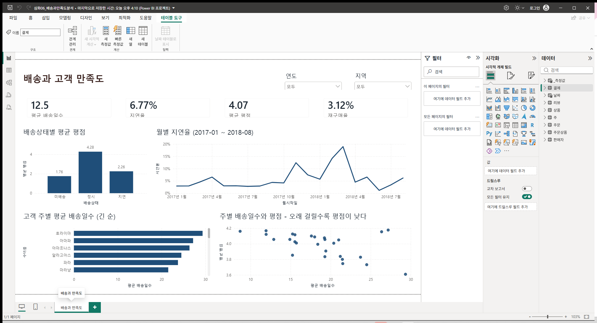

# 6장. 분석 실습 - 배송과 고객 만족도

## 학습 목표

- 지금까지 만든 측정값으로 **질문 → 차트 → 답** 순서의 분석 페이지를 만든다.
- **분산형 차트**로 두 측정값 사이의 관계를 본다.
- 숫자를 근거로 분석 문장을 쓰고, "원인" 과 "관계" 를 구별한다.

## 6-1. 분석 질문 정하기

차트부터 만들지 말고 **질문**을 먼저 적는다. 이 장의 질문은 세 개다.

1. 배송이 늦으면 고객 평점이 낮아질까?
2. 배송이 오래 걸리는 지역은 어디인가?
3. 지연율은 시간이 지나며 어떻게 변했나?

질문마다 알맞은 차트를 고른다.

| 질문 | 차트 | X / 범주 | Y / 값 |
|---|---|---|---|
| ① 배송상태별 평점 | 묶은 세로 막대형 | 주문[배송상태] | 평균 평점 |
| ② 지역별 배송일수 | 묶은 가로 막대형 (긴 순) | 주[주이름] | 평균 배송일수 |
| ③ 지연율 추이 | 꺾은선형 | 날짜[월시작일] | 지연율 |
| ①+② 배송일수와 평점의 관계 | **분산형** | 범례·세부 정보: 주[주이름] | X: 평균 배송일수, Y: 평균 평점 |

## 6-2. 페이지 만들기

5장 파일을 열고 새 페이지 이름을 **배송과 만족도** 로 한다.

1. 제목 텍스트 상자, 슬라이서 2개 (날짜[연도], 주[지역], 드롭다운).
2. 카드 4개: 평균 배송일수, 지연율, 평균 평점, 재구매율. 카드 서식에서 표시 단위 **없음**.
3. 위 표의 차트 4개를 배치한다. 꺾은선형 차트에는 5장처럼 **시각적 개체 필터**로 기간 2017-01-01 ~ 2018-08-31 을 건다.
4. **분산형 차트**: 시각화 창의 점 모양 아이콘. **값**(또는 세부 정보)에 주[주이름], **X축**에 평균 배송일수, **Y축**에 평균 평점. 점 하나가 주 하나다.

## 6-3. 차트 읽기

**① 배송이 늦으면 평점이 크게 떨어진다.**

| 배송상태 | 평균 평점 |
|---|---|
| 정시 | 4.28 |
| 지연 | 2.26 |
| 미배송 | 1.76 |

늦게 온 주문은 정시 주문보다 평점이 **2점 낮다.** 5점 만점에서 2점은 매우 큰 차이다.

**② 북부·북동부의 먼 주가 오래 걸린다.** 판매자 대부분이 상파울루(SP) 등 남동부에 있어서, 아마존 지역의 호라이마(29.3일), 아마파(27.2일), 아마조나스(26.4일)까지는 평균 한 달 가까이 걸린다. 상파울루 고객은 평균 8.7일이다.

| 지역 | 평균 배송일수 | 지연율 |
|---|---|---|
| 남동부 | 10.7 | 6.1% |
| 남부 | 14.0 | 5.9% |
| 중서부 | 15.0 | 6.5% |
| 북동부 | 19.9 | **12.7%** |
| 북부 | 22.5 | 8.6% |

**③ 지연율은 대부분의 달에 3~7% 이지만, 몇몇 달에 크게 튄다.** 2017년 11월(12.4%), 2018년 2월(14.1%), 2018년 3월(19.0%)이다. 2017년 11월은 블랙프라이데이로 주문이 몰린 달이다. 2018년 2~3월에는 어떤 일이 있었는지 데이터만으로는 알 수 없다. 이런 달은 따로 표시해 두고 원인을 알아볼 거리로 남긴다.

**분산형 차트**에서 점들이 **오른쪽 아래로** 기운다. 배송이 오래 걸리는 주일수록 평점이 낮다.

## 6-4. 분석 문장 쓰기 - 관계와 원인

분석 결과를 문장으로 쓸 때 조심할 점이 있다.

| 쓴 문장 | 평가 |
|---|---|
| "배송이 늦으면 평점이 낮다." | 숫자로 확인한 **관계**. 좋다 |
| "늦게 온 주문의 평균 평점은 2.26으로 정시 4.28보다 2점 낮다." | 숫자를 함께 쓴 문장. 더 좋다 |
| "평점을 올리려면 배송만 빠르게 하면 된다." | **원인**이라고 단정했다. 배송이 늦은 상품이 원래 품질이 낮은 상품일 수도 있다 |

차트가 보여 주는 것은 "함께 움직인다" 는 **관계**다. 원인인지는 다른 자료나 실험으로 확인해야 한다. 보고서에는 관계를 쓰고, 원인은 "~ 때문일 수 있다(가설)" 로 적는다.

> 분석 문장 예시 - "배송이 예상일보다 늦은 주문(전체의 6.8%)은 평균 평점이 2.26으로 정시 주문(4.28)보다 2점 낮다. 북동부 지역은 평균 배송일수가 약 20일이고 지연율이 12.7%로 가장 높으므로, 이 지역 고객에게는 예상 배송일을 여유 있게 안내하는 것을 검토할 수 있다."

## 정리

- 분석은 **질문 → 알맞은 차트 → 숫자로 답** 순서로 한다.
- 두 측정값의 관계는 **분산형 차트**로 본다.
- 차트가 보여 주는 것은 **관계**다. 원인이라고 단정하지 말고 숫자와 함께 쓴다.

## 확인 문제

1. 지역 슬라이서에서 **남동부** 를 고르면 지연율과 평균 배송일수는 얼마인가? **북부** 는?
2. 연도 슬라이서에서 2017 과 2018 을 비교하자. 평균 배송일수는 줄었나 늘었나?
3. 분산형 차트에서 가장 오른쪽 아래(배송이 오래 걸리고 평점도 낮은)에 있는 주는 어디인가? 마우스를 올려 확인하자.
4. 6-3 의 ①을 근거로 "배송 지연이 평점을 떨어뜨린다" 고 쓰려면 어떤 자료가 더 있으면 좋을까?
