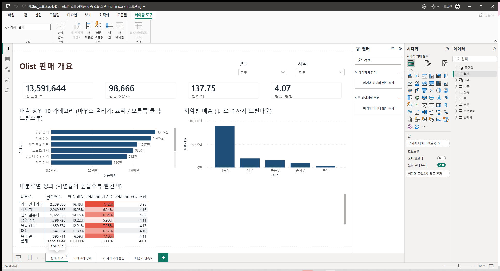
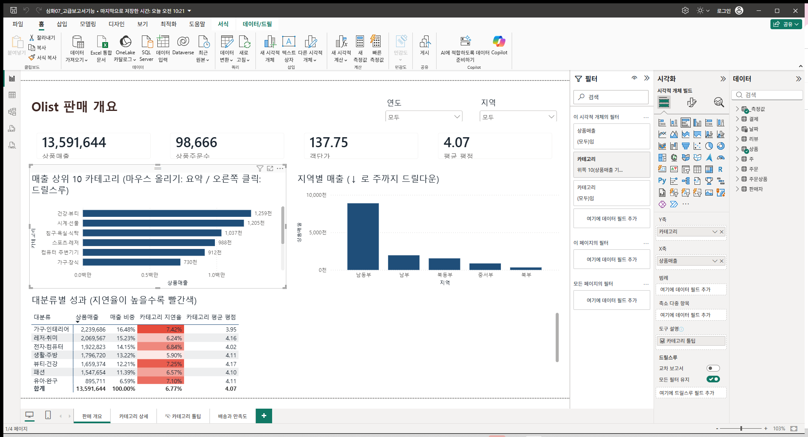
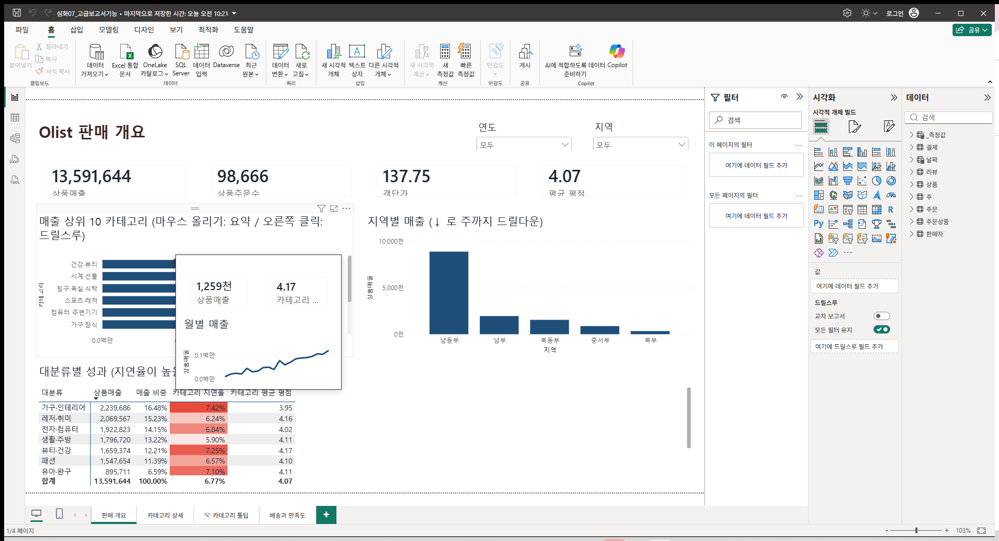
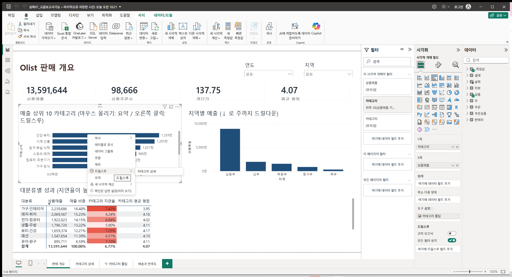
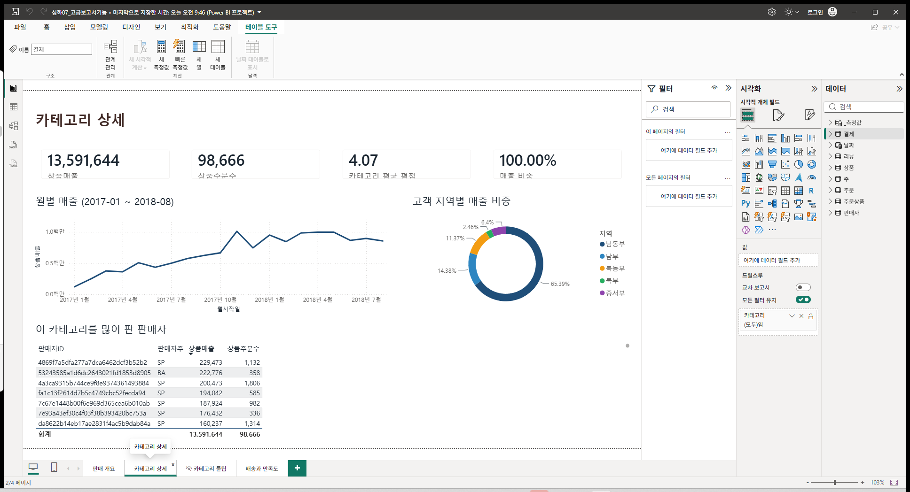

# 7장. 고급 보고서 기능 - 드릴다운, 드릴스루, 도구 설명, 조건부 서식

## 학습 목표

- **계층**으로 차트를 위아래로 파고드는 **드릴다운**을 쓴다.
- **상위 N** 필터로 많은 항목 중 중요한 것만 보여 준다.
- 표의 값에 따라 색을 칠하는 **조건부 서식**을 건다.
- 마우스를 올리면 뜨는 **도구 설명 페이지**, 오른쪽 클릭으로 넘어가는 **드릴스루 페이지**를 만든다.

이 장에서 만드는 보고서는 0장 첫 화면의 보고서다. 6장 파일을 열고 새 페이지 **판매 개요** 를 만든다. 제목, 슬라이서(날짜[연도], 주[지역]), 카드 4개(상품매출, 상품주문수, 객단가, 평균 평점)는 6장과 같은 방법으로 놓는다.



## 7-1. 드릴다운 - 지역에서 주로

1. **묶은 세로 막대형** 을 놓고 X축에 주[지역]을, 그 아래에 주[주이름]을 넣는다. (3장에서 만든 **지역 계층** 을 통째로 끌어 놓아도 된다)
2. Y축에 상품매출. 정렬은 **… → 기준 정렬 → 상품매출**, 내림차순.
3. 차트 위에 마우스를 올리면 오른쪽 위에 화살표 단추들이 보인다.

| 단추 | 하는 일 |
|---|---|
| ↓ (드릴다운 켜기) | 켠 다음 막대를 누르면 그 지역 **안의 주**들이 나온다 |
| ⇊ (다음 수준으로 이동) | 모든 지역을 풀어 **주 전체**를 보여 준다 |
| ⑂ (계층 확장) | 지역과 주를 함께 표시한다 (남동부 SP, 남동부 RJ …) |
| ↑ (드릴업) | 한 단계 위로 돌아간다 |

↓ 를 켜고 **남동부** 막대를 누르면 상파울루·리우데자네이루·미나스제라이스·이스피리투산투 4개 주의 매출이 나온다.

> 날짜도 같다. X축에 **날짜 계층**(연도 → 분기 → 월)을 넣으면 연도별 막대에서 분기, 월로 파고들 수 있다.

## 7-2. 상위 N 필터 - 매출 상위 10 카테고리

카테고리는 70개가 넘는다. 전부 그리면 막대가 너무 가늘어진다.

1. **묶은 가로 막대형** 에 Y축 상품[카테고리], X축 상품매출을 넣고 상품매출 내림차순 정렬.
2. 차트를 고른 채 **필터 창 → 이 시각적 개체의 필터** 에서 **카테고리** 카드를 펼친다.
3. 필터 형식 **상위 N** → 항목 표시 **위쪽 10** → 값 칸에 **상품매출** 을 끌어 놓고 → **필터 적용**.



| 순위 | 카테고리 | 상품매출 |
|---|---|---|
| 1 | 건강·뷰티 | 1,258,681 |
| 2 | 시계·선물 | 1,205,006 |
| 3 | 침구·욕실·식탁 | 1,036,989 |

> 상위 N 은 **슬라이서에 따라 다시 계산된다.** 연도를 2017 로 고르면 2017년의 상위 10이 나온다.

## 7-3. 조건부 서식 - 지연율이 높으면 빨간색

**행렬**에 행 상품[대분류], 값 상품매출 · 매출 비중 · 카테고리 지연율 · 카테고리 평균 평점을 넣는다. 카테고리 지연율은 4장의 카테고리 평균 평점과 같은 방법으로 만든다.

```dax
카테고리 지연율 = CALCULATE([지연율], CROSSFILTER('주문상품'[주문ID], '주문'[주문ID], Both))
```

1. 행렬을 고르고 시각화 창 **값** 칸의 **카테고리 지연율** 오른쪽 ▾ → **조건부 서식 → 배경색**.
2. 서식 스타일 **그라데이션**, 최소값 흰색, 최대값 빨간색 → **확인**.

지연율이 높은 대분류일수록 칸이 진한 빨간색이 된다. 숫자를 읽지 않아도 문제가 있는 곳이 눈에 띈다.

> 조건부 서식에는 배경색 외에 **글꼴 색**, **데이터 막대**(칸 안에 막대), **아이콘**(▲▼●) 이 있다. 서식 스타일 **규칙** 을 고르면 "8% 이상이면 빨강" 처럼 구간을 직접 정할 수 있다.

## 7-4. 도구 설명 페이지 - 마우스를 올리면 요약 화면

차트의 막대에 마우스를 올리면 기본으로 값 몇 개가 뜬다. 이 자리에 **작은 보고서 페이지**를 띄울 수 있다.

1. 새 페이지를 만들고 이름을 **카테고리 툴팁** 으로 바꾼다.
2. 시각화 창 **서식(붓) → 페이지 정보 → 도구 설명으로 사용** 을 켠다.
3. **캔버스 설정 → 형식 → 도구 설명** (320 × 240 크기)으로 바꾼다.
4. 작은 카드 2개(상품매출, 카테고리 평균 평점)와 월별 매출 꺾은선형을 놓는다.
5. 페이지 탭을 오른쪽 클릭 → **페이지 숨기기**. (보고서를 보는 사람에게 이 페이지가 따로 보이지 않게)
6. **판매 개요** 페이지로 돌아와 상위 10 막대 차트를 고르고, **서식 → 일반 → 도구 설명** → 형식 **보고서 페이지**, 페이지 **카테고리 툴팁**.

막대에 마우스를 올리면 그 카테고리의 매출·평점·월별 추이가 작은 화면으로 뜬다.



## 7-5. 드릴스루 - 오른쪽 클릭으로 상세 페이지

**드릴스루**는 한 항목을 골라 그 항목만의 **상세 페이지**로 넘어가는 기능이다.

1. 새 페이지 **카테고리 상세** 를 만든다.
2. 시각화 창 **빌드(필드)** 아래쪽의 **드릴스루** 칸에 상품[카테고리]를 끌어 놓는다. 왼쪽 위에 **← 돌아가기** 단추가 자동으로 생긴다.
3. 이 페이지에 카드(상품매출, 상품주문수, 카테고리 평균 평점, 매출 비중), 월별 매출 꺾은선형, 고객 지역별 매출 도넛형, 판매자별 매출 표를 놓는다.
4. **판매 개요** 로 돌아가 상위 10 막대 중 하나를 **오른쪽 클릭 → 드릴스루 → 카테고리 상세**.



카테고리 상세 페이지가 그 카테고리 하나로 걸러져 열린다. 왼쪽 위 **돌아가기** 로 원래 페이지에 돌아온다.



> 도구 설명은 **잠깐 보기**, 드릴스루는 **자세히 보기**다. 둘 다 같은 원리 - 고른 항목(카테고리)이 대상 페이지의 **필터**로 넘어간다.

## 7-6. 더 알아보기 - 책갈피와 단추

**보기 → 책갈피** 창에서 **추가** 를 누르면 지금 화면 상태(슬라이서 선택, 보이는 차트)가 저장된다. **삽입 → 단추** 로 단추를 놓고 **작업 → 책갈피** 를 연결하면, 단추를 눌러 저장한 화면으로 바꿀 수 있다. "2018년만 보기", "차트 ↔ 표 바꾸기" 같은 보고서 메뉴를 만들 때 쓴다. 단추의 작업을 **페이지 탐색** 으로 바꾸면 다른 페이지로 가는 메뉴 단추가 된다.

## 정리

- 계층을 축에 넣으면 **드릴다운**(↓ ⇊ ⑂ ↑)으로 위아래 수준을 오간다.
- **상위 N** 필터는 측정값 기준으로 위에서 N개만 남긴다. 슬라이서에 따라 다시 계산된다.
- **조건부 서식**(배경색·글꼴색·데이터 막대·아이콘)으로 숫자를 색으로 읽게 한다.
- **도구 설명 페이지**(마우스 올리기)와 **드릴스루 페이지**(오른쪽 클릭)는 고른 항목을 필터로 넘겨받는 작은/상세 페이지다.

## 확인 문제

1. 드릴다운으로 **북동부** 를 열었을 때 매출이 가장 큰 주는 어디인가?
2. 상위 10 필터를 **아래쪽 5** 로 바꾸면 어떤 카테고리가 나오는가? (분류 없음 포함)
3. 대분류 행렬에서 카테고리 지연율이 가장 높은 대분류는 어디인가?
4. 드릴스루로 **건강·뷰티** 상세 페이지를 열었다. 고객 지역 중 남동부의 매출 비중은 몇 % 인가?
