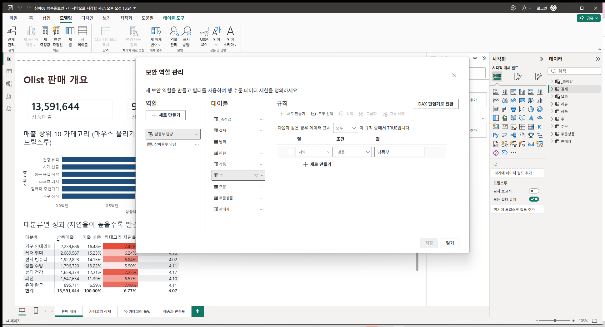
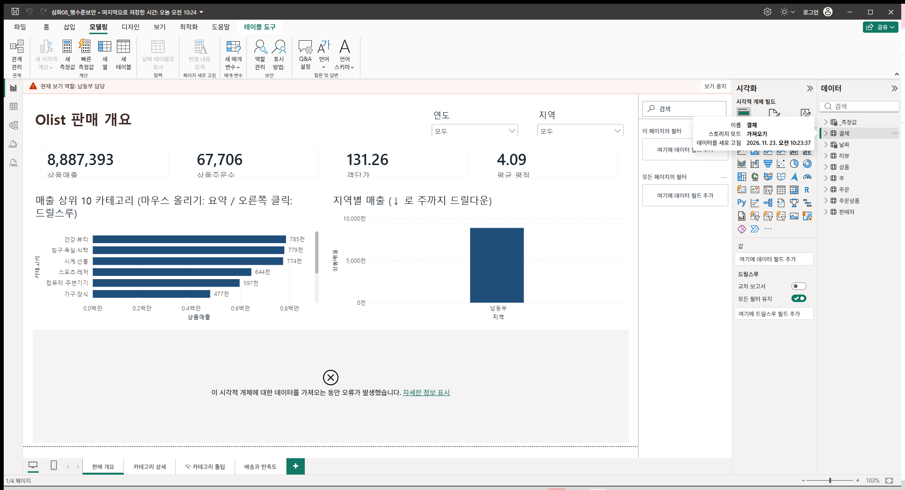
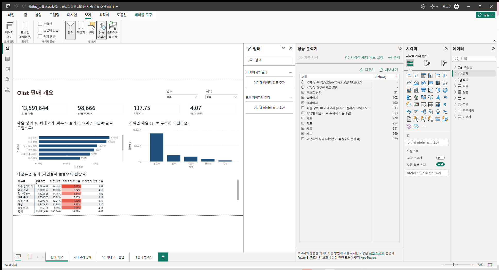

# 8장. 행 수준 보안(RLS)과 성능 점검

## 학습 목표

- **행 수준 보안(RLS)** 으로 보는 사람에 따라 다른 데이터를 보여 주는 **역할**을 만든다.
- **표시 방법**(역할로 보기)으로 역할이 제대로 걸리는지 시험한다.
- **성능 분석기**로 느린 시각적 개체를 찾는다.
- 보고서를 넘기기 전에 확인할 목록을 안다.

## 8-1. 행 수준 보안이란

회사에서 보고서 하나를 여러 사람이 본다. 그런데 남동부 담당자는 남동부 데이터만, 상파울루 담당자는 상파울루 데이터만 봐야 한다면? 지역마다 보고서를 따로 만들면 고칠 때마다 여러 개를 고쳐야 한다.

**행 수준 보안(Row-Level Security, RLS)** 은 보고서는 하나로 두고, **역할**마다 볼 수 있는 **행**을 제한한다.

```text
역할 "남동부 담당" : 주 테이블에서 [지역] = "남동부" 인 행만 보인다
   → 관계를 따라 필터가 흐른다: 주 → 주문 → 주문상품·결제·리뷰
   → 이 역할의 사람에게는 남동부 고객의 주문만 계산된다
```

## 8-2. 역할 만들기

7장 파일을 연다.

1. **모델링 → 역할 관리**. **보안 역할 관리** 창이 열린다.
2. **역할 → + 새로 만들기** → 역할 이름을 `남동부 담당` 으로 바꾼다 (이름 오른쪽 … → 이름 바꾸기).
3. 가운데 **테이블** 목록에서 **주** 를 고른다.
4. 오른쪽 **규칙 → + 새로 만들기** → 열 `지역`, 조건 `같음`, 값 `남동부`.
5. 다시 **+ 새로 만들기** → `상파울루 담당` 역할, 테이블 **주**, 규칙 열 `주코드` 같음 `SP`.
6. **저장** → **닫기**.

> 위쪽 **DAX 편집기로 전환** 을 누르면 같은 규칙이 DAX 식으로 보인다. 규칙 편집기로 만들기 어려운 조건(여러 열, 함수)은 DAX 로 직접 쓴다.

```dax
[지역] = "남동부"
```



> 필터 식은 그 테이블의 **각 행**에 대해 참/거짓을 판단한다. 참인 행만 보인다. 그리고 그 테이블에서 관계를 따라 다(\*) 쪽 테이블들도 함께 걸러진다. 그래서 **차원 테이블**(주, 판매자 등)에 거는 것이 보통이다.

## 8-3. 역할로 보기

1. **모델링 → 표시 방법** (영어판 View as) → `남동부 담당` 체크 → **확인**.
2. 보고서 위쪽에 "지금 보고 있는 역할: 남동부 담당" 표시줄이 생긴다.



| 측정값 | 전체 | 남동부 담당 |
|---|---|---|
| 주문수 | 99,441 | 68,266 |
| 상품매출 | 13,591,644 | 8,887,393 |

슬라이서에서 다른 지역을 고르려 해도 남동부만 남아 있다. 위쪽 표시줄의 **보기 중지** 를 눌러 돌아온다.

### 대분류 행렬이 오류가 나는 이유

표시 방법으로 보면 아래쪽 **대분류별 성과** 행렬에 "데이터를 가져오는 동안 오류가 발생했습니다" 가 뜬다. 행렬에 들어 있는 `카테고리 지연율`, `카테고리 평균 평점` 이 **CROSSFILTER** 를 쓰기 때문이다.

Power BI 는 행 수준 보안이 걸린 모델에서 측정값이 관계 방향을 마음대로 바꾸는 것(`CROSSFILTER`, `USERELATIONSHIP`)을 막는다. 방향을 바꾸면 보안 필터를 돌아 나가는 길이 생길 수 있기 때문이다. 해결 방법은 두 가지다.

| 방법 | 하는 일 |
|---|---|
| 관계 자체를 양방향으로 | 주문상품 ↔ 주문 관계를 열고 크로스 필터 방향 **모두**, **양방향으로 보안 필터 적용** 체크. 측정값은 CROSSFILTER 없이 `[지연율]`, `[평균 평점]` 을 그대로 쓴다 |
| 보안용 보고서에서는 빼기 | 보안이 필요한 사람이 보는 페이지에는 CROSSFILTER·USERELATIONSHIP 측정값을 넣지 않는다 |

3장에서 "양방향 관계는 조심해서 쓴다" 고 했다. 보안이 필요한 모델에서는 측정값 안의 방향 바꾸기를 쓸 수 없으니, **꼭 필요한 관계 하나만** 양방향(+ 보안 필터 적용)으로 바꾸는 것이 실무에서 쓰는 방법이다.

> **실제 공유에서는?** 보고서를 Power BI 서비스(웹)에 게시한 뒤, 의미 체계 모델의 **보안** 설정에서 역할에 사람(이메일 계정)을 넣는다. Desktop 에서는 역할을 만들고 시험하는 데까지 할 수 있다. 사람마다 자기 지역을 자동으로 보게 하려면 `USERPRINCIPALNAME()` 함수(로그인한 사람의 이메일)를 쓰는 **동적 RLS** 를 쓴다.

## 8-4. 성능 분석기

보고서가 느리면 어떤 시각적 개체가 시간을 잡아먹는지 찾아야 한다.

1. **보기 → 성능 분석기**. 오른쪽에 창이 열린다.
2. **기록 시작** → **시각적 개체 새로 고침**.
3. 시각적 개체마다 걸린 시간(밀리초)이 나온다. 펼치면 **DAX 쿼리**(모델 계산) · **시각적 개체 표시**(그리기) · **기타** 로 나뉜다.



| 오래 걸리는 곳 | 흔한 원인 | 고치는 방법 |
|---|---|---|
| DAX 쿼리 | 행이 많은 표에서 FILTER, 반복 함수를 겹쳐 쓴 측정값 | 계산을 단순하게, 필요한 열만 FILTER |
| 시각적 개체 표시 | 점·행이 수만 개인 표, 분산형 차트 | 상위 N, 요약된 축 사용 |
| 페이지 전체 | 한 페이지에 시각적 개체가 너무 많다 | 페이지 나누기, 드릴스루로 옮기기 |

Olist 정도의 데이터(10만 행)에서는 보통 수백 밀리초 안에 끝난다. 재구매 고객수처럼 고객 9만 명을 하나씩 도는 측정값이 상대적으로 오래 걸리는 것을 볼 수 있다.

## 8-5. 보고서를 넘기기 전 확인 목록

| 확인 | 방법 |
|---|---|
| 숫자가 맞는가 | 핵심 측정값을 원본(엑셀, SQL)과 한두 개 비교 |
| 필요 없는 열·쿼리를 뺐나 | 로드 사용 안 함, 열 제거 → 파일이 작고 빠르다 |
| 이름이 읽기 쉬운가 | 테이블·열·측정값 이름, 차트 제목 |
| 측정값에 설명이 있나 | 모델 보기에서 측정값을 고르고 속성 창 **설명** 에 계산 방법을 적는다 |
| 숨길 것을 숨겼나 | 키 열(주문ID 등), 임시 열은 **숨기기** |
| 역할을 시험했나 | 역할로 보기 |
| 기간이 맞는가 | 불완전한 달(2016년, 2018년 9~10월)을 어떻게 처리했는지 보고서에 적어 둔다 |

## 정리

- **RLS** = 역할마다 볼 수 있는 행을 DAX 필터 식으로 제한. 차원 테이블에 걸면 관계를 따라 퍼진다.
- **역할로 보기**로 시험한다. 실제 사람 배정은 Power BI 서비스에서.
- **성능 분석기**로 시각적 개체별 DAX 쿼리·표시 시간을 잰다.

## 확인 문제

1. `상파울루 담당` 으로 표시 방법을 바꾸면 주문수는 얼마인가? 전체의 몇 %인가?
2. 역할 `남부 담당` 을 만들어 보자. 상품매출은 얼마인가?
3. 판매자[판매자주] = "SP" 로 필터하는 역할 `상파울루 판매자` 를 만들면, 주문수(주문 테이블)는 바뀔까? 상품매출은? 필터가 흐르는 방향으로 설명하시오.
4. 성능 분석기에서 가장 오래 걸린 시각적 개체는 무엇이었는가? 그 개체에는 어떤 측정값이 들어 있나?
