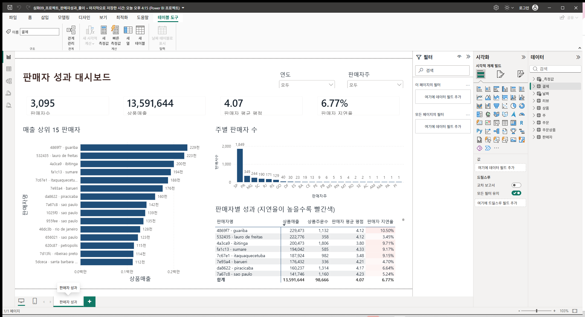

# 9장. 프로젝트 - 판매자 성과 대시보드 혼자 만들기

## 학습 목표

- 지금까지 배운 모델·측정값·보고서 기능을 **새 질문**에 스스로 적용한다.
- 같은 모델을 다른 관점(고객·카테고리가 아니라 **판매자**)으로 분석한다.
- 완성한 대시보드를 근거로 판매자 운영에 대한 제안을 쓴다.

## 9-1. 과제 소개

당신은 Olist 의 **판매자 관리팀**이다. 3,000여 판매자 중 누가 매출을 많이 내는지, 누가 배송을 자주 늦게 하는지, 어느 판매자의 평점이 낮은지 한눈에 보는 대시보드를 만들어 달라는 요청을 받았다.

8장까지 만든 파일(`심화08_행수준보안.pbix` 또는 내 파일)에 새 페이지 **판매자 성과** 를 만든다. 막히면 9-4 의 단계별 힌트를 보고, 그래도 막히면 `pbix\심화09_프로젝트_판매자성과_풀이.pbix` 를 연다.

## 9-2. 만들어야 할 것

**측정값 3개와 계산 열 1개**

| 이름 | 종류 | 뜻 |
|---|---|---|
| 판매자수 | 측정값 | 상품을 판 판매자 수 (서로 다른 판매자ID 수) |
| 판매자 평균 평점 | 측정값 | 판매자 필터에서도 맞게 나오는 평균 평점 |
| 판매자 지연율 | 측정값 | 판매자 필터에서도 맞게 나오는 지연율 |
| 판매자명 | 판매자 테이블의 계산 열 | 판매자ID 앞 6글자 + " · " + 판매자도시 (예: `4869f7 · guariba`) |

**시각적 개체**

| 개체 | 내용 |
|---|---|
| 제목 | 판매자 성과 대시보드 |
| 슬라이서 2개 | 날짜[연도], 판매자[판매자주] (드롭다운) |
| 카드 4개 | 판매자수, 상품매출, 판매자 평균 평점, 판매자 지연율 |
| 가로 막대형 | 매출 상위 15 판매자 (판매자명, 상위 N 필터) |
| 세로 막대형 | 주별 판매자 수 (판매자주, 많은 순) |
| 행렬 | 판매자명별 상품매출, 상품주문수, 판매자 평균 평점, 판매자 지연율 (지연율에 조건부 서식) |

## 9-3. 완성 예시



카드 값이 아래와 같으면 정답이다. (슬라이서는 모두 "모두")

| 측정값 | 값 |
|---|---|
| 판매자수 | 3,095 |
| 상품매출 | 13,591,644 |
| 판매자 평균 평점 | 4.07 |
| 판매자 지연율 | 6.77% |

> 전체 값은 기본 측정값과 같다. 차이는 **판매자로 걸렀을 때** 나타난다. 판매자[판매자주] 슬라이서에서 SP 를 골라 보자. 그냥 `[평균 평점]` 은 4.07 그대로지만 `[판매자 평균 평점]` 은 바뀌어야 한다.

## 9-4. 단계별 힌트

**① 판매자수** - 판매자 필터는 주문상품까지 흐른다. 주문상품에서 센다.

```dax
판매자수 = DISTINCTCOUNT('주문상품'[판매자ID])
```

**② 판매자 평균 평점, 판매자 지연율** - 리뷰와 배송상태는 주문 쪽에 있다. 판매자 필터가 주문까지 올라가게 하려면? 4장 4-5 를 다시 보자.

```dax
판매자 평균 평점 = CALCULATE([평균 평점], CROSSFILTER('주문상품'[주문ID], '주문'[주문ID], Both))
```

```dax
판매자 지연율 = CALCULATE([지연율], CROSSFILTER('주문상품'[주문ID], '주문'[주문ID], Both))
```

**③ 판매자명** - 데이터 창에서 **판매자** 테이블을 고르고 **새 열**. 글자 앞부분은 `LEFT(글자, 개수)`, 글자 잇기는 `&`.

```dax
판매자명 = LEFT('판매자'[판매자ID], 6) & " · " & '판매자'[판매자도시]
```

**④ 상위 15** - 7장 7-2 의 상위 N 필터. 항목 **판매자명**, 위쪽 15, 값 상품매출.

**⑤ 조건부 서식** - 7장 7-3. 판매자 지연율 → 배경색 → 그라데이션.

## 9-5. 분석 문장 쓰기

완성한 대시보드로 아래 질문에 답을 문장으로 쓰자. 풀이는 부록 C 에 있다.

1. 판매자가 가장 많은 주는 어디이고, 전체의 몇 % 인가?
2. 매출 1위 판매자의 매출, 평균 평점, 지연율은? 매출 상위 15 판매자 중 지연율이 10% 를 넘는 판매자는 누구인가?
3. 판매자주 슬라이서에서 **SP** 와 **RJ** 를 각각 골라 판매자 평균 평점과 지연율을 비교하자.
4. 1~3의 결과를 바탕으로 판매자 관리팀에 할 **제안 하나**를 두세 문장으로 쓰시오. (6장 6-4 의 "관계와 원인" 을 생각하며)
