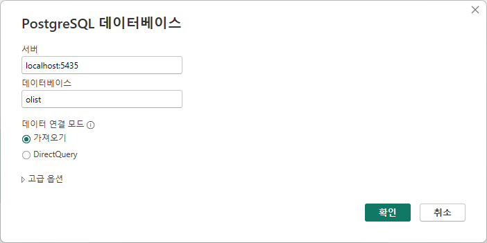
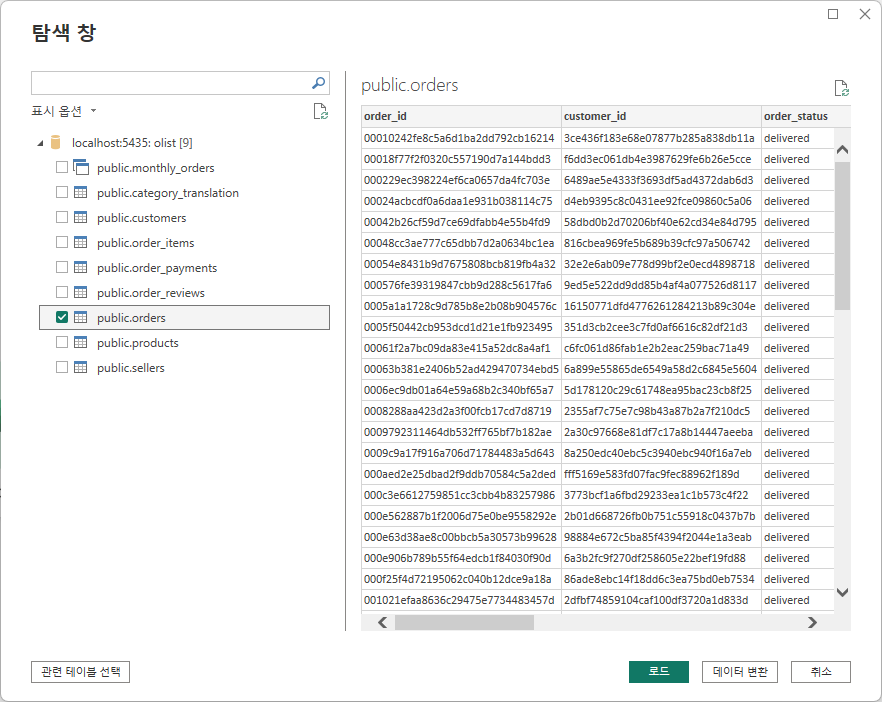

# 10장. (선택) PostgreSQL 데이터베이스에 연결하기

## 학습 목표

- Docker 로 Olist 데이터가 들어 있는 PostgreSQL 데이터베이스를 띄운다.
- Power BI 에서 데이터베이스에 연결해 테이블을 불러온다.
- **SQL 문**으로 필요한 데이터만 불러오고, **가져오기**와 **DirectQuery** 의 차이를 안다.

> 이 장은 **선택**이다. Docker Desktop 이 없거나 설치할 수 없으면 읽기만 해도 된다. 회사에서는 CSV 보다 데이터베이스에 직접 연결하는 경우가 훨씬 많으므로, 할 수 있다면 꼭 해 보자.

## 10-1. 데이터베이스 띄우기

**Docker Desktop** 이 설치되어 있고 실행 중이어야 한다. (설치 방법은 Docker 공식 사이트 또는 Git·Docker 입문 교안을 참고)

1. PowerShell 을 열고 저장소의 `db` 폴더로 이동해 컨테이너를 시작한다.

```powershell
cd C:\study\power-bi-tutorial\db
docker compose up -d
```

2. 처음에는 PostgreSQL 이미지를 내려받고 CSV 를 테이블로 불러오느라 1~2분 걸린다. 상태를 확인한다.

```powershell
docker compose ps
```

STATUS 가 `healthy` 이면 준비가 끝난 것이다. (`starting` 이면 잠시 뒤 다시 확인)

| 접속 정보 | 값 |
|---|---|
| 서버 | `localhost:5435` |
| 데이터베이스 | `olist` |
| 사용자 / 비밀번호 | `postgres` / `postgres` (실습용) |
| 테이블 | orders, order_items, order_payments, order_reviews, customers, products, sellers, category_translation |
| 뷰 | monthly_orders (월별 주문 요약) |

`db\init\01_olist.sql` 을 열어 보면 테이블을 만들고(`CREATE TABLE`) CSV 를 불러오는(`COPY`) SQL 이 주석과 함께 들어 있다.

## 10-2. Power BI 에서 연결하기

1. 새 보고서에서 **홈 → 데이터 가져오기 ▾ → 자세히…** → 검색 칸에 `PostgreSQL` → **PostgreSQL 데이터베이스** → **연결**.
2. 서버 `localhost:5435`, 데이터베이스 `olist`, 데이터 연결 모드 **가져오기** → **확인**.



3. 자격 증명 창이 열린다. 왼쪽 **데이터베이스** 가 골라진 상태에서 사용자 이름 `postgres`, 암호 `postgres` 를 **직접 입력**하고 **연결**.
4. **암호화 지원** 창("암호화된 연결을 사용하여 데이터 원본에 연결할 수 없습니다…")이 나오면 **확인** 을 누른다. 실습용 데이터베이스는 내 PC 안에서만 쓰므로 암호화하지 않은 연결로 접속해도 된다. (회사 데이터베이스라면 관리자에게 암호화 설정을 물어보자)

> **암호를 잘못 넣었다면?** 입력한 자격 증명은 PC 에 저장되어 다음 연결에도 그대로 쓰인다. "No password has been provided" 나 "password authentication failed" 오류가 계속 나면 **홈 → 데이터 변환 ▾ → 데이터 원본 설정** 에서 `localhost:5435` 를 고르고 **권한 지우기 → 삭제** 한 뒤 다시 연결한다.
5. **탐색 창**에 `public.orders` 같은 테이블 목록이 나온다.



6. `public.orders`, `public.order_items` 를 체크하고 **로드**.

CSV 와 달리 **열 형식**(날짜/시간, 숫자)이 데이터베이스에 정해져 있어서 Power BI 가 짐작할 필요가 없다. 리뷰 글의 줄 바꿈 문제도 없다.

## 10-3. SQL 문으로 필요한 것만 불러오기

데이터베이스가 크면 테이블을 통째로 불러오지 말고 **필요한 행과 열만** 가져오는 것이 좋다.

1. **데이터 가져오기 → PostgreSQL 데이터베이스** → 같은 서버·데이터베이스 → **고급 옵션** 을 펼친다.
2. **SQL 문** 칸에 아래를 붙여 넣고 **확인**.

```sql
-- 2018년 배송완료 주문만, 고객의 주(state)를 붙여서
SELECT o.order_id,
       c.customer_unique_id,
       c.customer_state,
       o.order_purchase_timestamp::date        AS purchase_date,
       o.order_delivered_customer_date::date   AS delivered_date,
       o.order_estimated_delivery_date::date   AS estimated_date
FROM orders o
JOIN customers c ON c.customer_id = o.customer_id
WHERE o.order_status = 'delivered'
  AND o.order_purchase_timestamp >= '2018-01-01'
```

3. 미리 보기에서 **로드**. 2장에서 Power Query 병합으로 했던 일(주문 + 고객)을 데이터베이스가 SQL 의 `JOIN` 으로 대신 해 준다.

> **쿼리 폴딩** - SQL 문을 직접 쓰지 않고 테이블을 고른 뒤 Power Query 에서 행 필터·열 제거를 해도, Power BI 는 그 단계를 **SQL 로 바꿔** 데이터베이스에 보낸다. 단계를 오른쪽 클릭했을 때 **네이티브 쿼리 보기** 가 켜져 있으면 그 단계까지 SQL 로 바뀐(폴딩된) 것이다. 데이터베이스가 계산하고 결과만 받아 오므로 빠르다.

## 10-4. 뷰 불러오기

데이터베이스 담당자가 자주 쓰는 계산을 **뷰**(view, 저장된 SELECT 문)로 만들어 두기도 한다. 탐색 창에서 `public.monthly_orders` 를 체크해 불러오면 월별 주문수·배송완료 주문수가 이미 계산된 표가 들어온다.

## 10-5. 가져오기와 DirectQuery

연결 창의 **데이터 연결 모드**에는 두 가지가 있다.

| | 가져오기 (Import) | DirectQuery |
|---|---|---|
| 데이터 위치 | .pbix 안에 **복사** | 데이터베이스에 그대로, 볼 때마다 질의 |
| 최신 데이터 | **새로 고침** 해야 바뀐다 | 차트를 볼 때마다 최신 |
| 속도 | 빠르다 | 데이터베이스 속도에 달렸다 |
| 쓸 수 있는 기능 | 모든 Power Query·DAX | 일부 Power Query 단계·DAX 함수 제한 |
| 이럴 때 | 대부분의 경우 (이 과정 전체) | 데이터가 아주 크거나 실시간이 꼭 필요할 때 |

처음에는 **가져오기**로 시작하고, 꼭 필요할 때만 DirectQuery 를 검토한다.

## 10-6. 끝내기

실습이 끝나면 컨테이너를 멈춘다. 데이터베이스 내용은 볼륨에 남아 있어서 다음에 `docker compose up -d` 하면 바로 쓸 수 있다.

```powershell
docker compose stop
```

완전히 지우려면(다음 시작 때 CSV 를 다시 불러온다) `docker compose down -v`.

## 정리

- `db` 폴더의 `docker compose up -d` 로 Olist 데이터가 든 PostgreSQL(localhost:5435)을 띄운다.
- Power BI 의 **PostgreSQL 데이터베이스** 커넥터로 서버·데이터베이스·자격 증명을 넣어 연결한다.
- **SQL 문**이나 **뷰**로 필요한 데이터만 불러온다. Power Query 단계도 SQL 로 바뀌어(쿼리 폴딩) 데이터베이스에서 계산된다.
- 기본은 **가져오기**, 실시간이 꼭 필요할 때 **DirectQuery**.

## 확인 문제

1. 10-2 에서 불러온 `public.order_items` 의 행 수는 CSV 로 불러온 주문상품(112,650)과 같은가?
2. 10-3 의 SQL 문으로 불러온 2018년 배송완료 주문은 몇 건인가?
3. 10-3 의 SQL 에 `AND c.customer_state = 'SP'` 를 더하면 몇 건이 되는가?
4. `public.monthly_orders` 뷰에서 주문이 가장 많은 달은 언제인가?
