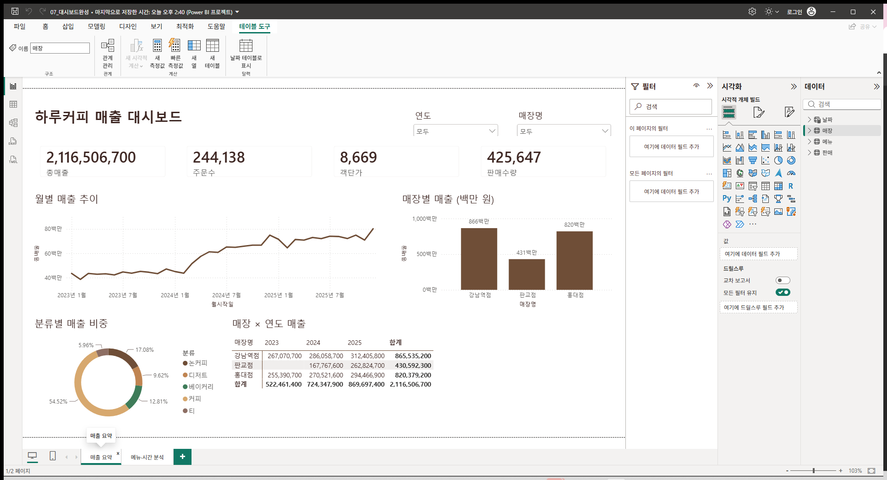
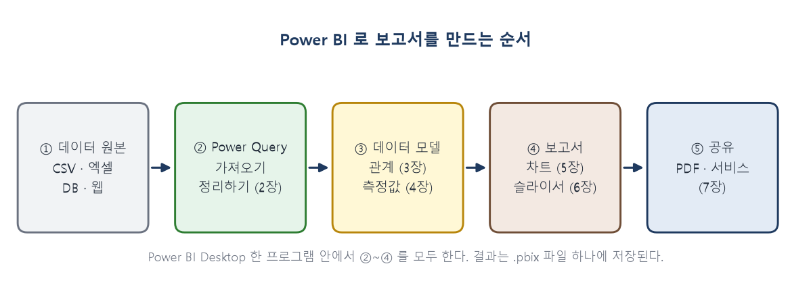

# 0장. 과정 안내와 실습 준비

## 이 과정에서 만드는 것

**Power BI** 를 처음 배우는 사람이 혼자서도 따라 할 수 있게 만든 기초 과정이다. 가상의 카페 **"하루커피"** 의 3년치 매출 데이터를 정리하고 분석해서, 마지막 7장에서 아래와 같은 **매출 대시보드**를 완성한다.



Power BI 로 보고서를 만드는 일은 항상 같은 순서로 진행된다. 이 과정의 장도 이 순서를 그대로 따라간다.



> 이 과정을 마치면 2단계 **심화 과정**(실제 전자상거래 데이터 Olist 분석)으로 이어진다.

## 진행 순서 (약 20시간)

| 장 | 내용 | 시간 | 완성 파일 |
|---|---|---|---|
| 0장 | 과정 안내, Power BI Desktop 설치, 실습 파일 받기 | 1 | - |
| 1장 | Power BI 화면 둘러보기와 데이터 불러오기 | 2 | 01_데이터불러오기.pbix |
| 2장 | Power Query 로 데이터 정리하기 | 3 | 02_데이터정리.pbix |
| 3장 | 관계와 날짜 테이블 | 2 | 03_관계와날짜.pbix |
| 4장 | 측정값 만들기 (DAX 첫걸음) | 2.5 | 04_측정값.pbix |
| 5장 | 차트 만들기 | 2.5 | 05_차트.pbix |
| 6장 | 슬라이서와 서식 | 2 | 06_슬라이서와서식.pbix |
| 7장 | 대시보드 완성과 공유 | 1.5 | 07_대시보드완성.pbix |
| 8장 | 과제 - 편의점 매출 대시보드 혼자 만들기 | 4 | 과제_편의점_풀이.pbix |

## 공부하는 방법

1. **장 처음의 "학습 목표" 를 읽는다.** 이 장이 끝나면 무엇을 할 수 있게 되는지 먼저 안다.
2. **따라 하기 단계를 그대로 클릭한다.** "홈 → 데이터 가져오기" 처럼 화살표(→)는 차례대로 누르라는 뜻이다. 단계마다 화면 그림이 있으니 내 화면과 비교하자.
3. **장이 끝나면 내 파일을 저장한다.** 파일 이름은 `내카페.pbix` 처럼 아무것이나 좋다. 다음 장은 그 파일을 이어서 쓴다.
4. **확인 문제를 푼다.** 풀이는 부록 C 에 있다.

> **막히거나 수업을 빠졌다면** 저장소의 `pbix` 폴더에 장마다 **완성 파일**이 있다. 예를 들어 4장을 시작하려는데 3장을 못 끝냈다면 `03_관계와날짜.pbix` 를 열어 이어서 하면 된다. 오류가 나면 **부록 A 오류 해결**을 먼저 찾아보자.

## 0-1. Power BI Desktop 설치

**Power BI Desktop** 은 Microsoft 가 무료로 주는 Windows 프로그램이다. (macOS 에서는 실행되지 않는다.)

1. 시작 메뉴에서 **Microsoft Store** 를 연다.
2. 위쪽 검색 칸에 `Power BI Desktop` 을 치고, Microsoft Corporation 이 만든 **Power BI Desktop** 을 고른다.
3. **설치**(또는 **받기**)를 누른다. 설치가 끝나면 시작 메뉴에 Power BI Desktop 이 생긴다.

> Store 를 쓸 수 없는 PC 라면 https://www.microsoft.com/download 에서 `Power BI Desktop` 을 검색해 설치 파일(PBIDesktopSetup_x64.exe)을 받아도 된다. Store 판은 매달 자동으로 업데이트되어 편하다.

처음 실행하면 **로그인** 창이 뜰 수 있다. 이 과정은 내 PC 안에서만 작업하므로 **로그인하지 않아도 된다.** 창 오른쪽 위의 X 로 닫는다.

> 이 교안의 화면은 **Power BI Desktop 2.159 (2026년 11월)** 한국어판이다. Power BI 는 매달 조금씩 바뀌므로 단추 위치나 아이콘이 조금 다를 수 있다. 그럴 때는 **메뉴 이름**을 보고 찾아가자.

## 0-2. 실습 파일 받기

모든 실습은 `C:\study\power-bi-tutorial` 폴더에서 한다. (바탕 화면이나 OneDrive 폴더는 경로에 한글·빈칸이 섞이거나 동기화 때문에 문제가 생기기 쉽다.)

**방법 1. ZIP 으로 받기 (Git 을 모른다면 이 방법)**

1. 웹 브라우저에서 https://github.com/sinaboro/power-bi-tutorial 를 연다.
2. 초록색 **Code** 단추 → **Download ZIP** 을 누른다.
3. 받은 `power-bi-tutorial-main.zip` 을 오른쪽 클릭 → **압축 풀기** → 대상 폴더를 `C:\study` 로 정한다.
4. 풀린 폴더 이름 `power-bi-tutorial-main` 을 **`power-bi-tutorial`** 로 바꾼다.

**방법 2. Git 으로 받기**

**[PS]**

```powershell
mkdir C:\study
cd C:\study
git clone https://github.com/sinaboro/power-bi-tutorial.git
```

받은 폴더는 이렇게 생겼다.

```text
C:\study\power-bi-tutorial
├─ data                     ← 실습 데이터 (이 과정에서 불러올 파일)
│  ├─ 카페_판매.csv          하루커피 판매 내역 3년치 (약 36만 줄)
│  ├─ 카페_메뉴.xlsx         메뉴 22개
│  ├─ 카페_매장.xlsx         매장 3곳
│  ├─ 하루커피_테마.json     6장에서 쓰는 색 테마
│  └─ 편의점_*.csv/xlsx      8장 과제용 데이터
├─ pbix                     ← 장별 완성 파일 (막혔을 때 열어 본다)
└─ docs                     ← 이 교안 PDF
```

> **폴더 위치가 중요하다.** 완성 파일(.pbix)은 `C:\study\power-bi-tutorial\data` 의 파일을 불러오도록 만들어져 있다. 다른 곳에 두면 완성 파일에서 **새로 고침**할 때 "파일을 찾을 수 없다" 는 오류가 난다. (화면은 그대로 열린다. 해결 방법은 부록 A)

## 0-3. 실습 데이터 소개

하루커피는 매장이 세 곳인 가상의 카페다. 2023년 1월 1일부터 2025년 12월 31일까지의 판매 기록이 있다.

**카페_매장.xlsx** - 매장 3곳

| 매장코드 | 매장명 | 지역 | 오픈일 | 좌석수 |
|---|---|---|---|---|
| S01 | 강남역점 | 서울 | 2021-05-01 | 48 |
| S02 | 홍대점 | 서울 | 2022-03-12 | 40 |
| S03 | 판교점 | 경기 | 2024-03-15 | 56 |

**카페_메뉴.xlsx** - 메뉴 22개 (커피 7, 논커피 5, 티 3, 디저트 3, 베이커리 4)

| 메뉴코드 | 메뉴명 | 분류 | 판매가 | 원가 |
|---|---|---|---|---|
| M01 | 아메리카노 | 커피 | 4500 | 900 |
| M02 | 카페라떼 | 커피 | 5000 | 1300 |
| M11 | 자몽에이드 | 논커피 | 6000 | 1800 |
| M16 | 치즈케이크 | 디저트 | 6500 | 2600 |
| … | … | … | … | … |

**카페_판매.csv** - 메뉴 하나를 판 기록이 한 줄이다. 한 번의 주문(주문번호)에 메뉴가 여러 개면 여러 줄이 된다.

| 열 | 뜻 | 예 |
|---|---|---|
| 주문상세번호 | 줄마다 붙은 번호 | 37 |
| 주문번호 | 한 번의 주문(영수증) 번호 | S01-20230101-0023 |
| 주문일시 | 주문한 날짜와 시각 | 2023-01-01 08:16:33 |
| 매장코드 | 어느 매장인가 | S01 |
| 메뉴코드 | 어떤 메뉴인가 | M02 |
| 수량 | 몇 개 | 1 |
| 단가 | 그때 판 가격 (원) | 4700 |
| 결제수단 | 카드 / 간편결제 / 현금 | 카드 |
| 주문유형 | 매장 / 포장 | 매장 |

> **데이터 속 이야기** 판교점은 2024년 3월에 문을 열었다. 커피 가격은 2025년 1월에 300원 올랐다(그래서 판매.csv 의 단가가 메뉴.xlsx 의 판매가와 다를 수 있다). 여름에는 에이드, 겨울에는 따뜻한 차가 잘 팔린다. 이런 이야기가 차트에서 어떻게 보이는지 찾아보는 것도 재미있다.

> **일부러 넣은 "지저분한" 값** 실제 회사 데이터는 깨끗하지 않다. 그래서 이 데이터에도 중복된 줄, 수량이 빈 줄, `카드`·`신용카드`·`CARD` 처럼 표기가 섞인 값, 메뉴명 앞뒤의 빈칸을 일부러 넣어 두었다. 2장에서 Power Query 로 정리한다.
