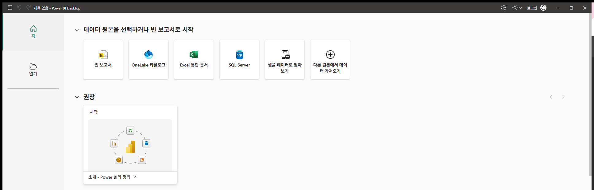
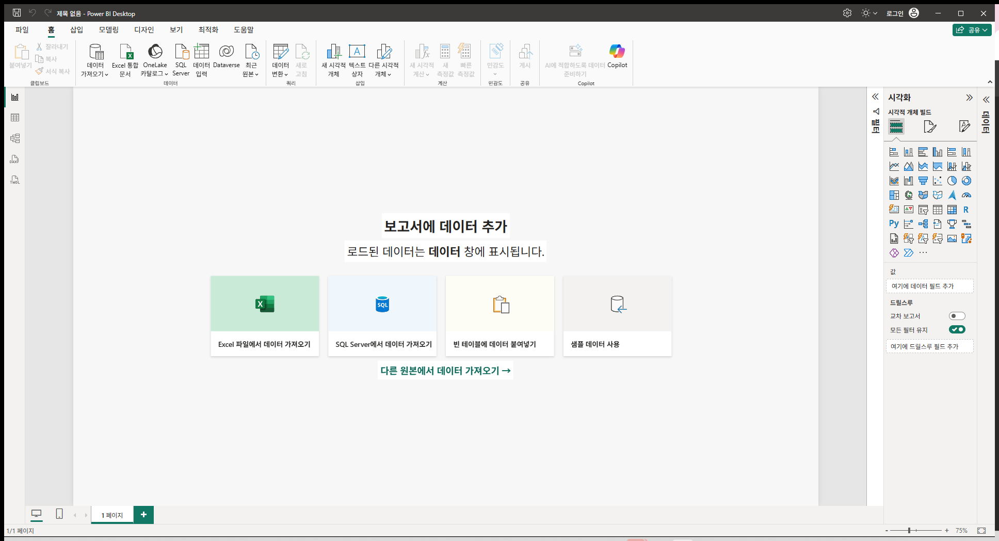
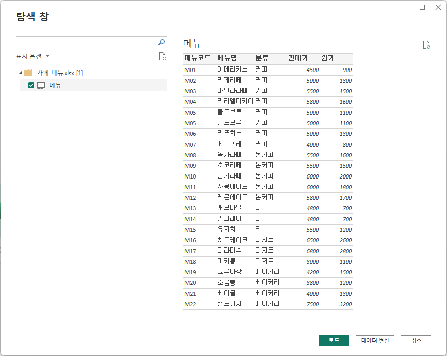
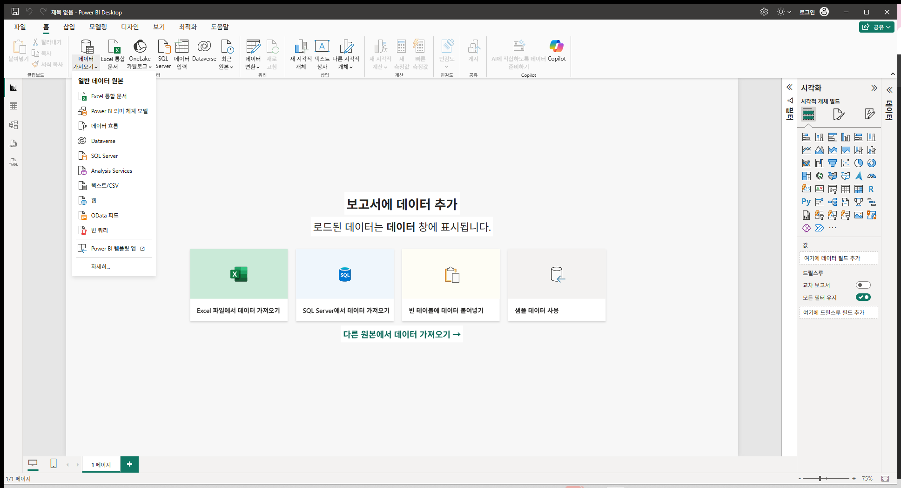
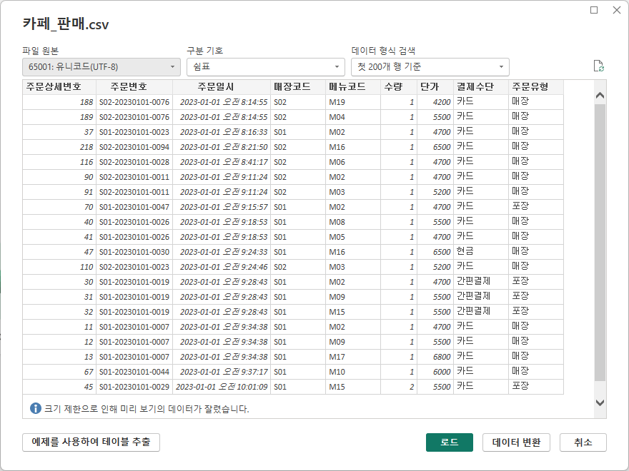
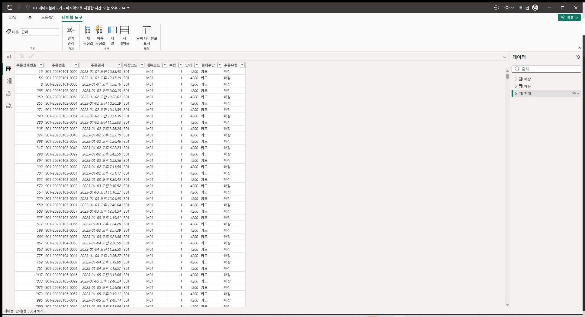
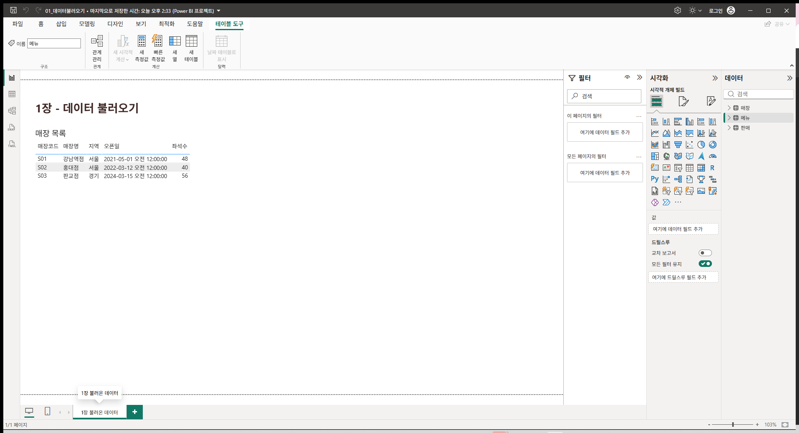

# 1장. Power BI 시작하기 - 화면과 데이터 불러오기

## 학습 목표

- Power BI Desktop 화면의 각 부분(리본, 보기 단추, 캔버스, 오른쪽 창)의 이름과 역할을 안다.
- 엑셀 파일과 CSV 파일을 불러온다.
- 테이블 보기에서 불러온 데이터를 확인한다.
- 첫 번째 시각적 개체(표)를 만들고 파일을 저장한다.

## 1-1. Power BI 는 무엇인가

**Power BI** 는 흩어진 데이터를 모아 정리하고, 차트로 된 **보고서**를 만드는 Microsoft 의 도구다. 엑셀로도 표와 차트를 만들 수 있지만, Power BI 는

- 수십만~수백만 줄의 데이터를 빠르게 다루고,
- 여러 파일을 **관계**로 이어 한 번에 분석하고,
- 클릭 한 번으로 모든 차트가 함께 바뀌는 **대화형 보고서**를 만든다.

| 이름 | 하는 일 | 이 과정에서 |
|---|---|---|
| **Power BI Desktop** | 내 PC 에서 보고서를 만드는 프로그램 (무료) | 모든 장 |
| Power BI 서비스 | 만든 보고서를 웹에 올려 공유 (회사 계정 필요) | 7장에서 소개만 |
| Power BI 모바일 | 휴대폰으로 보고서 보기 | 다루지 않음 |

## 1-2. 화면 둘러보기

Power BI Desktop 을 실행하면 시작 화면이 나온다.

**빈 보고서** 를 누르면 작업 화면이 열린다. (Excel 통합 문서 단추로 바로 엑셀을 불러올 수도 있다)

| 부분 | 위치 | 하는 일 |
|---|---|---|
| **리본** | 위쪽 | 홈·삽입·모델링·보기 탭의 단추들. 데이터 가져오기, 새 측정값 등 |
| **보기 단추** | 왼쪽 세로 막대 | 위에서부터 **보고서 보기**(차트 만들기) · **테이블 보기**(데이터 확인) · **모델 보기**(관계) · DAX 쿼리 보기 · TMDL 보기 |
| **캔버스** | 가운데 | 차트를 올려놓는 도화지. 아래쪽에 **페이지 탭** |
| **필터 창** | 오른쪽 | 이 페이지·모든 페이지에 거는 조건 |
| **시각화 창** | 오른쪽 | 차트 종류 고르기, 필드 넣기, 서식 바꾸기 |
| **데이터 창** | 맨 오른쪽 | 불러온 테이블과 열 목록 |

> 오른쪽 창이 접혀서 안 보이면 창 위쪽의 **«** 단추를 누르거나, 리본 **보기** 탭에서 필터·시각화·데이터 창을 켠다.

## 1-3. 엑셀 파일 불러오기 - 메뉴와 매장

1. 리본 **홈 → Excel 통합 문서** 를 누른다.
2. `C:\study\power-bi-tutorial\data\카페_메뉴.xlsx` 를 고르고 **열기**.
3. **탐색 창**이 열린다. 왼쪽 목록에서 시트 **메뉴** 의 체크 상자를 켜면 오른쪽에 미리 보기가 나온다.

4. 아래쪽 **로드** 를 누른다. (**데이터 변환** 은 2장에서 쓴다)
5. 같은 방법으로 `카페_매장.xlsx` 의 **매장** 시트도 불러온다.

오른쪽 **데이터** 창에 **메뉴**, **매장** 테이블이 생겼다.

## 1-4. CSV 파일 불러오기 - 판매

**CSV** 는 값을 쉼표(,)로 나눈 글자 파일이다. 프로그램끼리 데이터를 주고받을 때 가장 많이 쓴다.

1. 리본 **홈 → 데이터 가져오기** 의 아래쪽 ▾ 를 누르면 자주 쓰는 원본 목록이 나온다.

2. **텍스트/CSV** → `카페_판매.csv` → **열기**.
3. 미리 보기 창이 열린다. 세 가지를 확인한다.

| 항목 | 확인할 값 | 틀리면 |
|---|---|---|
| **파일 원본** | `65001: 유니코드(UTF-8)` | 한글이 `카페` 처럼 깨진다 → 목록에서 UTF-8 로 바꾼다 |
| **구분 기호** | `쉼표` | 모든 값이 한 열에 붙어 나온다 |
| **데이터 형식 검색** | `첫 200개 행 기준` | 그대로 둔다 |

4. **로드** 를 누른다. 36만 줄이라 몇 초~수십 초 걸린다.

> **불러오기 = 복사하기** Power BI 는 파일의 내용을 `.pbix` 안으로 **복사**해 온다(가져오기 모드). 그래서 원본 CSV 를 고쳐도 보고서는 바로 바뀌지 않고, 리본 **홈 → 새로 고침** 을 눌러야 다시 읽어 온다.

## 1-5. 테이블 보기로 데이터 확인하기

왼쪽 보기 단추에서 두 번째 **테이블 보기**(표 모양 아이콘)를 누르고, 오른쪽 데이터 창에서 **판매** 를 고른다.

- 아래쪽 상태 표시줄에 **행 수**가 나온다. 판매는 **360,470개 행**이다.
- 열 이름 옆의 아이콘이 **데이터 형식**이다. Power BI 가 처음 200줄을 보고 짐작한 것이다. (`123` 정수, `ABC` 텍스트, 달력 모양 날짜/시간)
- 테이블 보기에서는 데이터를 **보기만** 한다. 값을 고치는 것은 2장의 Power Query 에서 한다.

> **잠깐, 이상한 점이 보이나요?** 열 머리글의 ▾ 를 눌러 **결제수단** 값을 펼쳐 보면 `카드`, `신용카드`, `CARD` 가 섞여 있다. **수량**에는 빈 값도 있다. 2장에서 정리한다.

## 1-6. 첫 번째 시각적 개체 - 매장 목록 표

Power BI 에서는 차트·표·카드처럼 캔버스에 올리는 것을 모두 **시각적 개체**(visual)라고 부른다.

1. 왼쪽 맨 위 **보고서 보기** 로 돌아온다.
2. 시각화 창에서 **테이블** 아이콘(격자 모양)을 누른다. 캔버스에 빈 상자가 생긴다.
3. 데이터 창에서 **매장** 을 펼치고 매장코드·매장명·지역·오픈일·좌석수의 체크 상자를 차례로 켠다.
4. 상자의 모서리를 끌어 크기를 알맞게 키운다.
5. 리본 **삽입 → 텍스트 상자** 로 제목 `1장 - 데이터 불러오기` 를 적는다.

> 시각적 개체가 선택된 상태에서 시각화 창의 다른 아이콘을 누르면 **새로 만들어지지 않고 그 개체의 종류가 바뀐다.** 새로 만들려면 캔버스의 빈 곳을 한 번 눌러 선택을 푼 다음 아이콘을 누른다.

## 1-7. 저장하기

리본 위쪽의 디스켓 아이콘(또는 **Ctrl+S**)을 누르고, `C:\study\power-bi-tutorial` 에 `내카페.pbix` 로 저장한다. 2장부터는 이 파일을 열어 이어서 작업한다.

> **.pbix 한 파일에 모두 들어 있다.** 불러온 데이터, 정리 단계, 관계, 측정값, 보고서 화면이 모두 이 한 파일에 저장된다. 그래서 파일이 수 MB 가 된다.

## 정리

- Power BI Desktop = 데이터 불러오기 → 정리 → 모델 → 보고서를 한 프로그램에서 하는 무료 도구.
- 보고서 보기(차트) · 테이블 보기(데이터 확인) · 모델 보기(관계) 를 오가며 작업한다.
- 엑셀은 **홈 → Excel 통합 문서**, CSV 는 **홈 → 데이터 가져오기 → 텍스트/CSV**. CSV 는 **파일 원본(UTF-8)** 을 꼭 확인한다.
- 불러온 데이터는 .pbix 안에 복사된다. 원본이 바뀌면 **새로 고침**.

## 확인 문제

1. 테이블 보기에서 **메뉴** 테이블은 몇 개 행인가? 메뉴는 22개인데 왜 그 숫자가 나오는지 메뉴코드 열을 보고 설명하시오.
2. CSV 미리 보기에서 파일 원본을 `949: 한국어` 로 바꾸면 어떻게 되는지 확인하고, 그 이유를 짐작해 보시오.
3. 1-6 의 표에 **매장** 의 **좌석수** 합계가 맨 아래 줄에 나온다. 좌석수 합계는 얼마인가?
4. 데이터 창에서 **판매** 를 펼쳤을 때 **수량** 옆에 Σ(시그마) 기호가 붙어 있다. 이 기호는 무슨 뜻일지 짐작해 보시오.
