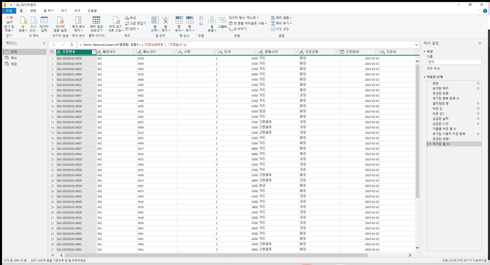
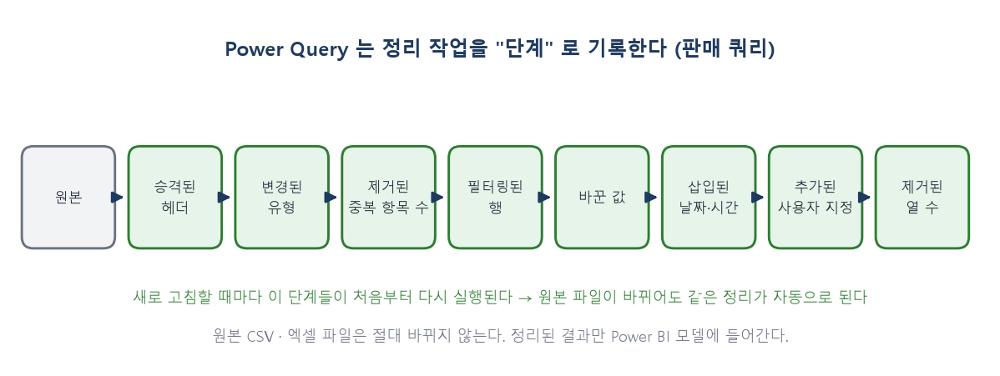
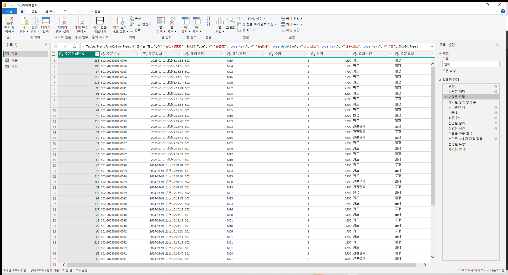
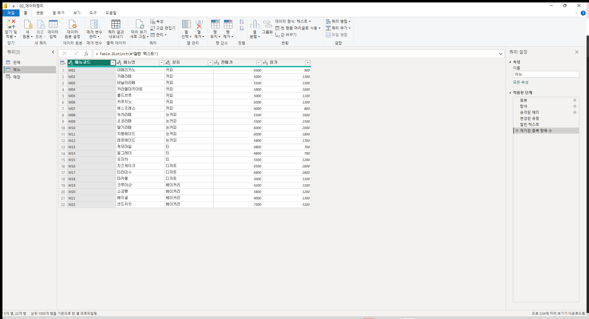
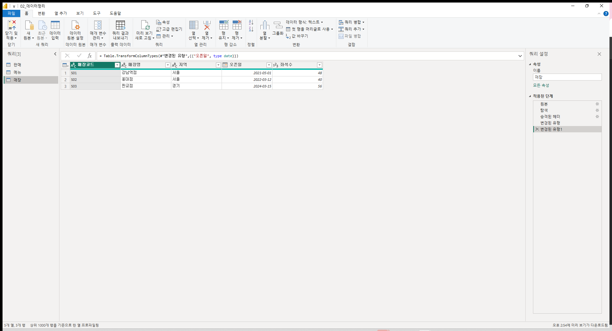
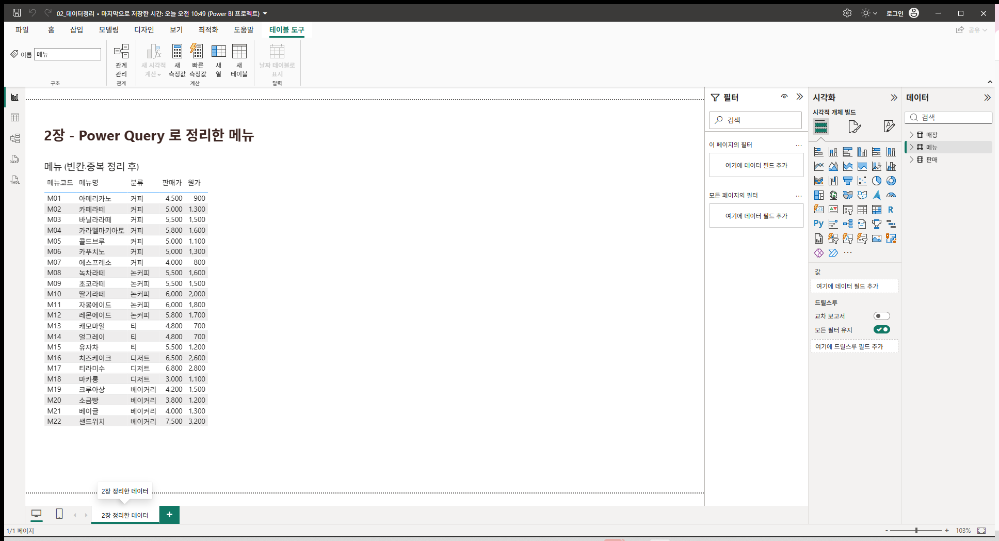

# 2장. Power Query 로 데이터 정리하기

## 학습 목표

- Power Query 편집기를 열고 화면 구성을 안다.
- 중복 행 제거, 빈 값 거르기, 값 바꾸기, 공백 자르기로 지저분한 데이터를 정리한다.
- 날짜·시간을 나누고, 계산된 열(매출액)을 추가하고, 필요 없는 열을 지운다.
- "적용된 단계" 가 무엇이고 왜 편리한지 설명할 수 있다.

## 2-1. 왜 정리부터 해야 할까

1장에서 본 판매 데이터에는 문제가 있었다.

| 문제 | 그대로 두면 |
|---|---|
| 똑같은 줄이 두 번 들어간 **중복 행** (40줄) | 매출이 실제보다 크게 나온다 |
| **수량이 빈** 줄 (30줄) | 매출 계산이 틀리거나 빈칸이 생긴다 |
| 결제수단이 `카드` / `신용카드` / `CARD` 로 섞임 | 결제수단별 차트에 카드가 세 덩어리로 나뉜다 |
| 메뉴명 앞뒤의 **빈칸** (` 바닐라라떼`) | 같은 메뉴가 다른 메뉴처럼 보인다 |
| 메뉴 표의 **중복** (콜드브루 두 번) | 3장에서 관계를 만들 때 오류가 난다 |

데이터 분석 시간의 절반 이상은 이런 정리에 쓴다는 말이 있다. Power BI 에서는 이 일을 **Power Query** 가 맡는다.

## 2-2. Power Query 편집기 열기

1장의 `내카페.pbix` 를 열고 리본 **홈 → 데이터 변환** 을 누른다. 새 창으로 **Power Query 편집기**가 열린다.



| 부분 | 하는 일 |
|---|---|
| 왼쪽 **쿼리** 목록 | 불러온 테이블 하나가 쿼리 하나 (판매, 메뉴, 매장) |
| 가운데 **미리 보기** | 처음 1,000줄 정도를 보여 준다. 열 머리글을 눌러 열을 고른다 |
| 위쪽 **수식 입력줄** | 지금 단계가 하는 일을 M 이라는 언어로 보여 준다 (읽기만 해도 된다) |
| 오른쪽 **적용된 단계** | 지금까지 한 작업이 순서대로 기록된다 |

> 수식 입력줄이 안 보이면 Power Query 편집기의 **보기** 탭에서 **수식 입력줄** 을 체크한다.



**적용된 단계**가 Power Query 의 핵심이다. 한 작업이 단계 하나가 되고, 단계를 누르면 그 시점의 데이터를 볼 수 있다. 잘못한 단계는 왼쪽의 ✕ 로 지우면 된다. 그리고 새로 고침할 때마다 이 단계들이 **처음부터 자동으로 다시 실행**된다. 다음 달에 새 CSV 가 와도 정리 작업을 다시 할 필요가 없다.

## 2-3. 판매 쿼리 정리하기

왼쪽 쿼리 목록에서 **판매** 를 고른다. 오른쪽 적용된 단계에는 이미 `원본`, `승격된 헤더`, `변경된 유형` 세 단계가 있다. 불러올 때 Power BI 가 자동으로 한 일이다.

| 자동 단계 | 하는 일 |
|---|---|
| 원본 | CSV 파일을 읽는다 |
| 승격된 헤더 | 첫 줄(주문번호, 주문일시 …)을 열 이름으로 올린다 |
| 변경된 유형 | 열마다 데이터 형식(정수, 텍스트, 날짜/시간)을 정한다 |



### ① 중복 행 제거

1. 미리 보기의 아무 셀이나 누른 뒤 **Ctrl+A** 로 모든 열을 고른다. (열 머리글이 모두 초록색이 된다)
2. **홈 → 행 제거 → 중복된 항목 제거**.

단계 `제거된 중복 항목 수` 가 생긴다. 모든 열의 값이 똑같은 줄을 하나만 남긴다. (주문상세번호까지 같으니 진짜 중복이다)

> 열 하나만 고른 채 중복을 제거하면 **그 열 기준**으로 지운다. 예를 들어 주문번호 열만 고르면 메뉴가 여러 개인 주문의 줄까지 지워져 버린다. 무엇을 골랐는지 꼭 확인하자.

### ② 수량이 빈 행 거르기

1. **수량** 열 머리글의 ▾ 를 누른다.
2. 목록에서 **(null)** 의 체크를 끈다. (안 보이면 아래쪽 **추가 로드** 를 누른다) → **확인**.

단계 `필터링된 행` 이 생긴다. `null` 은 "값이 없음" 을 뜻한다.

### ③ 결제수단 표기 통일 (값 바꾸기)

1. **결제수단** 열 머리글을 눌러 고른다.
2. **변환 → 값 바꾸기**. 찾을 값 `신용카드`, 바꿀 항목 `카드` → **확인**.
3. 한 번 더 **값 바꾸기**. 찾을 값 `CARD`, 바꿀 항목 `카드` → **확인**.

단계 `바꾼 값`, `바꾼 값1` 이 생긴다. 결제수단 ▾ 를 눌러 보면 이제 `간편결제`, `카드`, `현금` 세 가지뿐이다.

### ④ 주문일시를 날짜와 시로 나누기

나중에 "날짜별", "시간대별" 로 분석하려면 날짜와 시(0~23)가 따로 있어야 편하다.

1. **주문일시** 열을 고른다.
2. **열 추가 → 날짜 → 날짜만**. 맨 오른쪽에 `날짜` 열이 생긴다.
3. 다시 **주문일시** 열을 고르고 **열 추가 → 시간 → 시간 → 시간**. (시간 단추 ▾ 에서 **시간** 에 마우스를 올리면 하위 메뉴가 나오고, 그 안의 첫 번째 **시간** 을 누른다) `시간` 열이 생기고 0~23 숫자가 들어 있다.
4. 새 열 머리글을 두 번 눌러 이름을 바꾼다: `날짜` → **주문일자**, `시간` → **주문시**.

> **열 추가** 탭의 단추는 원래 열을 그대로 두고 **새 열을 만든다.** 같은 이름의 **변환** 탭 단추는 원래 열을 **바꿔 버린다.** 지금은 열 추가를 써야 한다.

### ⑤ 매출액 열 만들기 (사용자 지정 열)

판매 데이터에는 "얼마어치 팔았나" 가 없다. 수량 × 단가로 만든다.

1. **열 추가 → 사용자 지정 열**.
2. 새 열 이름 `매출액`, 사용자 지정 열 수식에 `[수량] * [단가]` 를 입력한다. (오른쪽 목록의 열 이름을 두 번 누르면 `[수량]` 처럼 자동으로 들어간다)
3. **확인**. 매출액 열 머리글 왼쪽의 형식 아이콘(ABC123)을 눌러 **정수** 로 바꾼다.

### ⑥ 필요 없는 열 제거

**주문상세번호** 는 중복을 찾을 때만 필요했고, **주문일시** 는 주문일자·주문시로 나눴으니 더는 필요 없다.

1. **주문상세번호** 를 누르고 **Ctrl** 을 누른 채 **주문일시** 를 누른다.
2. **홈 → 열 제거**.

> 필요 없는 열을 지우면 .pbix 파일이 작아지고 보고서가 빨라진다. 특히 주문일시처럼 값이 거의 모두 다른 열은 용량을 많이 차지한다. 이 정리로 완성 파일 크기가 절반 이하로 줄었다.

판매 쿼리의 적용된 단계는 이렇게 된다.

```text
원본
승격된 헤더
변경된 유형
제거된 중복 항목 수
필터링된 행
바꾼 값
바꾼 값1
삽입된 날짜
삽입된 시간
이름을 바꾼 열 수
추가된 사용자 지정 항목
변경된 유형1
제거된 열 수
```

> 단계 이름은 Power BI 버전에 따라 조금 다를 수 있다. 이름보다 **순서와 결과**가 같은지 확인하자.

## 2-4. 메뉴 쿼리 정리하기

1. 왼쪽에서 **메뉴** 쿼리를 고른다.
2. **메뉴명** 열을 고르고 **변환 → 서식 → 자르기**. 앞뒤 빈칸이 사라진다 (단계 `잘린 텍스트`).
3. **Ctrl+A** 로 모든 열을 고르고 **홈 → 행 제거 → 중복된 항목 제거**. 23줄이 22줄이 된다.



> 엑셀에서 불러온 메뉴·매장 쿼리에는 `원본` 다음에 **`탐색`** 단계가 하나 더 있다. 엑셀 파일 안에서 어느 시트를 쓸지 고르는 단계다 (1장 탐색 창에서 고른 것).

## 2-5. 매장 쿼리 - 형식 바꾸기

**오픈일** 열은 엑셀에서 날짜/시간(`2021-05-01 오전 12:00:00`)으로 들어왔다. 시각은 필요 없으니 **오픈일** 머리글의 형식 아이콘을 눌러 **날짜** 로 바꾼다.



## 2-6. 닫기 및 적용

**홈 → 닫기 및 적용** 을 누르면 편집기가 닫히고, 정리한 결과로 데이터를 다시 불러온다. 테이블 보기에서 판매가 **360,400개 행**(= 360,470 − 중복 40 − 빈 수량 30)인지 확인하자.

보고서 페이지에는 정리한 메뉴를 표로 올려 확인해 두었다.



> **원본 파일은 바뀌지 않는다.** Power Query 는 원본 CSV·엑셀을 고치지 않는다. 읽어 온 다음 정리해서 Power BI 안에만 넣는다. 그래서 언제든 단계를 고치거나 지워서 되돌릴 수 있다.

## 정리

- Power Query 편집기: **홈 → 데이터 변환**. 작업은 **적용된 단계**로 기록되고 새로 고침 때마다 다시 실행된다.
- 행 정리: 중복된 항목 제거(Ctrl+A 로 모든 열), 필터로 (null) 제거.
- 값 정리: 값 바꾸기, 자르기(앞뒤 공백 제거), 형식 바꾸기.
- 열 만들기: **열 추가** 탭(날짜만, 시, 사용자 지정 열). 필요 없는 열은 지운다.
- 끝나면 **닫기 및 적용**.

## 확인 문제

1. 중복을 제거할 때 **주문번호 열만** 고르고 중복된 항목 제거를 하면 어떤 문제가 생기는가?
2. 적용된 단계에서 `바꾼 값` 단계를 누르면 결제수단 목록에 무엇이 남아 있는가? 그 이유는?
3. 사용자 지정 열 수식을 `[수량] + [단가]` 로 잘못 썼다. 고치는 방법을 쓰시오. (힌트: 단계 오른쪽의 톱니바퀴)
4. 2-6 에서 판매가 360,400개 행이 아니라 360,430개 행이 나왔다. 어느 단계를 빠뜨렸을까?
