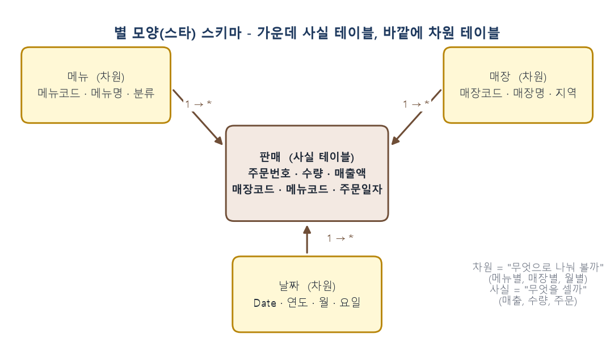
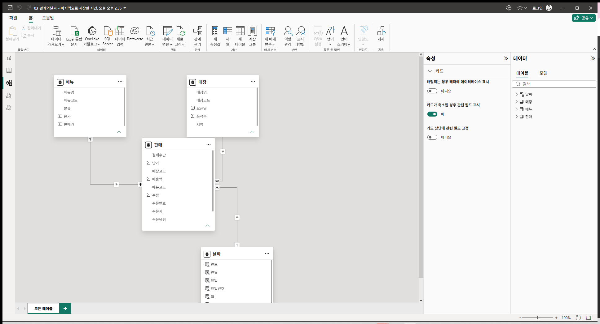
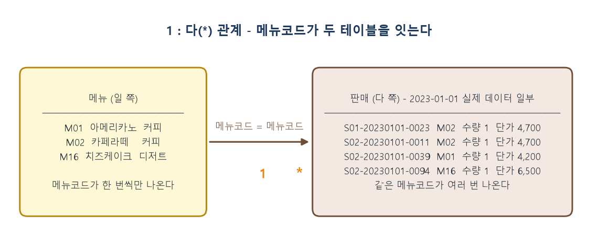
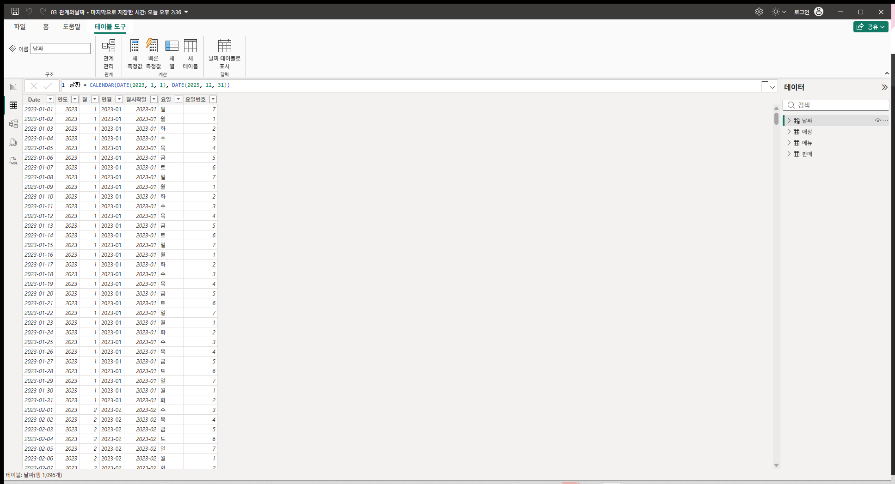
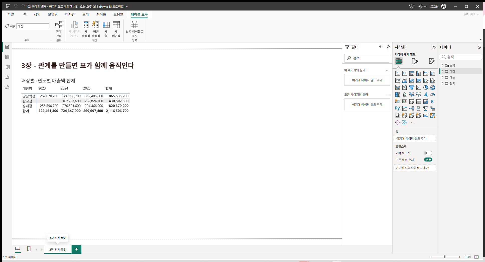

# 3장. 관계와 날짜 테이블

## 학습 목표

- 사실 테이블과 차원 테이블, 별 모양 모델을 설명할 수 있다.
- 모델 보기에서 테이블 사이의 관계(1 : 다)를 만들고 확인한다.
- DAX 로 날짜 테이블을 만들고, 열을 추가하고, 날짜 테이블로 표시한다.
- 관계가 있어야 "매장별·연도별 매출" 같은 분석이 된다는 것을 확인한다.

## 3-1. 테이블을 나눠 두는 이유

판매 표에는 `S01`, `M02` 같은 **코드**만 있다. 매장 이름이나 메뉴 분류는 매장·메뉴 표에 따로 있다. 판매 36만 줄마다 "강남역점, 서울, 48석" 을 반복해 적으면 용량이 커지고, 매장 이름이 바뀌면 36만 줄을 다 고쳐야 한다. 그래서 데이터는 보통 이렇게 나뉘어 있다.



| 종류 | 이 과정에서 | 특징 |
|---|---|---|
| **사실(Fact) 테이블** | 판매 | 사건(주문)이 일어날 때마다 줄이 늘어난다. 숫자(수량, 매출액)가 있다 |
| **차원(Dimension) 테이블** | 메뉴, 매장, 날짜 | 무엇으로 나눠 볼지 정하는 설명 정보. 줄이 적다 |

Power BI 는 이 표들을 **관계**로 이어서, 판매 표에 없는 "매장명" 이나 "분류" 로도 매출을 나눠 볼 수 있게 한다.

## 3-2. 모델 보기에서 관계 확인하기

왼쪽 보기 단추에서 세 번째 **모델 보기** 를 누른다. 테이블이 상자로 보이고, 관계는 상자 사이의 선으로 보인다.



> **이미 선이 있나요?** Power BI 는 데이터를 불러올 때 열 이름이 같은 열(메뉴코드, 매장코드)을 찾아 **관계를 자동으로 만들기도 한다.** 이미 있으면 아래 3-3 은 확인만 하고 넘어가면 된다.



선의 양 끝 표시를 읽는 법:

- **1** - 메뉴 쪽. 메뉴코드가 한 번씩만 나온다 (2장에서 중복을 지운 이유!)
- **\*** (다) - 판매 쪽. 같은 메뉴코드가 여러 번 나온다.
- 선 가운데 화살표 - 필터가 흐르는 방향. 메뉴 → 판매. "분류 = 커피" 를 고르면 판매 표도 커피 줄만 남는다.

## 3-3. 관계 만들기 - 메뉴와 매장

선이 없다면 직접 만든다.

1. 모델 보기에서 **메뉴** 상자의 **메뉴코드** 를 끌어서 **판매** 상자의 **메뉴코드** 위에 놓는다.
2. **새 관계** 창이 열린다. 카디널리티 **다대일(\*:1)** 또는 **일대다(1:\*)**, 교차 필터 방향 **단일** 인지 확인하고 **저장**.
3. 같은 방법으로 **매장[매장코드]** → **판매[매장코드]** 를 잇는다.

> 관계 선을 두 번 누르면 설정을 다시 볼 수 있다. 잘못 만든 관계는 선을 오른쪽 클릭 → **삭제**.

## 3-4. 날짜 테이블 만들기

월별·요일별로 보려면 날짜마다 연도, 월, 요일을 알려 주는 **날짜 테이블**이 있으면 편하다. 판매가 없는 날(휴일 등)도 빠짐없이 들어 있어야 하므로 판매 표의 날짜를 쓰지 않고 따로 만든다.

1. 리본 **모델링 → 새 테이블**.
2. 위쪽 수식 입력줄에 다음을 입력하고 **Enter**.

```dax
날짜 = CALENDAR(DATE(2023, 1, 1), DATE(2025, 12, 31))
```

`CALENDAR(시작일, 끝일)` 은 시작일부터 끝일까지 하루에 한 줄씩, **Date** 라는 열 하나짜리 표를 만든다. 3년이라 1,096줄(2024년은 윤년)이다.

이런 식을 **DAX**(Data Analysis Expressions)라고 한다. 엑셀 수식과 비슷하게 생긴 Power BI 의 계산 언어다.

3. **날짜** 테이블을 고른 채로 **테이블 도구 → 새 열** 을 눌러 아래 열을 하나씩 추가한다. (식 하나 입력 → Enter → 다시 새 열)

```dax
연도 = YEAR('날짜'[Date])
월 = MONTH('날짜'[Date])
연월 = FORMAT('날짜'[Date], "yyyy-mm")
월시작일 = DATE(YEAR('날짜'[Date]), MONTH('날짜'[Date]), 1)
요일 = FORMAT('날짜'[Date], "aaa")
요일번호 = WEEKDAY('날짜'[Date], 2)
```

| 열 | 함수 | 결과 예 (2024-07-15) |
|---|---|---|
| 연도 | `YEAR` | 2024 |
| 월 | `MONTH` | 7 |
| 연월 | `FORMAT(날짜, "yyyy-mm")` | 2024-07 |
| 월시작일 | 그 달 1일 | 2024-07-01 (5장의 월별 추이 차트 축) |
| 요일 | `FORMAT(날짜, "aaa")` | 월 |
| 요일번호 | `WEEKDAY(날짜, 2)` | 1 (월=1 … 일=7) |

> **'날짜'[Date] 처럼 테이블 이름을 작은따옴표로 감싸야 한다.** DAX 는 한글 테이블 이름을 따옴표 없이 쓰면 "잘못된 토큰" 오류를 낸다. 수식 입력줄에서 `'` 를 치면 자동 완성 목록이 나오니 골라서 넣자.



## 3-5. 날짜 테이블로 표시, 요일 정렬

1. **날짜** 테이블을 고르고 **테이블 도구 → 날짜 테이블로 표시** → 날짜 열 **Date** → **저장**. 이제 Power BI 가 이 표를 "공식 달력" 으로 쓴다.
2. 테이블 보기에서 **요일** 열을 고르고 **열 도구 → 열 기준 정렬 → 요일번호**. 이렇게 하지 않으면 요일이 가나다순(금, 목, 수, 월 …)으로 정렬된다.

## 3-6. 날짜 관계 만들기

모델 보기에서 **날짜[Date]** 를 끌어 **판매[주문일자]** 위에 놓는다 (일대다, 단일). 이제 관계가 세 개다.

| 일(1) 쪽 | 다(\*) 쪽 |
|---|---|
| 메뉴[메뉴코드] | 판매[메뉴코드] |
| 매장[매장코드] | 판매[매장코드] |
| 날짜[Date] | 판매[주문일자] |

## 3-7. 관계가 잘 됐는지 확인하기

보고서 보기에서 **행렬** 시각적 개체를 하나 만든다.

1. 시각화 창의 **행렬** 아이콘을 누른다.
2. 데이터 창에서 **매장 → 매장명** 을 **행** 칸에, **날짜 → 연도** 를 **열** 칸에, **판매 → 매출액** 을 **값** 칸에 끌어 놓는다.



매장명(매장 표)과 연도(날짜 표)는 판매 표에 없는 열인데도 매출액이 매장·연도별로 나뉘었다. 관계가 일하고 있다는 증거다. 판교점의 2023년 칸이 비어 있는 것도 맞다. 2024년 3월에 열었기 때문이다.

> 모든 칸에 같은 숫자(전체 합계)가 나온다면 관계가 없거나 잘못 이어진 것이다. 모델 보기에서 선을 확인하자.

## 정리

- 사실 테이블(판매) + 차원 테이블(메뉴, 매장, 날짜) = 별 모양 모델.
- 관계는 차원의 키(1) → 사실의 같은 열(\*). 필터는 1 → \* 방향으로 흐른다.
- 날짜 테이블: `CALENDAR` 로 만들고, 새 열(연도·월·요일…)을 더하고, **날짜 테이블로 표시**.
- DAX 에서 한글 테이블 이름은 `'날짜'[Date]` 처럼 작은따옴표로 감싼다.

## 확인 문제

1. 메뉴 표에 콜드브루가 두 줄 남아 있었다면, 메뉴 → 판매 관계를 만들 때 어떤 일이 생길지 쓰시오.
2. 요일 열에 **열 기준 정렬** 을 하지 않으면 요일별 차트의 막대 순서가 어떻게 되는가?
3. `날짜 = CALENDAR(DATE(2023,1,1), DATE(2025,12,31))` 를 입력했더니 "잘못된 토큰" 이 아니라 행이 1,096개 생겼다. 2023~2025년의 날 수를 계산해 맞는지 확인하시오.
4. 3-7 의 행렬에 **메뉴 → 분류** 를 **행** 칸의 매장명 아래에 하나 더 넣으면 어떻게 보이는가?
