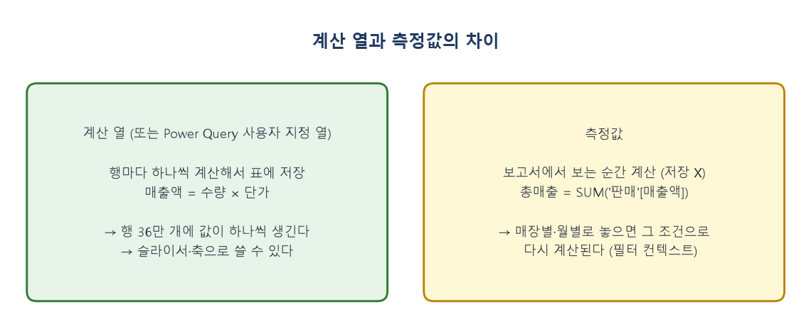
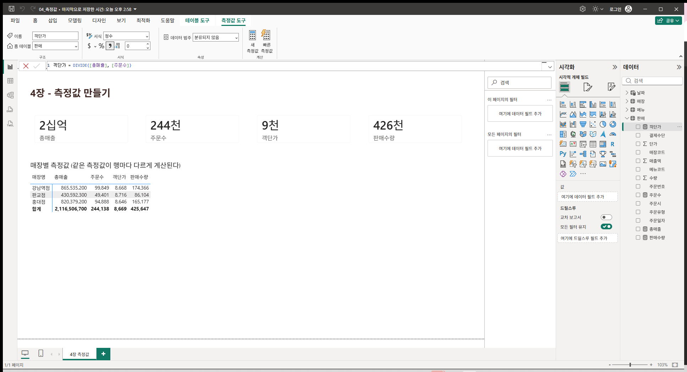
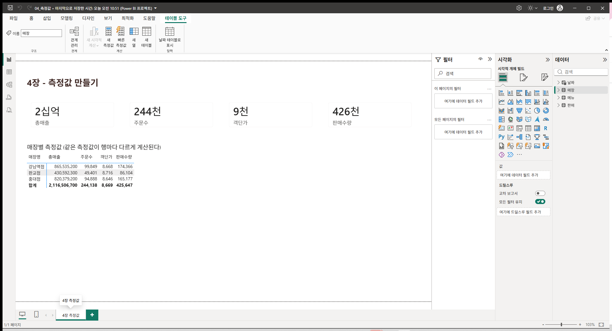
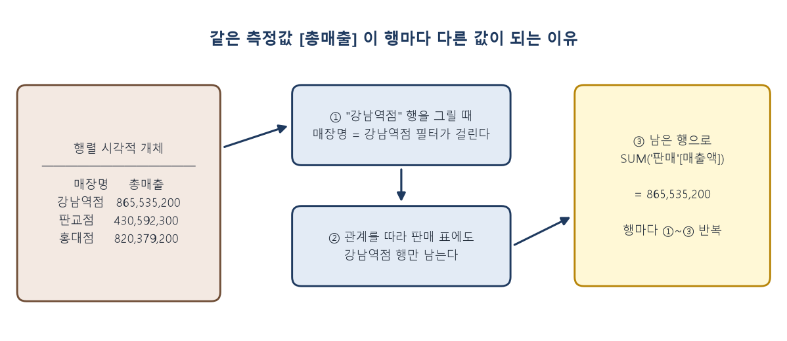

# 4장. 측정값 만들기 - DAX 첫걸음

## 학습 목표

- 계산 열과 측정값의 차이를 안다.
- SUM, DISTINCTCOUNT, DIVIDE 로 측정값 4개(총매출, 판매수량, 주문수, 객단가)를 만든다.
- 측정값에 숫자 서식(천 단위 쉼표)을 정한다.
- 같은 측정값이 행마다 다른 값이 되는 이유(필터 컨텍스트)를 설명할 수 있다.

## 4-1. 측정값이란?

3장 끝에서 매출액 **열**을 행렬에 끌어 놓았더니 "매출액의 합계" 가 나왔다. 숫자 열은 이렇게 끌어 놓기만 해도 합계가 된다(**암시적 측정값**). 하지만 다음과 같은 값은 끌어 놓기만으로는 만들 수 없다.

- **주문수** - 줄 수가 아니라 **서로 다른 주문번호의 개수** (주문 하나에 여러 줄이 있으므로)
- **객단가** - 주문 한 번에 평균 얼마를 썼나 = 총매출 ÷ 주문수

이렇게 "어떻게 계산할지" 를 직접 정한 것이 **측정값**(measure)이다.



## 4-2. 첫 측정값: 총매출

1. 데이터 창에서 **판매** 테이블을 한 번 누른다. (새 측정값이 이 테이블 안에 만들어진다)
2. 리본 **홈 → 새 측정값**.
3. 수식 입력줄에 입력하고 **Enter**.

```dax
총매출 = SUM('판매'[매출액])
```

데이터 창의 판매 아래에 계산기 모양 아이콘이 붙은 **총매출** 이 생긴다.

4. **총매출** 을 고른 상태에서 리본 **측정값 도구** 탭의 서식 칸에서 **정수**(또는 **,** 천 단위 구분 기호 단추)를 고른다. 이제 2116506700 이 아니라 **2,116,506,700** 으로 보인다.

## 4-3. 나머지 측정값 3개

같은 방법(판매 선택 → 새 측정값)으로 만든다. 서식도 모두 천 단위 쉼표로 정한다.

```dax
판매수량 = SUM('판매'[수량])
```

```dax
주문수 = DISTINCTCOUNT('판매'[주문번호])
```

```dax
객단가 = DIVIDE([총매출], [주문수])
```

| 측정값 | 함수 | 뜻 |
|---|---|---|
| 판매수량 | `SUM(열)` | 열의 값을 모두 더한다 |
| 주문수 | `DISTINCTCOUNT(열)` | 열에서 **서로 다른 값**이 몇 개인지 센다. 같은 주문번호가 여러 줄이어도 하나로 센다 |
| 객단가 | `DIVIDE(분자, 분모)` | 나누기. 분모가 0 이거나 비면 오류 대신 빈칸을 돌려준다 (`/` 보다 안전하다) |

> 측정값 안에서 다른 측정값을 부를 때는 `[총매출]` 처럼 **테이블 이름 없이 대괄호**만 쓴다. 열을 쓸 때는 `'판매'[매출액]` 처럼 테이블 이름을 붙인다. 이렇게 구분하면 식을 읽을 때 무엇이 측정값이고 무엇이 열인지 바로 보인다.

데이터 창에서 측정값을 누르면 위쪽 수식 입력줄에 식이 나온다. 고칠 때도 여기서 고친다.



## 4-4. 카드로 확인하기

**카드** 시각적 개체는 숫자 하나를 크게 보여 준다.

1. 캔버스 빈 곳을 누르고, 시각화 창의 **카드** 아이콘을 누른다.
2. 데이터 창의 **총매출** 을 카드에 끌어 놓는다(또는 체크).
3. 같은 방법으로 주문수, 객단가, 판매수량 카드를 만든다.

카드는 큰 숫자를 자동으로 줄여서 `2십억`, `244천` 처럼 보여 준다(표시 단위 **자동**). 틀린 것이 아니다. 정확한 숫자는 아래 4-5 의 행렬에서 확인하고, 카드의 표시 단위는 6장에서 **없음** 으로 바꾼다.

## 4-5. 같은 측정값, 다른 값 - 필터 컨텍스트

**행렬**을 하나 만들고 **행**에 매장 → 매장명, **값**에 측정값 4개를 넣는다.



| 확인 (행렬 값) | 값 |
|---|---|
| 총매출 (행렬 합계) | 2,116,506,700 |
| 주문수 | 244,138 |
| 객단가 | 8,669 |
| 판매수량 | 425,647 |
| 강남역점 총매출 | 865,535,200 |

식은 `SUM('판매'[매출액])` 하나인데 행마다 값이 다르다. 행렬이 각 행을 계산할 때 **"매장명 = 강남역점" 같은 조건(필터)**을 걸고 측정값을 계산하기 때문이다. 이 조건을 **필터 컨텍스트**라고 한다.



카드에는 아무 조건이 없으니 전체 합계가 나온다. 5장의 차트, 6장의 슬라이서도 모두 이 원리로 움직인다. **측정값은 한 번만 만들면 어디에 놓든 그 자리의 조건으로 다시 계산된다.** 이것이 측정값의 가장 큰 장점이다.

> **객단가 합계가 이상하다?** 행렬 맨 아래 합계 줄의 객단가는 세 매장 객단가의 **합**이 아니라 전체 총매출 ÷ 전체 주문수로 다시 계산된다. 측정값이기 때문이다. 엑셀에서 평균을 더하는 실수를 Power BI 가 막아 준다.

## 정리

- 측정값 = 보고서에서 보는 순간 그 자리의 조건(필터 컨텍스트)으로 계산되는 식. 저장 공간을 차지하지 않는다.
- **홈 → 새 측정값**. 열은 `'테이블'[열]`, 측정값은 `[측정값]`.
- `SUM`(합계), `DISTINCTCOUNT`(고유 개수), `DIVIDE`(안전한 나누기).
- 서식은 **측정값 도구** 탭에서 정한다.

## 확인 문제

1. `주문수 = COUNT('판매'[주문번호])` 로 만들면 결과가 어떻게 달라지고, 왜 틀린지 설명하시오.
2. `원가합계` 측정값을 만들려면 메뉴 표의 원가가 필요하다. 지금 모델에서 바로 `SUM('메뉴'[원가])` 를 쓰면 왜 원하는 값이 나오지 않는가? (힌트: 메뉴 표는 메뉴마다 한 줄)
3. 새 측정값 `평균판매단가 = DIVIDE([총매출], [판매수량])` 을 만들고 값을 쓰시오. 객단가와 무엇이 다른가?
4. 4-5 의 행렬에서 판교점의 객단가와 강남역점의 객단가 중 어느 쪽이 큰가?
