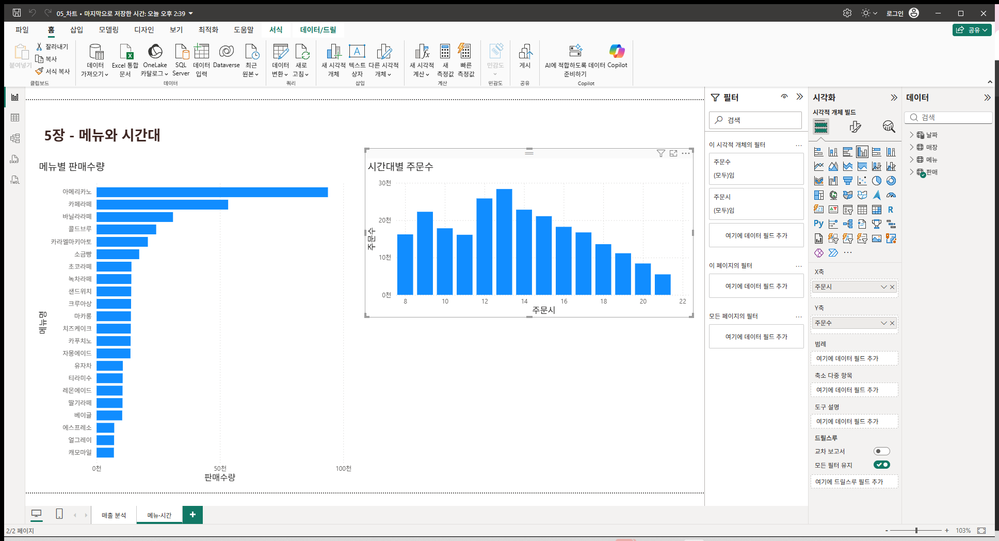
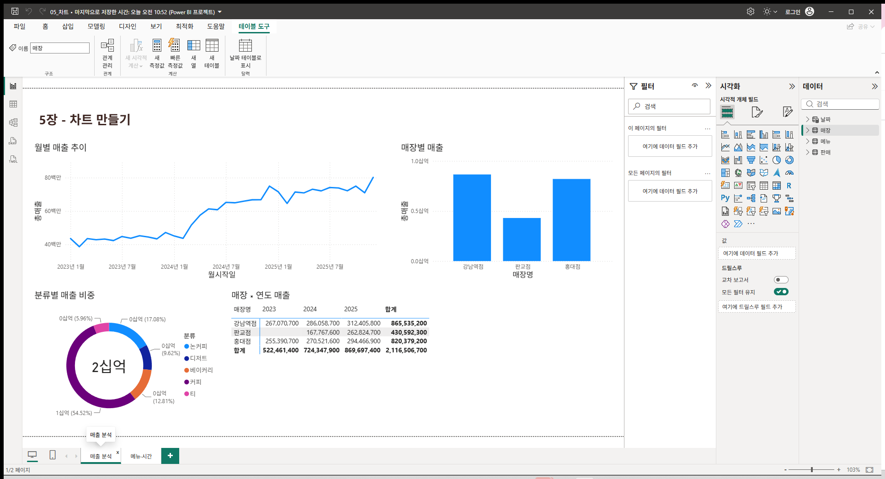
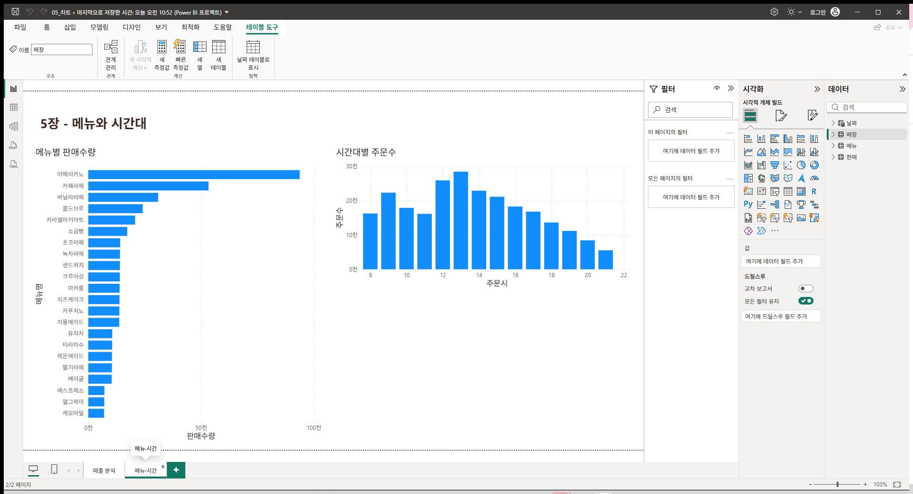

# 5장. 차트 만들기

## 학습 목표

- 하고 싶은 질문에 맞는 차트 종류를 고른다 (추세·비교·구성·자세한 숫자).
- 꺾은선형, 묶은 세로/가로 막대형, 도넛형, 행렬 차트를 만든다.
- 시각화 창의 필드 칸(X축, Y축, 범례, 값)에 열과 측정값을 넣는다.
- 차트를 정렬하고, 차트끼리 서로 걸러 주는 상호 작용을 확인한다.

## 5-1. 질문에 맞는 차트 고르기

| 질문 | 차트 | 이 장에서 |
|---|---|---|
| 시간에 따라 어떻게 **변했나**? (추세) | 꺾은선형 차트 | 월별 매출 추이 |
| 어느 쪽이 **더 큰가**? (비교) | 세로/가로 막대형 차트 | 매장별 매출, 메뉴별 판매수량, 시간대별 주문수 |
| 전체에서 무엇이 **얼마나 차지**하나? (구성) | 도넛형·원형 차트 | 분류별 매출 비중 |
| **정확한 숫자**가 필요하다 | 테이블, 행렬 | 매장 × 연도 매출 |

> 원형·도넛형은 조각이 5개를 넘으면 읽기 어렵다. 조각이 많으면 막대형이 낫다.

4장의 페이지 이름(아래쪽 탭)을 두 번 눌러 **매출 분석** 으로 바꾸고, 카드와 행렬은 지우거나 새 페이지(탭 옆 **+**)에서 시작한다.

## 5-2. 시각화 창의 필드 칸

차트를 고르면 시각화 창 아래쪽에 **필드 칸**이 나온다. 데이터 창의 열·측정값을 여기로 끌어 놓는다.

| 칸 | 넣는 것 | 예 |
|---|---|---|
| **X축** (막대·꺾은선) | 나눠 볼 기준이 되는 **열** | 매장명, 월시작일, 주문시 |
| **Y축** | 크기를 나타낼 **측정값** | 총매출, 주문수 |
| **범례** | 색으로 한 번 더 나눌 열 | (이 장에서는 쓰지 않음) |
| **값** (도넛·행렬) | 측정값 | 총매출 |

> 가로 막대형은 X축과 Y축이 반대다. **Y축**에 메뉴명(기준), **X축**에 판매수량(크기)을 넣는다.

## 5-3. 월별 매출 추이 - 꺾은선형 차트

1. 캔버스 빈 곳을 누르고 시각화 창의 **꺾은선형 차트** 아이콘을 누른다.
2. **날짜 → 월시작일** 을 **X축**, **판매 → 총매출** 을 **Y축** 에 넣는다.
3. 모서리를 끌어 페이지 왼쪽 위에 넓게 놓는다.

3년 동안 매출이 늘었고, 2024년 3월부터 크게 뛴다. 판교점이 문을 연 때다. 해마다 여름에 조금 오르는 모양도 보인다.

> **연월(글자) 대신 월시작일(날짜)을 쓰는 이유** 글자 열 `2023-01` 을 X축에 넣으면 36개 칸이 모두 따로 그려져 이름이 잘린다. 날짜 형식 열을 넣으면 Power BI 가 **연속 축**으로 그려 `2023년 1월`, `2023년 7월` 처럼 알맞게 띄워 준다.

## 5-4. 매장별 매출 - 묶은 세로 막대형 차트

1. 빈 곳을 누르고 **묶은 세로 막대형 차트**.
2. **매장 → 매장명** 을 X축, **총매출** 을 Y축.

## 5-5. 분류별 매출 비중 - 도넛형 차트

1. **도넛형 차트**.
2. **메뉴 → 분류** 를 **범례**, **총매출** 을 **값**.

커피가 매출의 절반 이상(54.52%)을 차지한다.

## 5-6. 매장 × 연도 - 행렬

3장에서 만든 것과 같다. **행** 매장명, **열** 날짜 → 연도, **값** 총매출(측정값).

> 지금은 숫자가 `0.87십억`, `2십억` 처럼 보인다. Power BI 가 큰 숫자에 단위(천, 백만, 십억)를 **자동**으로 붙이기 때문이다. 6장에서 "백만" 단위나 단위 없음으로 보기 좋게 바꾼다.

## 5-7. 메뉴와 시간대 - 두 번째 페이지

아래쪽 **+** 로 새 페이지를 만들고 이름을 **메뉴·시간** 으로 바꾼다.

**메뉴별 판매수량 (묶은 가로 막대형)**

1. **묶은 가로 막대형 차트** → **Y축** 메뉴 → 메뉴명, **X축** 판매수량.
2. 차트 오른쪽 위의 **…**(추가 옵션) → **기준 정렬** → **판매수량**, 다시 **…** → **기준 정렬** → **내림차순 정렬**. 많이 팔린 메뉴가 위로 온다.

**시간대별 주문수 (묶은 세로 막대형)**

1. **묶은 세로 막대형 차트** → **X축** 판매 → 주문시, **Y축** 주문수.
2. **…** → **기준 정렬** → **주문시**, **오름차순 정렬**. 8시부터 21시까지 순서대로 놓인다.

아메리카노가 압도적 1위이고, 주문은 출근 시간(8~9시)과 점심(12~13시)에 몰린다.

## 5-8. 차트끼리 서로 거르기 (상호 작용)

매출 분석 페이지에서 **매장별 매출** 차트의 **홍대점** 막대를 한 번 눌러 보자.

- 꺾은선은 홍대점의 월별 매출만 보여 준다.
- 도넛은 홍대점의 분류별 비중으로 바뀐다.
- 행렬은 홍대점 줄이 강조된다.

차트 하나를 누르는 것이 다른 차트들에 "매장명 = 홍대점" 필터를 거는 것과 같다(4장의 필터 컨텍스트). 같은 막대를 한 번 더 누르면 원래대로 돌아온다.

> **Ctrl 을 누른 채** 여러 막대를 누르면 여러 개를 함께 고를 수 있다.

## 정리

- 추세는 꺾은선, 비교는 막대, 구성은 도넛, 정확한 숫자는 테이블·행렬.
- 차트를 고르고 필드 칸(X축·Y축·범례·값)에 열과 측정값을 끌어 넣는다.
- 정렬은 차트의 **… → 기준 정렬**.
- 차트를 누르면 같은 페이지의 다른 차트가 함께 걸러진다.

## 확인 문제

1. 메뉴·시간 페이지의 시간대별 주문수에서 주문이 가장 많은 시간은 몇 시인가?
2. 매장별 매출 차트에서 **판교점**을 누르면 월별 매출 꺾은선은 언제부터 그려지는가? 그 이유는?
3. 도넛형 차트에 분류 대신 **매장 → 지역** 을 넣으면 조각이 몇 개가 되는가?
4. 메뉴별 판매수량 차트를 **총매출** 기준으로 바꾸면 1위는 여전히 아메리카노인가? 직접 바꿔 보고 쓰시오.
