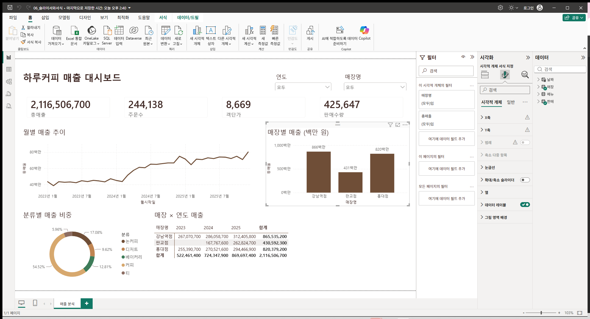
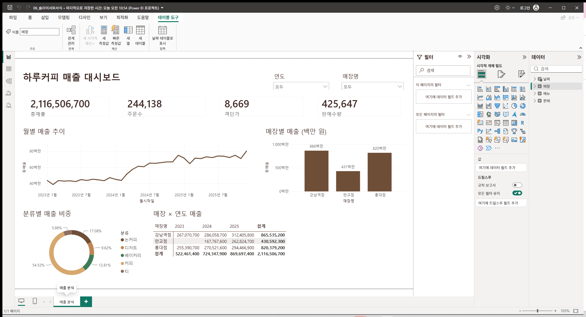

# 6장. 슬라이서와 서식 - 보기 좋고 쓰기 쉬운 보고서

## 학습 목표

- 슬라이서로 보는 사람이 직접 연도·매장을 고르게 한다.
- 서식 창에서 제목, 데이터 레이블, 표시 단위를 바꾼다.
- 테마 파일을 불러와 보고서 전체 색을 한 번에 바꾼다.
- 카드를 정확한 숫자로 보여 준다.

## 6-1. 슬라이서

**슬라이서**는 보고서를 보는 사람이 누르는 "필터 단추" 다. 5장에서 차트를 눌러 거른 것을 정식 단추로 만든 것이라고 보면 된다.

1. 캔버스 빈 곳을 누르고 시각화 창의 **슬라이서** 아이콘(깔때기 달린 표 모양)을 누른다.
2. **날짜 → 연도** 를 **필드** 칸에 넣는다.
3. 오른쪽 위에 작게 놓는다.
4. 같은 방법으로 **매장 → 매장명** 슬라이서를 하나 더 만든다.

슬라이서 모양을 바꾸려면 슬라이서를 고르고 시각화 창의 **시각적 개체 서식 지정**(붓 모양 아이콘) → **슬라이서 설정 → 옵션 → 스타일** 에서 고른다.

| 스타일 | 모양 | 쓰는 곳 |
|---|---|---|
| 세로 목록 | 체크 상자 목록 | 항목이 몇 개 안 될 때 |
| 타일 | 단추가 가로로 나열 | 연도처럼 짧은 항목 |
| **드롭다운** | 누르면 펼쳐지는 목록 | 자리를 아끼고 싶을 때 (이 과정) |

슬라이서에서 **2025** 를 고르면 페이지의 모든 차트가 2025년 숫자로 바뀐다. **Ctrl** 을 누른 채 고르면 여러 개를 고를 수 있다.

> **필터 창 vs 슬라이서** 오른쪽 **필터** 창에도 조건을 걸 수 있다. 필터 창은 만드는 사람이 "이 보고서는 항상 2024년 이후만" 처럼 고정하는 데, 슬라이서는 보는 사람이 바꿔 보는 데 쓴다.

## 6-2. 서식 창 둘러보기

시각적 개체를 하나 고르고 시각화 창 위쪽의 두 번째 아이콘 **시각적 개체 서식 지정**(붓 모양)을 누른다.



서식 창은 두 탭으로 나뉜다.

| 탭 | 바꾸는 것 |
|---|---|
| **시각적 개체** | 그 차트만의 설정 - 축, 데이터 레이블, 색, 범례 |
| **일반** | 모든 시각적 개체 공통 - 제목, 테두리, 배경, 크기 |

## 6-3. 제목, 데이터 레이블, 표시 단위

**매장별 매출** 막대 차트를 고르고 차례로 바꾼다.

1. **일반 → 제목 → 텍스트** 를 `매장별 매출 (백만 원)` 으로.
2. **시각적 개체 → 데이터 레이블** 을 **켜기**. 막대 위에 값이 나온다.
3. **데이터 레이블 → 값 → 표시 단위** 를 **백만**. `866백만` 처럼 보인다.
4. **Y축 → 값 → 표시 단위** 도 **백만**.

**도넛형 차트**는 비율이 중요하다.

1. **시각적 개체 → 세부 정보 레이블 → 옵션 → 레이블 내용** 을 **총 퍼센트** 로.
2. 가운데 큰 숫자(합계)가 거슬리면 **시각적 개체 → 중앙값** 을 끈다.

**카드**는 정확한 숫자로 보여 준다.

1. 카드를 고르고 **시각적 개체 → 설명 → 값 → 표시 단위** 를 **없음** 으로. `2십억` 이 `2,116,506,700` 이 된다.

> 메뉴 이름(설명, 세부 정보 레이블, 중앙값 등)은 차트 종류와 Power BI 버전에 따라 조금 다르다. 서식 창 위쪽의 **검색** 칸에 `표시 단위` 처럼 바꾸고 싶은 것을 치면 바로 찾아 준다.

## 6-4. 테마 - 보고서 전체 색 바꾸기

차트마다 색을 바꾸는 대신 **테마**로 한 번에 바꾼다.

1. 리본 **디자인** 탭을 누른다. 왼쪽에 테마 목록이 그림으로 나온다.
2. 기본 테마 중 하나를 골라 보자. 모든 차트의 색이 한꺼번에 바뀐다. (목록 오른쪽 ▾ 를 누르면 더 많은 테마가 보인다)
3. **디자인 → 테마 가져오기** → `C:\study\power-bi-tutorial\data\하루커피_테마.json` → **열기**.

> 예전 버전의 Power BI Desktop 에는 **디자인** 탭이 없고 **보기 → 테마 ▾ → 테마 찾아보기** 에 있다.

하루커피 테마는 커피색(갈색) 계열이다. 테마 파일은 색과 글꼴을 적은 간단한 JSON 글자 파일이다.

<!-- file: data/하루커피_테마.json -->

```json
{
  "name": "하루커피",
  "dataColors": ["#6F4E37", "#C08552", "#3E7C59", "#D7A86E", "#8D6E63", "#E07A5F", "#4E6E81", "#B5A642"],
  "background": "#FFFFFF",
  "foreground": "#3E2723",
  "tableAccent": "#6F4E37",
  "textClasses": {
    "title": { "fontFace": "Malgun Gothic", "color": "#3E2723", "fontSize": 13 },
    "label": { "fontFace": "Malgun Gothic" },
    "callout": { "fontFace": "Malgun Gothic", "color": "#6F4E37" }
  }
}
```

| 항목 | 뜻 |
|---|---|
| `dataColors` | 차트가 차례로 쓰는 색 8개 (첫 색 `#6F4E37` = 커피색) |
| `background`, `foreground` | 배경색, 글자색 |
| `textClasses` | 제목·레이블 글꼴과 크기 |

> 테마 JSON 을 메모장으로 열어 `dataColors` 의 색 코드를 바꾸고 다시 불러오면 나만의 테마가 된다.

## 6-5. 페이지 정리

5장의 매출 분석 페이지를 이렇게 정리한다.

1. 리본 **삽입 → 텍스트 상자** 로 제목 `하루커피 매출 대시보드` (글꼴 크기 22, 굵게).
2. 슬라이서 두 개를 오른쪽 위에.
3. 카드 4개(총매출, 주문수, 객단가, 판매수량)를 제목 아래 한 줄로.
4. 그 아래 꺾은선·막대, 맨 아래 도넛·행렬.

> **맞춤** 여러 개체를 **Ctrl** 로 함께 고른 뒤 리본 **서식 → 맞춤 → 위쪽 맞춤**, **가로 간격 균등** 을 쓰면 줄이 깔끔하게 맞는다.



## 정리

- 슬라이서 = 보는 사람이 고르는 필터. 스타일은 서식 창의 슬라이서 설정에서.
- 서식 창: **시각적 개체**(그 차트만) / **일반**(제목·테두리 등 공통). 검색 칸을 활용한다.
- 큰 숫자는 **표시 단위**(없음, 천, 백만)로 읽기 쉽게.
- 색은 **테마**로 한 번에. 테마 파일은 JSON.

## 확인 문제

1. 연도 슬라이서에서 **2024** 만 고르면 카드의 총매출은 얼마인가? (부록 C 의 값과 비교)
2. 매장명 슬라이서에서 **판교점**, 연도 슬라이서에서 **2023** 을 고르면 차트들이 어떻게 보이는가? 왜 그런가?
3. 카드의 표시 단위를 **천** 으로 바꾸면 총매출이 어떻게 보이는가?
4. 하루커피 테마의 `dataColors` 첫 번째 색을 `#1F4E79`(남색)로 바꿔 불러오면 무엇이 바뀌는가?
