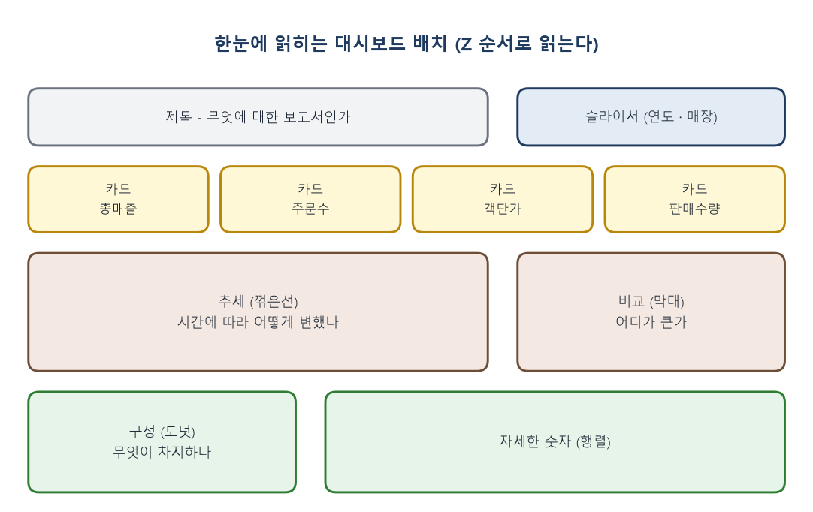
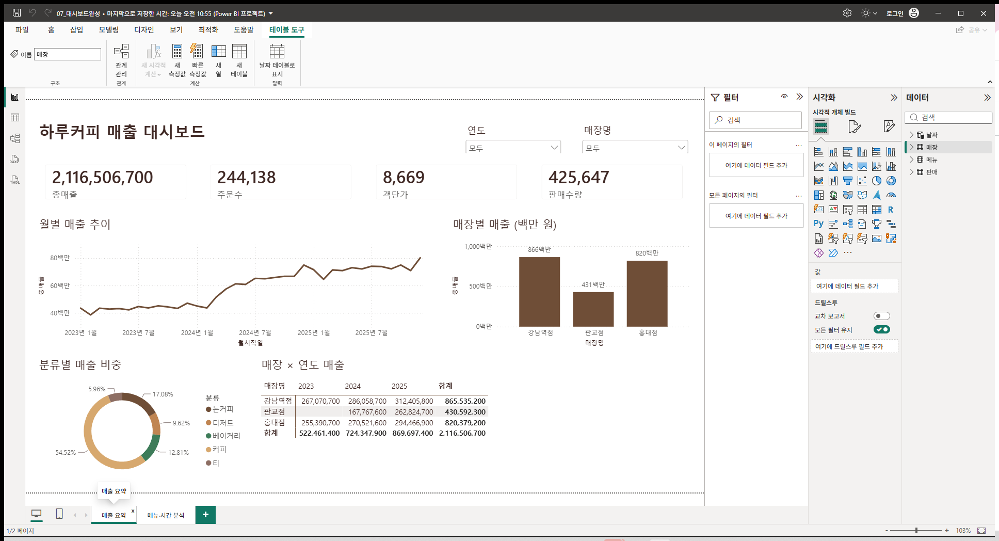
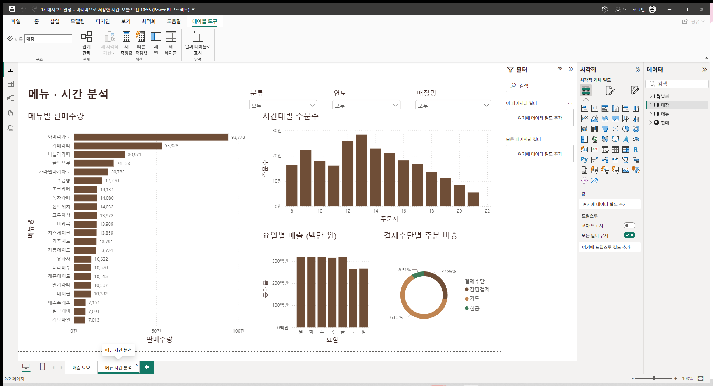

# 7장. 대시보드 완성과 공유

## 학습 목표

- 한눈에 읽히는 대시보드 배치 원칙을 안다.
- 두 번째 분석 페이지(메뉴·시간)를 완성하고 페이지를 정리한다.
- 보고서를 PDF 로 내보내고, Power BI 서비스 게시가 무엇인지 안다.
- 대시보드에서 찾은 내용을 문장으로 정리할 수 있다.

## 7-1. 좋은 대시보드 배치

사람은 화면을 **왼쪽 위 → 오른쪽 → 아래** 순서(Z 모양)로 읽는다. 그래서 가장 중요한 것을 왼쪽 위에 둔다.

1. **제목**: 무엇에 대한 보고서인지 한 줄로.
2. **슬라이서**: 오른쪽 위. 모든 차트에 영향을 주는 단추라는 것을 알 수 있게.
3. **카드(핵심 숫자)**: 제목 바로 아래 한 줄. "결론부터".
4. **추세 → 비교 → 구성 → 자세한 숫자** 순서로 아래로.

> **한 페이지에 차트는 6~8개까지.** 그보다 많으면 무엇을 봐야 할지 모르게 된다. 주제가 다르면 페이지를 나눈다.

## 7-2. 매출 요약 페이지

6장에서 정리한 페이지의 이름을 **매출 요약** 으로 바꾼다 (아래쪽 탭을 두 번 누르기).

## 7-3. 메뉴·시간 분석 페이지

5장의 메뉴·시간 페이지를 같은 원칙으로 정리한다.

1. 페이지 이름을 **메뉴·시간 분석** 으로.
2. 제목 텍스트 상자 `메뉴 · 시간 분석`.
3. **슬라이서 복사하기**: 매출 요약 페이지의 연도·매장명 슬라이서를 **Ctrl** 로 함께 골라 **Ctrl+C**, 메뉴·시간 분석 페이지에서 **Ctrl+V**. "시각적 개체 동기화" 를 묻는 창이 나오면 **동기화** 를 고른다. 이제 한 페이지에서 2025년을 고르면 다른 페이지도 2025년이 된다.
4. **분류** 슬라이서(메뉴 → 분류, 드롭다운)를 하나 더 만든다.
5. 메뉴별 판매수량(가로 막대, 데이터 레이블 표시 단위 **없음**)을 왼쪽에 길게.
6. 시간대별 주문수(세로 막대)를 오른쪽 위에.
7. **요일별 매출**: 묶은 세로 막대형 → X축 날짜 → 요일, Y축 총매출, Y축 표시 단위 **백만**. 3장에서 요일 열을 요일번호로 정렬해 두었기 때문에 **월 화 수 목 금 토 일** 순서로 나온다. (차트 **… → 기준 정렬 → 요일**, 오름차순)
8. **결제수단별 주문 비중**: 도넛형 → 범례 판매 → 결제수단, 값 주문수, 레이블 **총 퍼센트**. 2장에서 표기를 통일했기 때문에 조각이 세 개(카드·간편결제·현금)뿐이다.

## 7-4. 대시보드로 이야기하기

대시보드는 "차트를 모은 것" 이 아니라 **질문에 답하는 도구**다. 완성한 대시보드에서 찾은 것을 문장으로 써 보자.

| 질문 | 대시보드에서 찾은 답 |
|---|---|
| 매출은 늘고 있나? | 2023년 5.2억 → 2024년 7.2억 → 2025년 8.7억 원. 판교점 개점(2024년 3월) 효과가 크다 |
| 어느 매장이 가장 잘 되나? | 3년 합계는 강남역점(8.66억)이 1위. 판교점은 1년 9개월 만에 4.3억 원 |
| 무엇이 잘 팔리나? | 아메리카노가 판매수량 9만 4천 잔으로 압도적. 커피 분류가 매출의 54.5% |
| 언제 바쁜가? | 13시가 가장 많고(2만 8천 건) 12시, 14시가 뒤를 잇는다. 출근 시간 9시도 붐빈다. 주말 하루 매출은 평일 하루보다 약 16% 적다 |
| 어떻게 결제하나? | 카드 63.5%, 간편결제 28.0%, 현금 8.5% |

> 직접 슬라이서를 바꿔 가며 더 찾아보자. 예: 홍대점만 고르면 요일별 매출에서 주말이 오히려 높다. 상권(대학가)의 특징이다.

## 7-5. 저장과 공유

**저장** - **Ctrl+S**. .pbix 하나에 데이터와 보고서가 모두 들어 있으므로, Power BI Desktop 이 있는 사람에게는 이 파일을 보내면 된다.

**PDF 로 내보내기** - Power BI 가 없는 사람에게 보여 줄 때.

1. **파일 → 내보내기 → PDF로 내보내기**.
2. 페이지마다 한 장씩 PDF 가 만들어지고 바로 열린다. (슬라이서는 지금 고른 상태 그대로 찍힌다)

**Power BI 서비스에 게시** - 리본 **홈 → 게시** 를 누르면 웹(app.powerbi.com)에 올려 브라우저로 보고, 정해진 시간마다 자동으로 새로 고치게 할 수 있다. **회사·학교 계정**(Microsoft Entra ID)으로 로그인해야 하고, 다른 사람과 공유하려면 보통 **Pro 라이선스**가 필요하다. 이 과정에서는 다루지 않는다.

> **새로 고침이 필요할 때** 원본 CSV·엑셀에 새 데이터가 들어오면 **홈 → 새로 고침** 한 번으로 2장의 정리 단계부터 모든 차트까지 자동으로 다시 계산된다. 이것이 엑셀로 매달 보고서를 새로 만드는 것과 가장 크게 다른 점이다.

## 정리

- 배치: 제목 → 슬라이서 → 카드 → 추세 → 비교 → 구성 → 자세한 숫자 (Z 순서).
- 슬라이서는 복사해서 붙여 넣을 때 **동기화**로 여러 페이지를 함께 움직이게 할 수 있다.
- 공유: .pbix 파일 / PDF 내보내기 / Power BI 서비스 게시(회사 계정 필요).
- 대시보드에서 찾은 내용을 **문장**으로 정리해야 분석이 끝난다.

## 확인 문제

1. 홍대점만 골랐을 때 요일별 매출에서 가장 높은 요일은 무엇인가?
2. 2025년만 골랐을 때 결제수단 비중에서 간편결제는 몇 %인가? 2023년과 비교해 어떻게 변했나?
3. 메뉴·시간 분석 페이지에서 분류 슬라이서로 **논커피** 를 고르면 메뉴별 판매수량 1위는 무엇인가?
4. 이 대시보드에 "매장별 객단가" 를 보여 주는 차트를 하나 더 넣는다면 어떤 차트를, 어디에 두겠는가?
