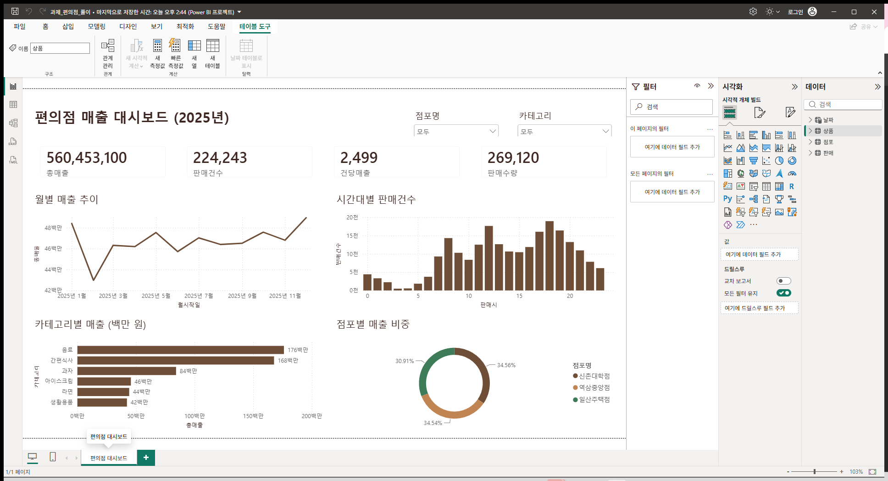

# 8장. 과제 - 편의점 매출 대시보드 혼자 만들기

## 학습 목표

- 1~7장에서 배운 순서를 새 데이터에 혼자 적용한다.
- 데이터를 보고 어떤 정리·관계·측정값·차트가 필요한지 스스로 정한다.
- 완성한 대시보드에서 찾은 내용을 문장으로 정리한다.

## 8-1. 과제 소개

동네 편의점 체인 세 곳의 **2025년 1년치** 판매 데이터다. 카페 데이터와 모양이 비슷하지만 열 이름과 내용이 조금 다르다. 교안을 다시 보며 혼자 대시보드를 완성해 보자. 막히면 8-4 의 단계별 힌트를 보고, 그래도 막히면 완성 파일 `pbix\과제_편의점_풀이.pbix` 를 연다.

| 파일 | 내용 |
|---|---|
| `편의점_판매.csv` | 판매번호, 판매일자(날짜), 판매시(0~23), 점포코드, 상품코드, 수량, 판매금액 - 약 22만 줄 |
| `편의점_상품.xlsx` (시트 **상품**) | 상품코드, 상품명, 카테고리, 가격 - 18개 상품, 6개 카테고리 |
| `편의점_점포.xlsx` (시트 **점포**) | 점포코드, 점포명, 상권 - 역삼중앙점(오피스), 신촌대학점(대학가), 일산주택점(주거지) |

> 카페 데이터와 다른 점: 판매 표에 **판매금액이 이미 있다** (수량 × 가격을 할 필요 없음). 줄 하나가 판매 한 건이므로 판매 건수는 **행 수**로 센다. 일부러 넣은 지저분한 값은 없다.

## 8-2. 만들어야 할 것

**새 보고서**(파일 → 새로 만들기)에서 시작해 한 페이지짜리 대시보드를 만든다.

1. 세 파일을 불러온다. 판매일자가 **날짜** 형식인지 확인한다.
2. 날짜 테이블(2025-01-01 ~ 2025-12-31)을 만들고 월시작일, 요일 열을 더한다.
3. 관계 3개를 만든다.
4. 측정값 4개: **총매출**, **판매수량**, **판매건수**(행 수), **건당매출**(총매출 ÷ 판매건수).
5. 아래 시각적 개체를 배치한다.

| 개체 | 내용 |
|---|---|
| 제목 | 편의점 매출 대시보드 (2025년) |
| 슬라이서 2개 | 점포명, 카테고리 (드롭다운) |
| 카드 4개 | 총매출, 판매건수, 건당매출, 판매수량 (표시 단위 없음) |
| 꺾은선형 | 월별 매출 추이 (X축 월시작일) |
| 세로 막대형 | 시간대별 판매건수 (X축 판매시, 오름차순) |
| 가로 막대형 | 카테고리별 매출, 많은 순 (표시 단위 백만) |
| 도넛형 | 점포별 매출 비중 (총 퍼센트) |

6. 하루커피 테마를 적용하고 `내편의점.pbix` 로 저장한다.

## 8-3. 완성 예시



카드 값이 아래와 같으면 정답이다. (슬라이서는 모두 "모두")

| 측정값 | 값 |
|---|---|
| 총매출 | 560,453,100 |
| 판매건수 | 224,243 |
| 건당매출 | 2,499 |
| 판매수량 | 269,120 |

## 8-4. 단계별 힌트

**① 불러오기** - 1장 1-3, 1-4. CSV 미리 보기에서 파일 원본 UTF-8 을 확인한다.

**② 날짜 테이블** - 3장 3-4. 기간만 바꾼다.

```dax
날짜 = CALENDAR(DATE(2025, 1, 1), DATE(2025, 12, 31))
```

새 열 `월시작일`, `요일`, `요일번호` 는 3장과 똑같이 만들고, **날짜 테이블로 표시**, 요일은 **열 기준 정렬 → 요일번호**.

**③ 관계** - 3장 3-3. 상품[상품코드] → 판매[상품코드], 점포[점포코드] → 판매[점포코드], 날짜[Date] → 판매[판매일자].

**④ 측정값** - 4장. 판매 테이블을 고르고 새 측정값.

```dax
총매출 = SUM('판매'[판매금액])
```

```dax
판매수량 = SUM('판매'[수량])
```

```dax
판매건수 = COUNTROWS('판매')
```

```dax
건당매출 = DIVIDE([총매출], [판매건수])
```

`COUNTROWS(테이블)` 은 테이블의 행 수를 센다. 카페에서는 주문 하나가 여러 줄이라 `DISTINCTCOUNT(주문번호)` 를 썼지만, 편의점 데이터는 한 줄이 한 건이라 행 수가 곧 건수다.

**⑤ 차트·슬라이서·서식** - 5·6장. 카테고리별 매출 정렬은 **… → 축 정렬 → 총매출 → 내림차순**.

## 8-5. 분석 문장 쓰기

완성한 대시보드로 아래 질문에 답을 문장으로 써 보자. 풀이는 부록 C 에 있다.

1. 매출이 가장 많은 카테고리와 가장 적은 카테고리는?
2. 세 점포 중 매출 비중이 가장 큰 곳은? 점포마다 바쁜 시간대가 어떻게 다른가? (점포명 슬라이서를 하나씩 골라 시간대별 판매건수를 비교)
3. 월별 매출 추이에서 매출이 가장 높은 달은? 그 달에 무엇이 많이 팔렸을까? (카테고리 슬라이서를 바꿔 가며 확인)
4. **아이스크림** 과 **생활용품**(핫팩이 들어 있다) 카테고리를 각각 골랐을 때 월별 추이는 어떻게 다른가?
